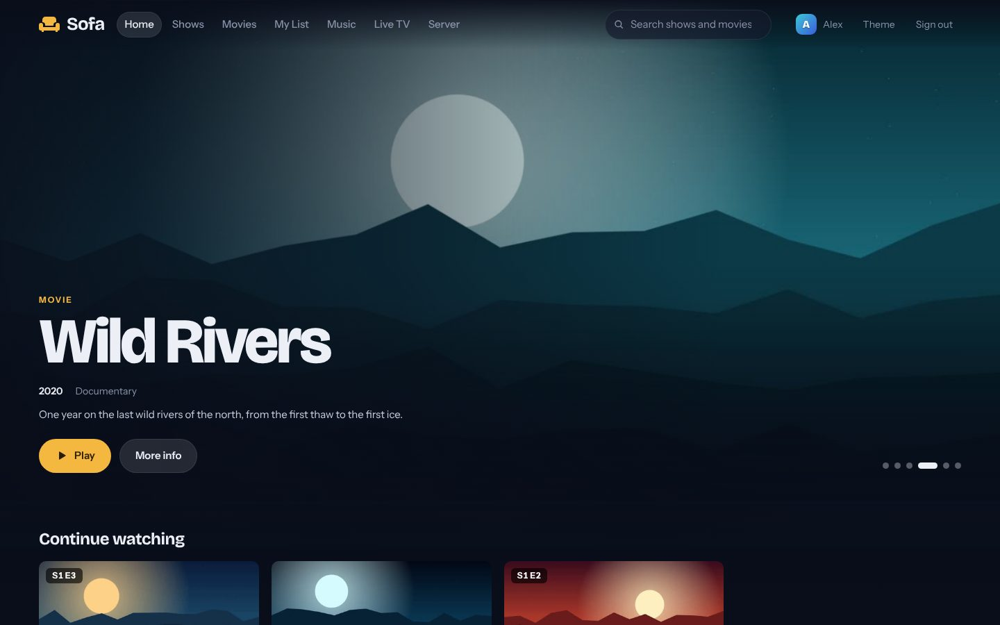
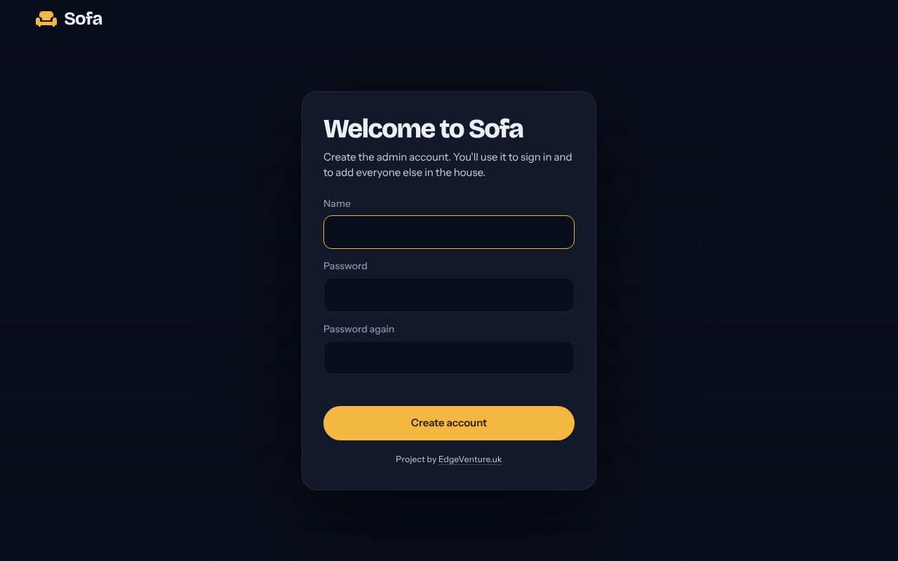
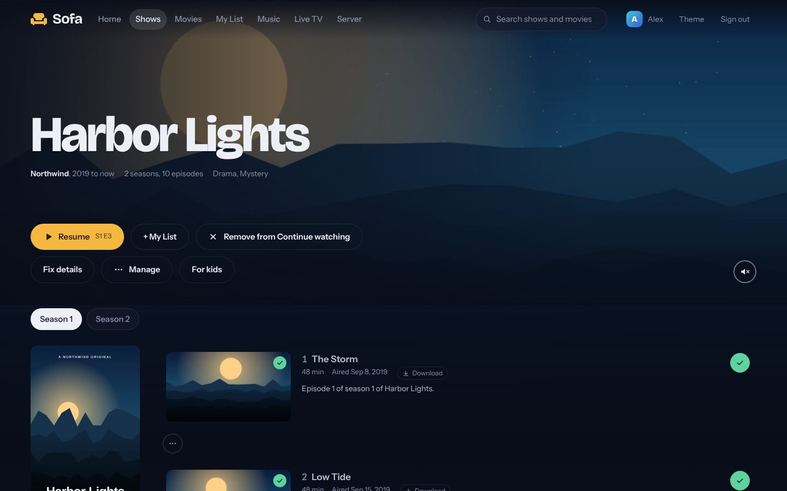
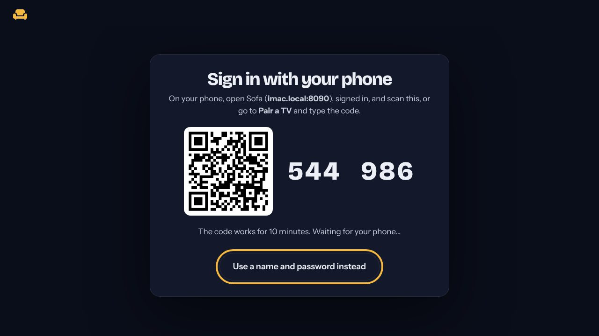
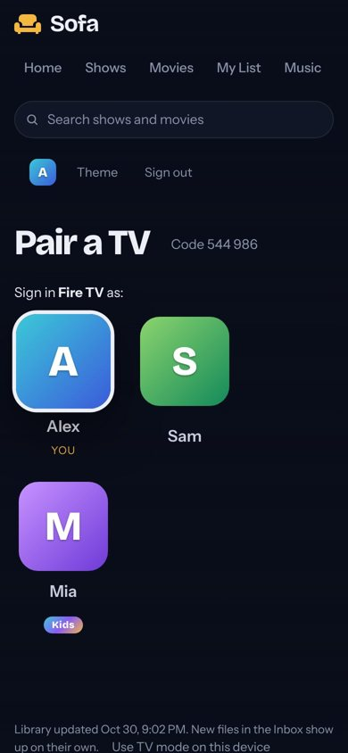
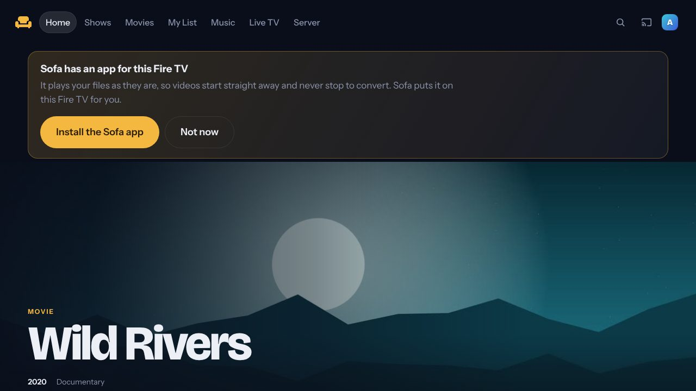
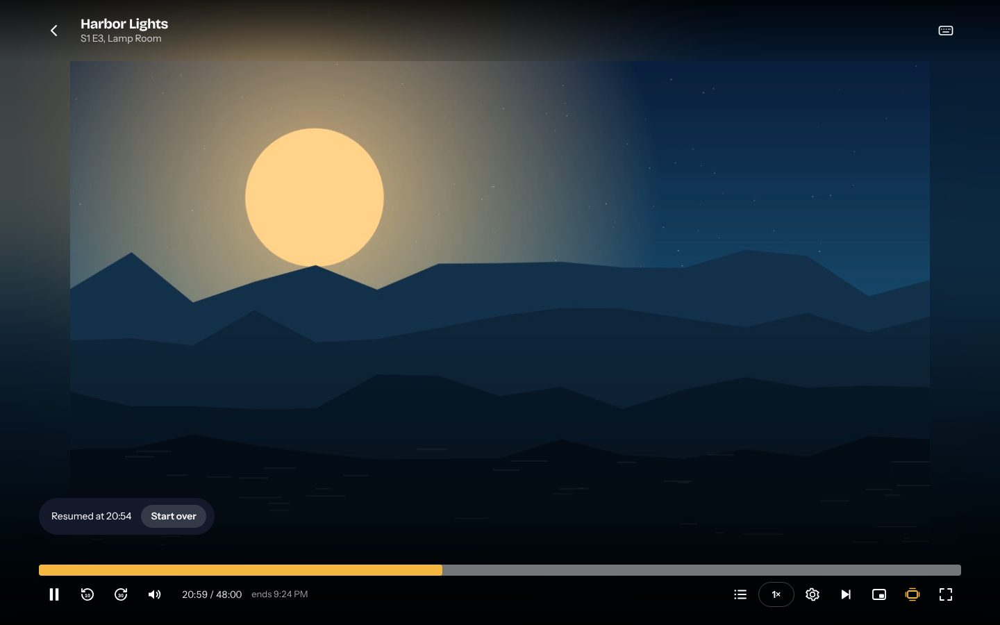
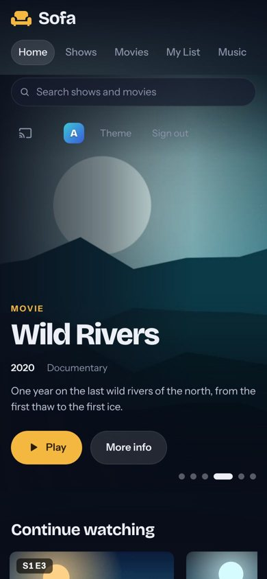
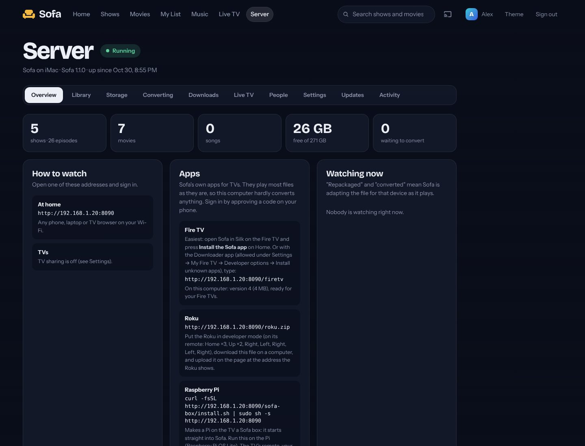

# Sofa

**Your own streaming service, at home.** Put your shows and movies in one folder on a computer
that stays on, and watch them on every TV, phone and laptop in the house, with posters,
"Continue watching", Skip Intro and a proper player. No subscriptions, no accounts with anyone,
no ads. It works with the internet down.



A project by [EdgeVenture.uk](https://edgeventure.uk). Free and open source (MIT).

- **Every screen:** Fire TV, Roku, a Raspberry Pi on the TV, smart TVs, phones, tablets, computers.
- **Every file:** MP4, MKV, AVI, HEVC... Sofa adapts whatever a device can't play by itself.
- **Tidy by itself:** drop files in the **Inbox** folder; Sofa names them, files them and finds pictures.
- **For the whole family:** a profile each, Kids profiles, and sign-in on the TV with your phone.
- **Private:** everything stays in your house. [How private?](docs/privacy.md)

---

## What you need

- **A computer that stays on**: a Mac (an old one is fine: Sofa runs on a 2011 iMac) or a Linux computer.
- **Your shows and movies** as files (from your own discs, downloads, a camera...).
- **Something to watch on**: a TV with a Fire TV stick, a Roku or a Raspberry Pi; or any phone, tablet or laptop.

All of them on the same Wi-Fi (or network) at home.

## Set it up in 4 steps

### Step 1. Install Sofa on the computer

1. Open **Terminal**. On a Mac: press **⌘ Command + Space**, type `Terminal`, press **Return**.
2. Copy this line, paste it into Terminal (**⌘ Command + V**) and press **Return**:

   ```sh
   curl -fsSL https://raw.githubusercontent.com/krintoxi/sofa/main/tools/get-sofa.sh | sh
   ```

3. Wait for **All done** (a minute or two; longer if it installs ffmpeg, the tool that lets every
   kind of video play). Then close Terminal. Sofa keeps running in the background, and starts again
   by itself when the computer restarts.

### Step 2. Make your account

On that computer, open **<http://localhost:8090>** in a web browser (Safari, Chrome...). Sofa asks
you to make the first account: that's you, the admin. Pick a name and a password.



### Step 3. Add your shows and movies

Open **Finder** → your home folder (the house icon) → **Entertainment** → **Inbox**, and drag your
video files or whole folders into it. Within a minute they're on Sofa's Home page, named properly,
with posters and descriptions:

| You drop in the Inbox | Sofa makes it |
|---|---|
| `the.sopranos.s01e01.1080p.mkv` | **The Sopranos**, Season 1, Episode 1 |
| `Heat.1995.1080p.BluRay.mkv` | the movie **Heat** (1995) |
| a folder with a whole series | the show, every season in order |

Anything it can't work out goes to a **Needs Review** folder, with a note on the Server page.
Nothing is ever deleted. You can also send files from any phone or laptop: **Server → Overview →
Send files from this device**.



### Step 4. Watch on the TV

**Find Sofa's address first.** In Sofa on the computer, open **Server** (at the top). Under
**How to watch → At home** there's an address like `http://192.168.1.20:8090`. Every device in
the house uses that address.

**On a Fire TV:**

1. Open the **Silk** browser (it's in the Fire TV's apps) and type Sofa's address.
2. The TV shows a code. On your phone, open Sofa (same address), press your picture at the top,
   then **Pair a TV**, and choose who's watching. The TV signs in by itself.

    

3. Home shows **Install the Sofa app**. Press it and follow the two steps on the screen: Sofa puts
   its own Fire TV app on the TV for you. The app plays every file as it is, so videos start
   straight away and never stop to convert.

   

**Other TVs:** Roku ([the Sofa channel](roku/README.md)), a Raspberry Pi as a
"[Sofa box](deploy/sofa-box/README.md)" (worked with the TV's own remote, your phone or a game
controller), or the web browser of a smart TV. Install steps for each are on **Server → Overview → Apps**.

**Phones, tablets and laptops:** open Sofa's address in the browser. On an iPhone or iPad, **Share
→ Add to Home Screen** makes it an app with its own icon.

That's it. Enjoy the show. 🍿



---

## Everyday questions

**How do I add more?** Drop files in **Entertainment → Inbox** on the Sofa computer (or **Send files
from this device** on the Server page). That's all.

**How do I update Sofa?** **Server → Updates → Update now.** Only Sofa's own program changes; your
videos, accounts, watch history and settings stay exactly as they are, and it goes back by itself
if anything goes wrong. ([More](docs/updating.md). Old copy without that button? Run
`curl -fsSL https://raw.githubusercontent.com/krintoxi/sofa/main/tools/update.sh | sh` in Terminal.)

**Can everyone have their own "Continue watching"?** Yes: **Server → People** adds a profile for
each person. Switch **Kids** on for children (family titles only). The TV asks who's watching.

**Can my phone be the remote?** Yes: with Sofa open on the TV, press the screen icon at the top
of Sofa on your phone, pick the TV, and play things there. The phone becomes the remote.

**A video stops or stutters.** On an older computer, some files (like 1080p HEVC) are hard to
convert as they play. Sofa notices and makes the picture a bit smaller by itself. The Fire TV app
avoids converting altogether. Admins can also **Convert to MP4** in the background (Server → Converting).

**Where are my files?** In your home folder → **Entertainment** (Shows, Movies, Music...). Sofa's
own settings and history are in `~/Sofa/data`.

**Can I watch away from home?** Yes. Either privately with Tailscale, or at your own web address
(`https://yourname.duckdns.org` is free) locked with everyone's password and encrypted: **Server →
Internet** walks you through it, and Sofa gets and renews the certificate itself.
[docs/remote-access.md](docs/remote-access.md)

**Something's not right.** **Server → Activity → Download a report** makes one text file that
explains what Sofa sees (no passwords). Send it to whoever helps you, or give it to Claude.

 

<details><summary>Prefer to install by hand?</summary>

```sh
git clone https://github.com/krintoxi/sofa.git ~/Sofa
cd ~/Sofa
./deploy/install.sh          # macOS: a LaunchAgent; Linux: a systemd user service
brew install ffmpeg          # macOS (on Linux: sudo apt install ffmpeg)
```

Or run it in a Terminal window instead of in the background: `python3 sofa.py serve`.
More detail, and what to do if something goes wrong: [docs/install.md](docs/install.md).
</details>

---

## Everything Sofa does

### Adding things to watch

Drop files or whole folders into **`~/Entertainment/Inbox`**, or send them from any phone or
laptop at home with **Send files from this device** (Server → Overview, admins). Sofa waits until
the copy finishes, works out what each file is, renames it and files it:

| You drop | Sofa files it as |
|---|---|
| `the.sopranos.s01e01.1080p.mkv` | `Shows/The Sopranos/Season 1/The Sopranos S01E01 The Sopranos.mkv` |
| a folder `The Sopranos Complete Series` with `Season 1/101 Pilot.avi` | the same tidy layout |
| `Heat.1995.1080p.BluRay.mkv` | `Movies/Heat (1995)/Heat (1995).mkv` |
| a folder `Star Wars Collection` with several movies | `Movies/Star Wars Collection/<each movie in its own folder>` |
| anything in **`Inbox/XXX`** | the **Adult** section; folders like `Hentai` or `Series` keep their shape (see below) |
| songs | `Music/<Artist>/<Album>/` |

It copes with the usual mess: anime names (`[Group] Show - 05`), `Show.205.hdtv`, daily shows
by date, phone and camera videos (filed in **Movies/Home Videos**), movies with no year,
subtitles and posters that came along (attached to the right video), and samples and
`.txt`/`.nfo`-style junk (set aside in Deleted, never thrown away). Only things with no
usable name at all go to **`Needs Review`**, with a note on the Server page. Nothing is ever
deleted. More: [docs/folder-structure.md](docs/folder-structure.md).

### Things that just work

- **Any file plays.** MP4 plays as it is. MKV, AVI, HEVC and 10-bit files are adapted for
  each device as they play, and Sofa also **converts them to MP4 in the background** so they
  play instantly next time. The originals are kept until you say otherwise.
  [docs/playback.md](docs/playback.md)
- **Hover previews.** Point at anything and a bigger card plays a few seconds of it, with Play
  and More info. On a TV, the card you're on plays in place.
- **Trailers.** Open a show or movie (More info) and, after a moment, three minutes of it from
  somewhere in the middle play behind the title. Sound off until you turn it on; off per device
  under Theme.
- **A proper player.** Skip Intro / Skip Recap / Skip Credits, "Next episode" when the
  credits start, previews while you scrub, an episode list, sound-track and subtitle
  choice, **Night mode** (loud scenes quieter, voices clearer), picture quality for converted
  video, a sleep timer, picture-in-picture, speed, keyboard shortcuts (press `?`), and
  double-tap to skip on phones.
- **Take it with you.** **Download** on a movie or an episode saves it to your phone or laptop for a
  trip. A file the device plays as it is downloads as it is; anything else (MKV, AVI, ...) gets a
  **travel copy** first (720p MP4 with its subtitles, about 1 GB an hour), made on the Sofa computer
  in the background. Copies are deleted after two weeks.
- **Sofa as an app.** On an iPhone or iPad: Safari → Share → **Add to Home Screen**, and Sofa opens
  full screen with its own icon. On Android and computers: the browser's menu → Add to Home screen /
  Install (Theme → This device says how on each).
- **Your phone is the remote.** With Sofa open on the TV, press the screen button at the top of
  Sofa on your phone, pick the TV, and Play sends things there; a bar on the phone pauses,
  skips, scrubs, goes to the next episode and stops. Works for any of your screens, at home,
  through the Sofa computer only. [docs/tv.md](docs/tv.md)
- **Artwork and details.** Shows from TVmaze; movies from the iTunes Store and Wikipedia
  (or TMDB, with a free key, for the best posters and collections); `.nfo` files next to your
  videos are read too. Episodes without a picture get a well-chosen still from the video, and a
  title no service knows gets a cover made from one (the whole frame, with its name), not a
  narrow slice of a wide picture.
  Wrong match, or none? Click **Find details** on the show or movie and pick the right one.
- **Surprise me** on Movies and Shows picks something you haven't watched (from the genre or filter
  you're on), and Home has **Something short** and **Movies you haven't seen** rows that change daily.
- **Genres and filters.** Movies and Shows can be browsed by genre (Comedy, Animation, Anime,
  Science Fiction, ...), narrowed by a filter box (name, genre, network, year) and by what you've
  watched. A genre page also lists titles with its name in the title (Adventure Time under
  Adventure). Home has a row for your biggest genres.
- **Save from a link.** Paste the address of a video page (YouTube, Vimeo and well over a
  thousand other sites); Sofa downloads it with the free yt-dlp tool and files it.
  Server → Downloads.
- **Tidy folders.** Download-style names ("Heat.1995.1080p.BluRay") are tidied, collections
  get a folder per movie, and stray "XXX" folders move into the Adult section.
- **More room on other drives.** Plug in a flash drive or an external SSD and press **Use this
  drive** (Server → Storage): its shows and movies join the one library, new things can go there,
  and **Manage → Move it to another drive** makes room on the computer. [docs/storage.md](docs/storage.md)
- **Fix things from the app (admins).** **Manage** on any movie, show or episode: move it
  (it's really a movie, an episode, adult, ...), delete it (to a Deleted folder you empty
  when you're sure), or take new pictures from the video.
- **Who's watching?** Everyone has their own profile, with their own "continue watching" and
  My List. The TV asks who's watching when Sofa opens; profiles that can see Adult or run the
  server are locked with a 4-digit PIN. Guests on your Wi-Fi scan a QR code on the Server page.
- **Kids profiles.** Switch **Kids** on for a profile (Server → People): it sees only family
  titles (rated for children, or Kids and Family genres), never Adult, Live TV or the Server
  page, and leaving it takes the other profile's PIN. **For kids** on any show or movie page
  allows or blocks that title.
- **Suggestions.** "More like this" on every show and movie, and "Because you watched …" rows on
  Home, worked out at home from genres, collections, networks and years (nothing is sent anywhere).
- **Light on old hardware.** The web app downloads the library compressed (a 7,500-file library is
  about 100 KB), long pages draw as you scroll, TV sticks get lighter motion, and Sofa's background
  work (converting, previews, Skip Intro) waits while the computer is busy.
- **My List**, **search as you type** (with pictures; arrow keys and the remote work in it), and
  a **banner on Home that plays** a few seconds of the featured title (off per device under Theme).
- **Home keeps up.** **New episodes** of shows you watch get their own row (and a "New" on the
  show), **Coming up** shows when the next one airs, and anything can be taken out of **Continue
  watching** (✕ on its card, or on its page) until you watch it again.
- **Episode guide.** A show's page lists the episodes that have aired but aren't in your library,
  whole seasons you don't have, and the next episode to air (from the episode list TVmaze already
  gave; shows still on the air are looked at again every few days).
- **Subtitles your way.** Out of sync? **Options → Subtitle timing** moves them half a second at a
  time. On a dark box or outlined, four sizes. **Hide spoilers** (under Theme) blurs pictures and
  descriptions of episodes you haven't watched.
- **Made for old Macs too.** Sofa times this computer's video conversion and uses the faster way
  that works properly (on some older Macs Apple's hardware converter draws lines across the
  picture; Sofa checks, and never uses it there). On a slow computer, **Gentle mode** keeps video
  converted while you watch at 720p and saves heavy background work for the quiet hours (1-7 am).
  Server → Overview → This computer. If a video converts slower than it plays (a 1080p HEVC 10-bit
  episode on a 2011 iMac, say), the player waits once for a few seconds of video instead of stopping
  every few seconds, then makes the picture a little smaller; Sofa remembers, and starts the next
  one like it at that size. Server → Overview → Watching now shows how fast it's converting.
- **Themes.** Press **Theme** at the top: Midnight, Cinema, Ocean, Forest, Grape or Pure black,
  plus subtitle size and TV mode. Each device keeps its own.
- **TVs.** On Fire TV, open Sofa in the **Silk** browser: it switches to TV mode (the whole menu
  fits, with Search and your profile at the end), and the remote works like Netflix (OK on Skip
  Intro skips, ◀ ▶ seek with a preview, Back closes panels first). Roku Media Player, VLC and most
  smart TVs also find Sofa by themselves.
  [docs/tv.md](docs/tv.md)
- **Sofa's own TV apps**, for Fire TV ([android/](android/README.md)) and Roku
  ([roku/](roku/README.md)). They play MKV, HEVC and Dolby sound as they are, so the Sofa computer
  hardly converts anything. Install from **Server → Overview → Apps**; sign in by approving a code
  on your phone.
- **The Sofa box:** a Raspberry Pi on the TV that starts straight into Sofa, worked with the TV's own
  remote (HDMI-CEC), your phone or a game controller. One command installs it
  ([deploy/sofa-box/](deploy/sofa-box/README.md)). Game controllers work in Sofa on any computer too.
- **Music**, with albums, artists, stations, likes and a queue. **Live TV** from free channel lists.

### The Adult section

**First, switch it on for yourself:** **Server → People → Adult**. It's off for everyone at
first, admins included; guests and TVs never see it.

- **Its own front page**: a featured strip and a row per category (Movies, Hentai, Shows, ...),
  plus new arrivals, favorites, studios and performers.
- **Your folders are the categories.** Every folder in `~/Entertainment/Adult` (Movies,
  Hentai, Shows, Collections, anything you make) gets its own button and row in the Adult tab.
  Series and collections inside them are recognised.
- **Browse** by category, studio, performer and tag, keep favorites (♥), search, shuffle,
  and get moving previews on hover or remote focus. All of it works offline, from file
  names, `.nfo` files and saved links. A free ThePornDB token adds real covers.
- **Add** by dropping files or whole folders into `Inbox/XXX`, or with **+ Add a link**.
- **Pictures from the middle** of each video, in wide cards, unless the video came with its own.
- **Private:** addresses don't contain titles, and the Server page never names adult titles.

Adult live TV: the free iptv-org lists dropped adult channels in January 2024, so add an M3U
link you trust and tick **Adult channels**. [docs/adult.md](docs/adult.md)

### The Server page (admins)

| Tab | What's there |
|---|---|
| Overview | addresses to watch from, who's watching, the Inbox, anything that needs you, this computer (speed, Gentle mode, quiet hours) |
| Storage | where the library is (this computer and drives), where new things go, drives to add, moves between drives |
| Library | folders, rescan, **missing details** (fix them in a click), **duplicates** (keep the best copy), new pictures, free up space, the Deleted folder, Skip Intro progress, Needs Review |
| Converting | the convert-to-MP4 queue with progress; automatic converting on/off |
| Downloads | save videos from links; install yt-dlp; use a browser's sign-in; the "Send to Sofa" bookmark |
| Live TV | channel lists |
| People | accounts, Adult access, Kids profiles, guests |
| Settings | **privacy** (keep no logs, wipe all logs, work offline), name, theme, TV sharing, TMDB key, ThePornDB token, backups |
| Updates | version, **Update now** |
| Activity | everything Sofa did, filterable |

---

## Settings file

`~/Sofa/data/config.json` (made on first run). Almost everything is on the Server page;
see `sofa/config.py` for every option.

## Command line

`python3 sofa.py serve | scan | inbox | status | backup | restore FILE | adduser NAME [--admin] | passwd NAME`

## Tools

- `tools/get-sofa.sh` installs Sofa. `tools/update.sh` updates it.
- `tools/convert.py` converts files to MP4 by hand, even on another computer over SSH
  (Sofa's own background converter usually makes this unnecessary).

## Tests

`python3 -m unittest discover -s tests -t .` from the Sofa folder (standard library only; it uses a
throwaway library and data folder, never yours, and no internet). GitHub runs them on every push.

## Layout of this repository

```
sofa.py              command line entry point
sofa/                server: library, inbox, streaming, converter, intro finder, DLNA, live TV, accounts, updater
client/              web app (no build step)
deploy/              install script, macOS LaunchAgent, Linux systemd unit, the Sofa box (Raspberry Pi)
tools/               get-sofa.sh, update.sh, convert.py
docs/                install, updating, folders, storage (drives), playback, TV, adult, privacy, remote access, api (for apps)
tests/               the tests
android/             Sofa for Fire TV (Android app, built by GitHub)
roku/                Sofa for Roku (channel; Sofa serves it as /roku.zip)
```

## License

MIT. Bundled in `client/vendor`: hls.js (Apache-2.0), qrcode-generator (MIT), and the Bricolage
Grotesque and Instrument Sans fonts (SIL Open Font License 1.1, licenses next to them).
