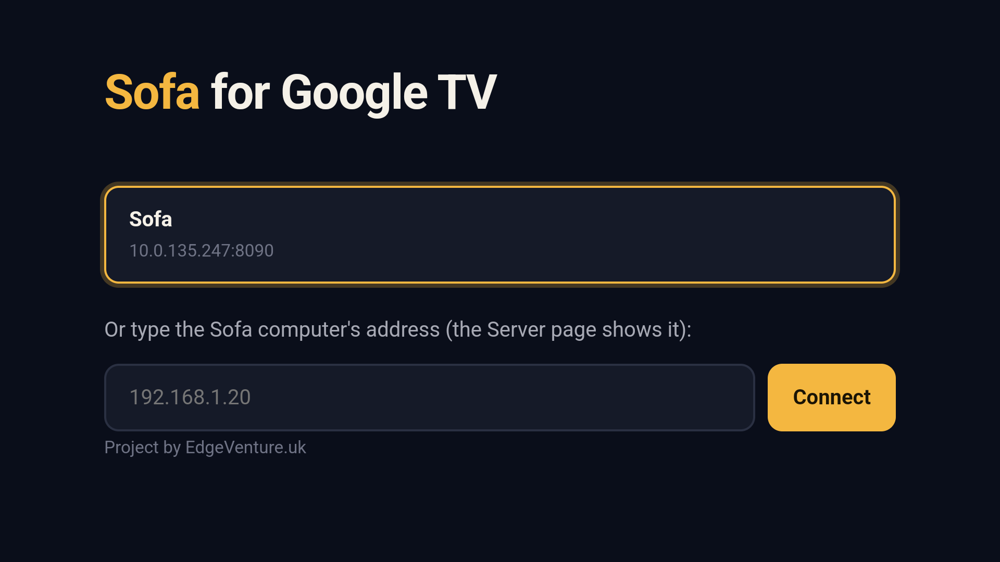
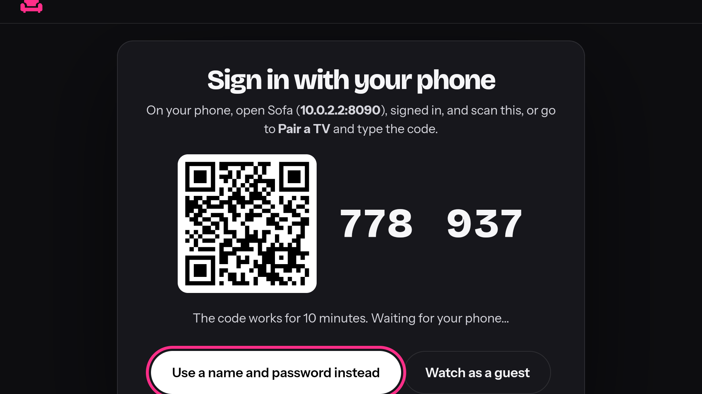
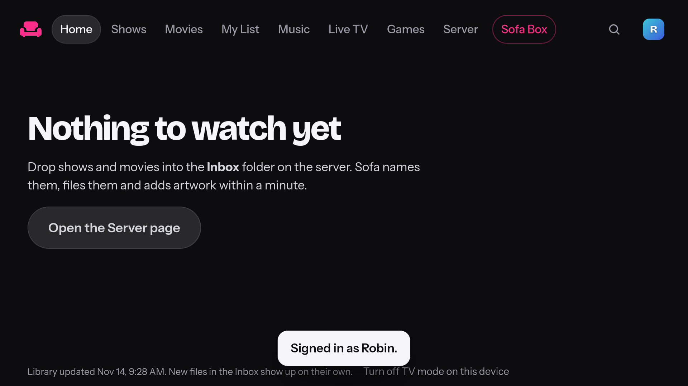

# Sofa for Fire TV, and for Android TV and Google TV

Sofa's own TV pages, with videos played by Android's player: MKV, HEVC and Dolby sound play as
they are, so the Sofa computer hardly ever has to convert anything (and an old Mac stays cool).

One app, two builds: **Fire TV** (below), and **Android TV and Google TV** ([further down](#android-tv-and-google-tv)),
which is new and has only run in an emulator.

## Installing it on a Fire TV

**The easy way:** open Sofa in **Silk** on the Fire TV. Home shows **Install the Sofa app**: press it
and follow the two steps on screen (turn on **ADB debugging** on the Fire TV, then answer the TV's
"Allow?" question once). The Sofa computer puts the app on the Fire TV over your home network and
opens it. Later, when Sofa has a newer app, the app itself shows **Update the app**.

The Sofa computer keeps the app (`data/apps/sofa-firetv.apk`): it gets the newest one from this
repository's Releases a minute after starting and then once a day, unless Sofa is set to work offline.
Installing on a Fire TV never needs the internet.

**The other way, with Downloader:**

1. On the Fire TV: **Settings → My Fire TV → Developer options → Install unknown apps**, and allow
   it for **Downloader** (install Downloader from the Amazon Appstore first; it's free).
   (No Developer options? **Settings → My Fire TV → About**, press OK on the device name 7 times.)
2. Open Downloader and type the Sofa address with `/firetv` on the end, for example
   `http://192.168.1.20:8090/firetv` (the Server page shows yours under **Apps**). Install.
3. Open **Sofa** from the Fire TV's apps. It finds the Sofa computer by itself (or type its
   address), then shows a code: approve it on your phone (Sofa → Pair a TV, or scan the QR).

Updating: the same steps install a newer version over the old one, keeping the sign-in.

## Android TV and Google TV

The same app, built for the TVs, sticks and boxes that run Android TV or Google TV (Android 5.1 and newer, ARM or
x86). **New: GitHub builds
it and works it on an Android TV emulator with the remote's keys on every change. It has never been on a real TV,
and it isn't in Google Play.**

What's the same as on a Fire TV: Sofa's own TV pages, the remote's arrows and OK everywhere, Back leaving the
player and then the app, **signing in by approving a code on your phone**, and Android's own player for MKV, HEVC
and Dolby sound. What's its own:

- **Its name on the device is `uk.edgeventure.sofa.tv`**, not the Fire TV app's `uk.edgeventure.sofa`. The Fire TV
  app is signed with the key in this folder, which anyone can sign with; an app under another name can't be
  replaced by something signed with it.
- **It says it's for TVs** (`android.software.leanback` is required), so a TV's home screen lists it with its
  banner and Google Play would offer it to TVs only. It asks for no touch screen and no phone hardware.
- **Its release is never signed with the key in this folder.** `app/build.gradle.kts` reads a key from the
  environment (`SOFA_TV_KEYSTORE`, a path, with `SOFA_TV_KEYSTORE_PASSWORD`, `SOFA_TV_KEY_ALIAS`,
  `SOFA_TV_KEY_PASSWORD`); GitHub's workflow takes the same from the repository's secrets
  (`SOFA_TV_KEYSTORE_BASE64` and the three others). With none set, the bundle is built unsigned.





*From GitHub's Android TV 14 emulator (x86, 1080p), worked with the remote's keys by `android/tv_check.py`.*

### Trying it

The workflow keeps two files with each run (the `sofa-googletv` artifact): `sofa-googletv-debug.apk`, signed with a
throwaway debug key made on GitHub's machine, and `sofa-googletv.aab`, the bundle Google Play takes.

On a TV with **Developer options** on (Settings → System → About, press OK on **Android TV OS build** seven times)
and **USB debugging** or **Network debugging** allowed:

```sh
adb connect <the TV's address>
adb install -r sofa-googletv-debug.apk
```

It appears on the TV's home screen as **Sofa**. It looks for Sofa on the network (or takes a typed address), then
shows a code to approve on your phone (Sofa → Pair a TV).

### What GitHub checks (`android/tv_check.py`, the `tv` job)

On an Android TV 14 system in an emulator (x86, 1080p), with a scratch Sofa beside it: the TV's launcher lists the
app; it opens on its start page; the arrows move the highlight and a typed address arrives; it reaches Sofa and
shows Sofa's sign-in for a TV; the code on the TV, approved through Sofa's own API as a phone approves it, signs the
TV in and Home shows; the arrows move the highlight there; Back leaves. Screenshots of each step are kept with the
run (`google-tv-screenshots`). It can't check a real TV, its remote, its sound, or a video on its decoder.

### Google's rules, as read on 2026-11-13

- **Target level:** Google Play wants new TV apps and their updates to target Android 14 (API 34) since 31 August
  2026 ([Target API level requirements](https://support.google.com/googleplay/android-developer/answer/11926878)).
  This app targets 34.
- **A TV app** must declare the leanback launcher entry and a 320 by 180 banner, not need a touch screen, and work
  with a D-pad alone ([TV app quality](https://developer.android.com/docs/quality-guidelines/tv-app-quality)): the
  entries above. Play takes app bundles, not APKs: the workflow builds one.
- **Memory pages of 16 KB** concern apps with their own native code. This one has none (Kotlin and Android's
  media3 player).
- **Developer verification:** since 30 September 2026 in Brazil, Indonesia, Singapore and Thailand, and everywhere
  in 2027, an app installed on a certified Android device, a TV included, has to come from a developer Google has
  verified, or be installed over ADB or through Android's longer "advanced" way
  ([Android developer verification](https://support.google.com/android-developer-console/answer/16561738)).
  Until `uk.edgeventure.sofa.tv` is registered to a verified developer, `adb install` is the way onto a TV.

### The owner's steps, when it's time

Nothing here is done by a workflow or anyone but the owner: accounts, keys, the listing and any fee are theirs.

1. **A private signing key** for `uk.edgeventure.sofa.tv`, made once and kept out of the repository
   (`keytool -genkeypair -v -keystore sofa-tv.jks -alias sofa-tv -keyalg RSA -keysize 4096 -validity 10000`), with
   a copy somewhere safe: an app can't change its key later. To have GitHub sign the bundle, its four values go in
   the repository's secrets (Settings → Secrets and variables → Actions).
2. **A Google Play Console account** (a one-time fee and proof of identity), and with it the developer
   verification above; then register the package name `uk.edgeventure.sofa.tv` and the key's fingerprint, before
   2027, so sideloading it keeps working too.
3. **A real TV pass** (a low-cost Google TV stick does): install, find Sofa, sign in by phone, play an MKV with
   HEVC and Dolby sound, Skip Intro, Back. Its line then goes into
   [Tested hardware](../docs/capabilities.md#tested-on).
4. **The Play listing**, if Sofa should be in the store: the bundle, the TV banner and screenshots, a privacy
   policy address, the content rating form. Play's review of a TV app looks at the D-pad and at the Home button.

## How it's built

GitHub builds both (`.github/workflows/android.yml`) whenever this folder changes, and publishes
`sofa-firetv.apk` on the repository's Releases page from `main` as `firetv-<build>`. The Google TV build is kept
with the run and published nowhere. Sofa fetches the
newest of those (`sofa/apps.py`, checked against GitHub's SHA-256), serves it at `/firetv`, and installs
it over the network with a small ADB client of its own (`sofa/adb.py`, standard library only; its key
is in `data/adb/`, and a Fire TV only accepts it after you press OK on the TV).

To build it yourself: Android Studio, or `gradle assembleRelease` in this folder with the Android SDK.

**The signing key** (`sofa-sideload.jks`, password `sofa-sideload`) is in this folder on purpose: every
Fire TV build is signed with the same key, so updates install over the old version (the workflow checks the
fingerprint on every build). It signs nothing else. It only proves "built
from this repository", so install Sofa only from your own Sofa computer or this repository's
Releases page.
