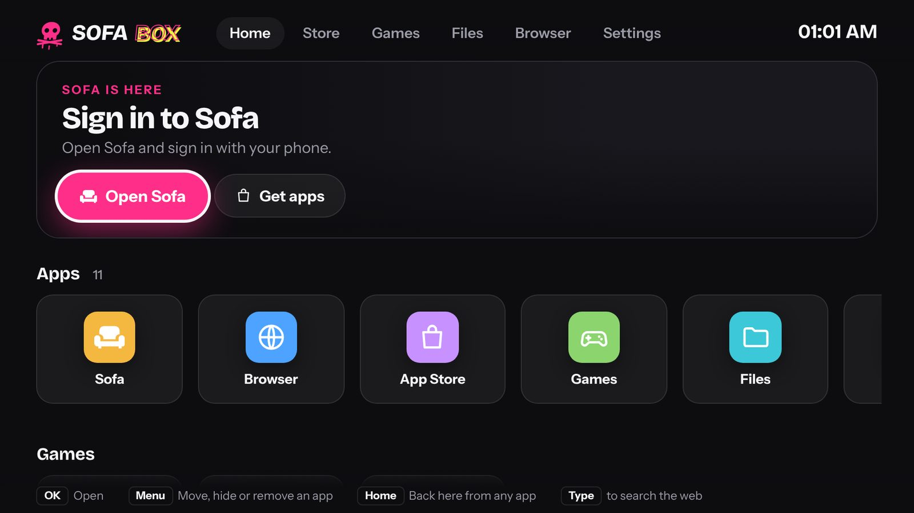
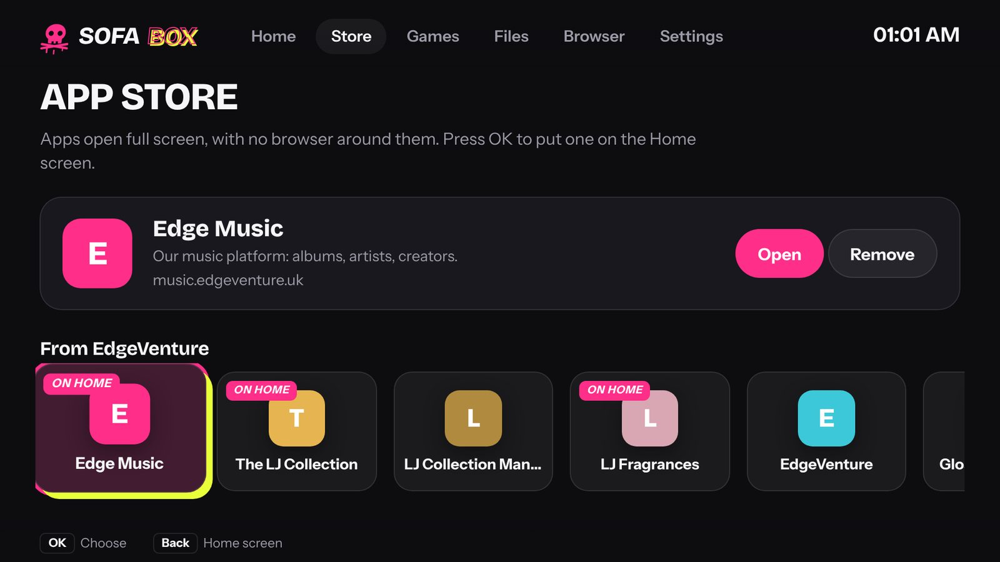
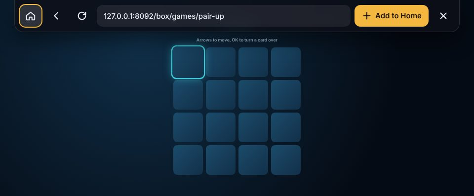
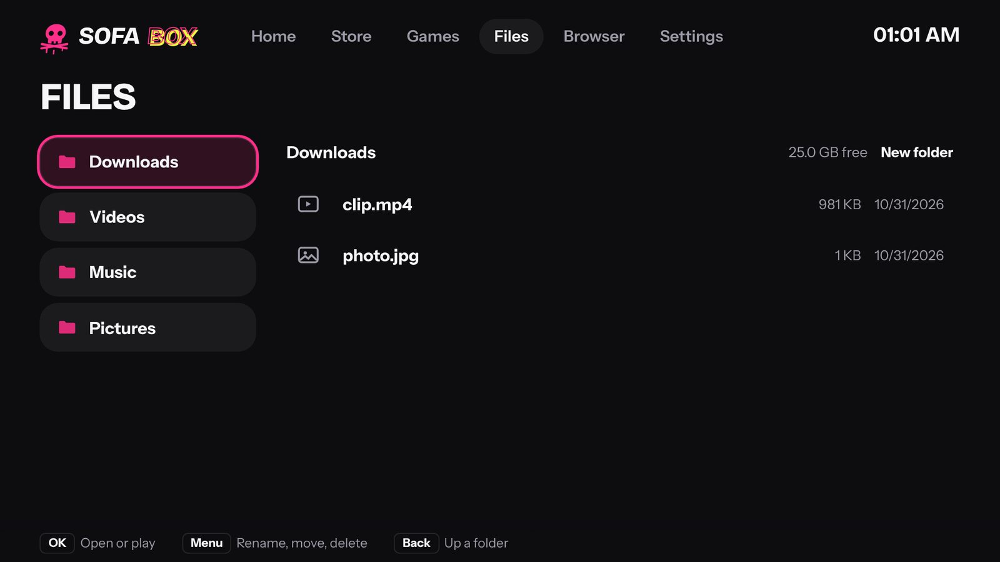
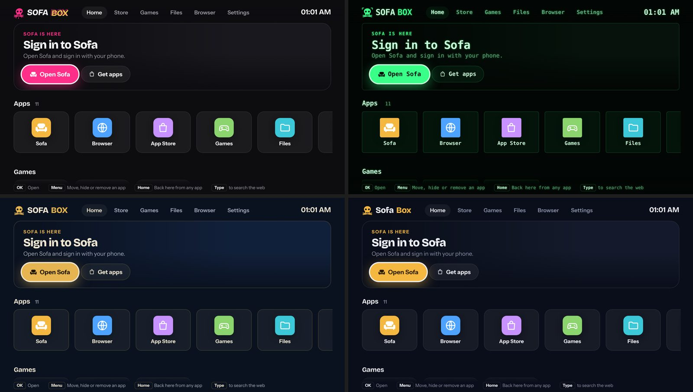
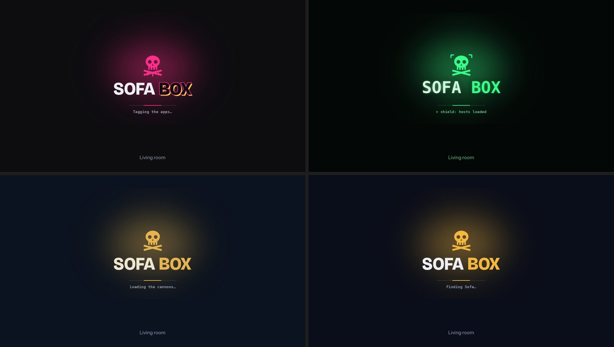

# The Sofa Box (a Raspberry Pi on the TV)

Your own TV box, in place of a Fire TV: a Raspberry Pi on the TV that starts on its own home screen,
with Sofa, your apps, a browser, an app store, games and a file manager. No ads, no account, and
nothing watching what you watch; the TV itself never needs to be online.



- **Sofa** plays with the box's own player (mpv, on the Pi's video chip), so most files play as they
  are and Sofa only converts what the Pi can't play. Home shows what you were watching.
- **Apps:** our own (Edge Music, The LJ Collection, LJ Fragrances) and anything from the **App
  Store** (YouTube, Pandora, SomaFM, Twitch, Pluto TV…) open full screen, with no browser around
  them. **Home** brings you back; they keep playing.
- **Browser**, with **Sofa Shield** keeping ads and trackers out of the whole box. On any site, the
  **Sofa bar** (Menu key, or the mouse at the top edge) has **Add to Home**: the site becomes an app.
- **Games** that run well on the box, **Files** for downloads and USB drives, and **themes**: Street,
  Terminal, Pirate or Sofa, for the home screen and the boot screen.

## What you need

- A **Raspberry Pi 3 Model B+**, 4 or 5, and its power supply. A Pi 3 needs the proper 2.5 A
  supply: a phone charger makes it slow down and stutter.
- A **microSD card**, 8 GB or more (a 32 GB card is plenty).
- An **HDMI cable** to the TV (micro-HDMI on a Pi 4/5), and if you can, a **network cable** to the
  router (better for video than Wi-Fi).
- Something to work it, any of:
  - **your phone**: in Sofa on the phone, the **Play on** button sends a video to the "Sofa box" and
    turns the phone into its remote;
  - **the TV's own remote**, through the HDMI cable (HDMI-CEC; Panasonic calls it VIERA Link). A
    universal remote set to the TV works as well as the original;
  - **a 2.4 GHz keyboard and mouse** (the kind with one small USB dongle): plug in the dongle and they
    work straight away, the easiest for the first start and for typing in the browser;
  - **a game controller** (Xbox, PlayStation, 8BitDo…), over Bluetooth or a USB cable;
  - a cheap "air mouse" remote with a USB dongle (it acts as a keyboard and mouse).

## Setting it up: the ready-made card (easiest)

1. Download the newest **`sofa-box-….img.xz`** from the
   [releases page](https://github.com/krintoxi/sofa/releases) (the one called "Sofa box").
2. Install **Raspberry Pi Imager** (raspberrypi.com/software) on your computer and open it.
   Choose your Pi, then **Choose OS → Use custom** and pick the file, then your card.
3. When it asks about **OS customisation**, you can press **Edit settings** to add your Wi-Fi, and
   a user name and password with SSH under Services (only needed to look inside the box later). Or
   press **No**: a network cable needs nothing.
4. Write it, put the card in the Pi, plug in HDMI (and the network cable), then power.
5. The TV shows the Sofa Box boot screen, then the first-start steps: the internet, finding Sofa,
   and your look. The first start takes a few minutes.
6. **Sign in to Sofa:** open Sofa from the home screen; it shows a code and a QR code. On your phone,
   open Sofa, press your picture, then **Pair a TV**, and type the code (or scan the QR).

From then on the box starts on its home screen whenever it's switched on. If the Sofa computer is off,
it waits for it. If there's more than one Sofa at home, it asks once.

## Setting it up on the card you already have

The installer works on Raspberry Pi OS (Lite or with a desktop) and on other Debian or Ubuntu
systems. From the Pi's own keyboard and screen, or over SSH (`ssh you@raspberrypi.local`), run one line with your Sofa
computer's address (Sofa's **Server → Overview → Apps** shows it ready to copy):

```
curl -fsSL http://192.168.1.20:8090/sofa-box/install.sh | sudo sh -s http://192.168.1.20:8090
```

It takes about 10 minutes on a Pi 3, then Sofa appears on the TV. Restart once when it says so.

- **A card set up for a small 3.5-inch screen (LCD-show)** squeezes the TV's picture down to
  480 × 320 to copy it onto the little screen. The installer undoes that: the TV gets its full
  picture back, and the small screen's driver is switched off. The old settings are kept as
  `config.txt.before-sofa-box` on the card's boot partition.
- **A desktop** (Raspberry Pi OS with desktop) is switched off so Sofa can have the screen.
  `sudo sofa-box desktop` brings it back; `sudo sofa-box appliance` gives the screen to Sofa again.
- **An old system** without the `cage` screen program (Raspbian Buster and older) gets a bare X
  screen instead. It works, but the ready-made card is faster and gets updates.

Running the same line again later updates the box.

## Try it on your computer first

You can see the box before there's a Pi: the TV pages as the box shows them (at the TV's size), a
remote, its settings and its boot screen. From the Sofa folder on any computer with Python and
Pillow (`pip3 install pillow`):

```
python3 tools/sofa-box-preview.py
```

It opens the preview in your browser. To use another computer's Sofa, add its address
(`python3 tools/sofa-box-preview.py http://192.168.1.20:8090`). `--slow` makes it behave like a
Pi 3. Videos open in mpv in a window if mpv is installed (on a Mac: `brew install mpv`).

## Using it

### The home screen

Everything starts here. **Home** comes back to it from anywhere: the remote's Home (on many TV
remotes it's the Home or Menu button, sent over HDMI), a controller's Xbox/PS button, **F1** or the
Windows key on a keyboard, or **Home** on the Sofa bar.

- **Apps:** OK opens one. **Menu** on an app moves it, hides it or removes it.
- **Open now:** what's still open (music keeps playing); OK goes back to it, ✕ closes it.
- **Typing** anything on Home searches the web.

### The App Store



Pick an app and press OK: it's on Home, and it opens full screen with no browser around it.
**Any website** at the bottom puts any address on Home. Apps marked **DRM** (Netflix, Disney+,
Prime Video, Spotify) need protection the Pi 3 may not manage: they might not play.

### The browser and the Sofa bar

**Browser** on Home: type an address or a search. On any site, press **Menu** (or move the mouse to
the top edge) for the Sofa bar: **Home**, **Back**, **Reload**, the address, **Add to Home** (the
site becomes an app on Home) and **Close**. Downloads go to **Files → Downloads**.



**Sofa Shield** (Settings) keeps ads and trackers out of every app and site on the box, with a list
of known ad and tracking sites that brings itself up to date every week.

### Files and games



**Files** shows Downloads, Videos, Music, Pictures and any USB drive you plug in. OK plays a video or
song in the box's player, or shows a picture; **Menu** renames, moves or deletes. **Games** has small
games that run well on the box, worked with the arrows and OK (or a controller).

### Settings and themes

**Settings** on Home: the look (**Street**, **Terminal**, **Pirate** or **Sofa**, for the home screen
and the boot screen) and the box's name, Sofa Shield, picture and sound, Wi-Fi, controllers, which
apps show on Home, which Sofa it uses, and restart.



The boot screen follows the theme, with the box's name under it and lines ticking by while it starts:



- **Picture:** Automatic, 1080p or 720p. On Automatic the box watches for dropped frames and asks for
  720p by itself if 1080p is too much.
- **Sound:** "TV or soundbar", or "AV receiver" to send surround as it is to a receiver.

### Keyboard and mouse

A 2.4 GHz keyboard-and-mouse set works as soon as its dongle is in. The arrows, **Enter** (OK) and
**Esc** or **Backspace** (Back) work everywhere; the pointer appears when the mouse moves and hides
when it's still; right-click on an app is its **Menu**.

**The TV's remote:** turn CEC on in the TV's settings. On a Panasonic (like the TC-60AS530U):
**Menu → Setup → VIERA Link Settings → VIERA Link: On**. Samsung calls it Anynet+, LG SimpLink,
Sony Bravia Sync. Then, with the TV showing the box: arrows move, **OK** opens and plays (and
skips an intro when Skip Intro shows), **Return/Back** goes back, ▶ ‖ plays and pauses, ◀◀ ▶▶
skip, the numbers jump through a video (5 = halfway).

**A game controller:** **Settings → Pair a controller**, then put the controller in pairing mode
(Xbox: hold the small pair button on top until the Xbox button flashes fast; PlayStation: hold
Share/Create and PS). A USB cable works without pairing.

| Button | Does |
|---|---|
| D-pad or left stick | move (like a remote's arrows) |
| A (✕ on PlayStation) | OK: open, play, press |
| B (○) or View/Select | Back |
| X (□) or Start/Menu | play / pause |
| Y (△) | search; while playing, subtitles |
| LB, LT / RB, RT | 10 seconds back / 30 seconds on |
| Xbox / PS button | Home |

## Good to know

- **Picture cut off at the edges?** That's the TV zooming in (overscan). On a Panasonic, turn
  **16:9 Overscan** off (Menu → Picture → Screen Settings); other TVs call it "Just Scan",
  "Screen Fit" or "Full Pixel".
- **Keep the TV off the internet.** With a Sofa box the TV needs no Wi-Fi or network cable, so it
  can't report what's on its screen (many smart TVs do, "ACR") or show ads.
- **Something not right?** Over SSH: **`sofa-box doctor`**. It checks the power supply, the
  services, the connection to Sofa, the TV, the video chip, sound and the remotes, and says what
  to do about anything wrong. `sofa-box logs` shows what the box has been saying.
- **What the Pi 3 plays as it is:** H.264 up to 1080p, in MP4 or MKV, with AAC, AC-3 or E-AC-3
  sound. Sofa converts HEVC (x265) and anything bigger than 1080p for it, as it does for any TV.

## What's on the box

| | |
|---|---|
| `sofa-box-agent.service` | the home screen, apps, store, files; finds Sofa; plays videos with mpv; opens apps as tabs of the box's one Chromium (over its DevTools port, `127.0.0.1` only); all on `127.0.0.1:8091`, only for the box itself |
| `sofa-box.service` | the TV's screen: Chromium full screen in `cage` (a screen that shows one window), starting on the home screen |
| `sofa-box-input.service` | game controllers as a remote |
| `sofa-box-cec.service` | the TV remote's buttons over HDMI-CEC |
| `sofa-box-shield.timer` | Sofa Shield's list of ad and tracker sites, brought up to date every week |
| `/usr/local/bin/sofa-box` | `doctor`, `status`, `logs`, `choose`, `pair-controller`, `tv-on`, `shield`, `desktop` |

Installed apps are in `~/.config/sofa-box/apps.json` (their icons next to it); the store's list is
`store.json` in this folder. How it all fits together: [docs/sofa-box-os.md](../../docs/sofa-box-os.md).

The files are in `/usr/local/lib/sofa-box`, the box's settings in `~/.config/sofa-box/settings.json`
of the user it runs as. To remove it all:
`sudo sofa-box shield off`, `sudo systemctl disable --now sofa-box sofa-box-agent sofa-box-input sofa-box-cec sofa-box-shield.timer`, then delete those
files and `/etc/systemd/system/sofa-box*.service`.

## Making the card yourself

The ready-made card is built by GitHub from this folder ([the workflow](../../.github/workflows/sofa-box-image.yml)).
To build one yourself, on Linux:

```
sudo tools/build-sofa-box-image.sh out --sofa http://192.168.1.20:8090
```

`--sofa` builds your Sofa's address in (optional: the box finds Sofa by itself). On a computer that
isn't Arm it needs `qemu-user-static`. The card has Raspberry Pi OS's own `pi` user for SSH (no
password until Raspberry Pi Imager's settings give it a name and password) and `sofabox`, which runs
Sofa on the TV. Each build writes a report of what's on the card next to it.
