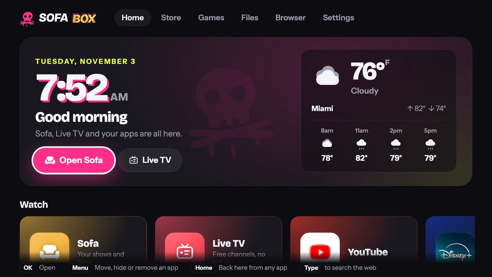
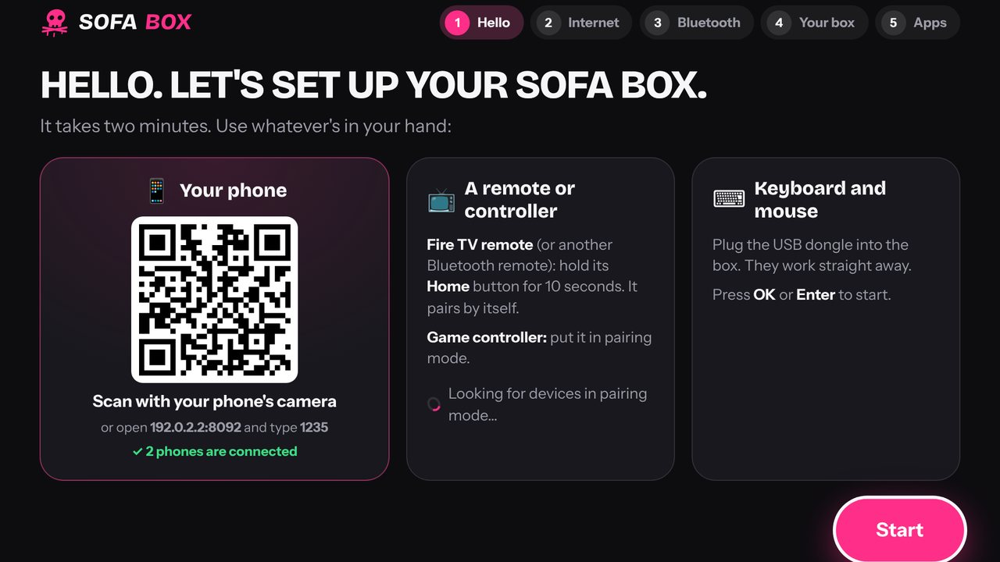
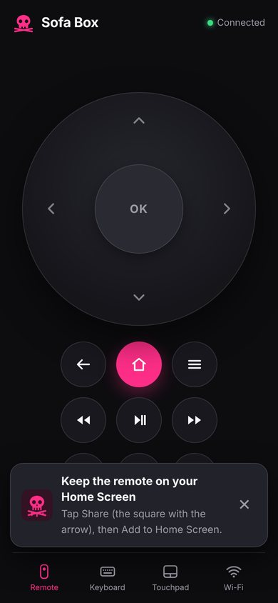
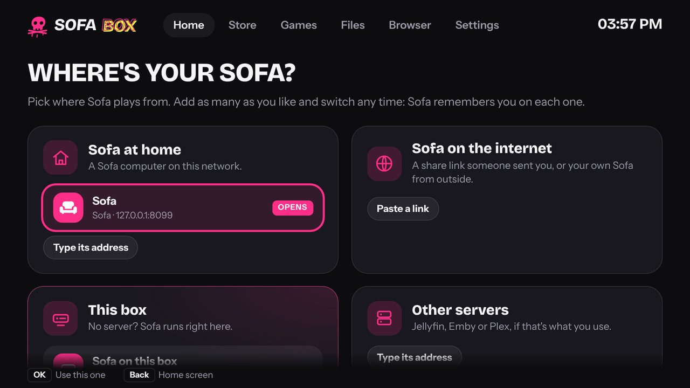
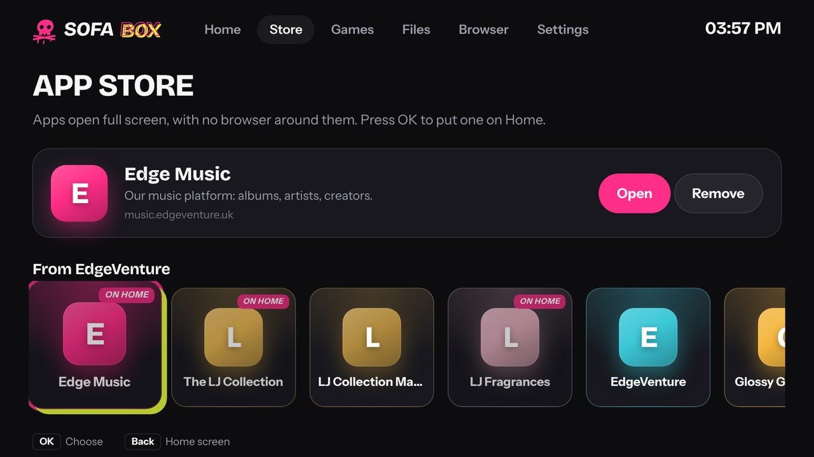
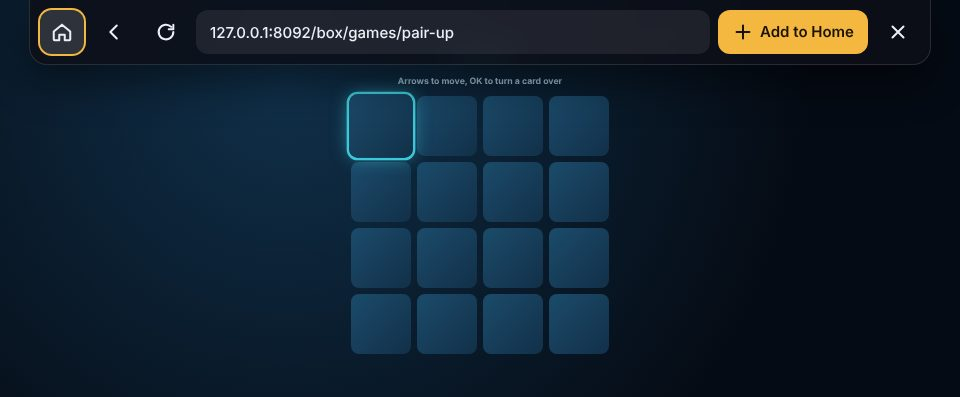
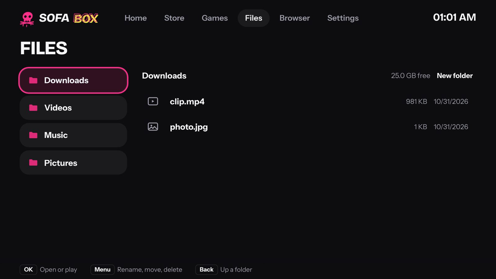
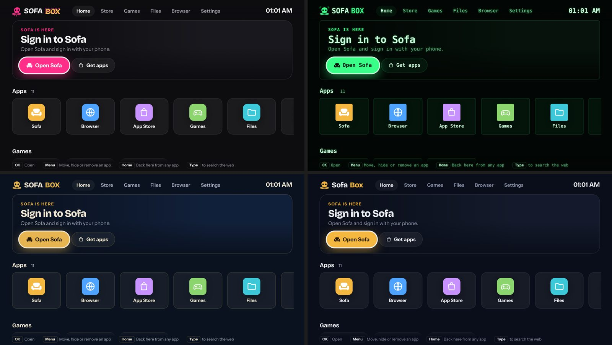
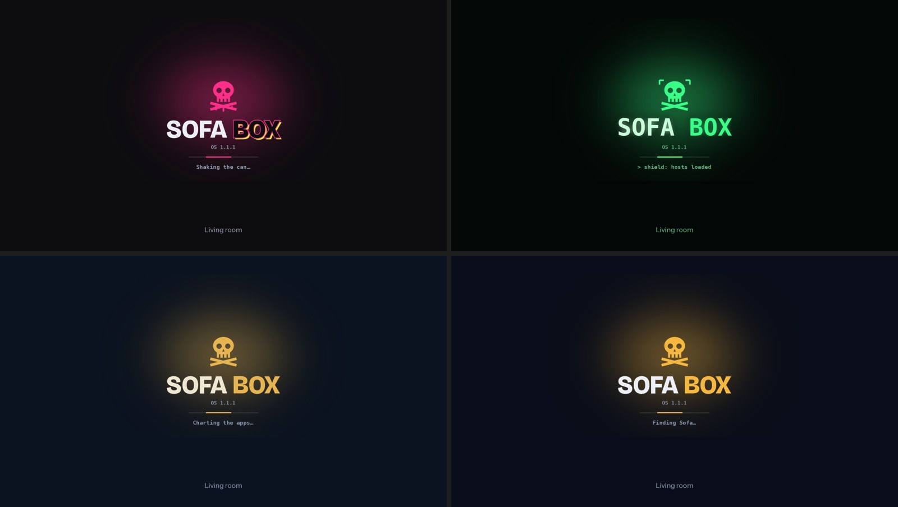

# The Sofa Box (a Raspberry Pi on the TV)

Your own TV box, in place of a Fire TV: a Raspberry Pi on the TV that starts on its own home screen,
with Sofa, free Live TV, your streaming apps, a browser, an app store, games and a file manager. No
ads, no account and no usage statistics: the box tells no one what you watch but the Sofa you play it
from, which keeps your place ([what the box sends, and where](../../docs/privacy.md#on-a-sofa-box)). The TV
itself never needs to be online, and if yours is, **Settings → Help** shows how to turn off its own tracking.

> **Sofa Box OS, Sofa App, Sofa Server: which is which?** **Sofa Box OS** is the system on the Pi (this
> guide). It has the **Sofa App** built in, the part you watch with. Your own shows and movies live on a
> **Sofa Server**, a program on a computer that stays on; the box opens yours, a friend's, or a small
> one on the box itself. You don't need a Sofa Server for Live TV or streaming apps.
> [The three parts, side by side](../../README.md#three-parts-sofa-server-sofa-app-and-sofa-box-os)

**[⬇ Download Sofa Box OS](https://github.com/krintoxi/sofa/releases/tag/sofa-box-stable)** (the stable card, tried
on a real box) · [The newest card](https://github.com/krintoxi/sofa/releases/tag/sofa-box) (testing) ·
[Every version](https://github.com/krintoxi/sofa/releases?q=box-os) · [What's new](CHANGES.md)



- **Sofa from anywhere:** your Sofa Server at home, a Sofa Server on the internet (a share link someone
  sent you), **Sofa on the box itself** (no other computer needed), or your Jellyfin, Emby or Plex server.
  It plays with the box's own player (mpv, on the Pi's video chip), so most files play as they are.
- **Free Live TV** has its own tile, and works with no server at all: Classic Cinema from the start, and the
  free channel lists you add.
- **Streaming apps** (Netflix, YouTube, Prime Video, Disney+, Max, Hulu…), our own (Edge Music,
  The LJ Collection, LJ Fragrances) and anything else from the **App Store** open full screen, with
  no browser around them. **Home** brings you back; they keep playing.
- **USB drives and DVDs:** plug in a drive and its videos, music and pictures are in Files; put a
  DVD or music CD in a USB disc drive and play it from Home.
- **Browser**, with **Sofa Shield** keeping known ad and tracker sites out of the whole box. On any site, the
  **Sofa bar** (Menu key, or the mouse at the top edge) has **Add to Home**: the site becomes an app.
- **Games** that run well on the box, **Files** for downloads and USB drives, and **themes**: Street,
  Terminal, Pirate or Sofa, for the home screen and the boot screen.

## What you need

- A **Raspberry Pi 3 Model B+**, 4 or 5, and its power supply. A Pi 3 needs the proper 2.5 A
  supply: a phone charger makes it slow down and stutter. Only the 3 B+ has run the box so far; the code knows
  the 4 and the 5, and nobody has tried one yet ([what's been tested on what](../../docs/capabilities.md#tested-on)).
- A **microSD card**, 8 GB or more (a 32 GB card is plenty).
- An **HDMI cable** to the TV (micro-HDMI on a Pi 4/5), and if you can, a **network cable** to the
  router (better for video than Wi-Fi).
- Something to work it, any of (nothing else needed):
  - **your phone** (iPhone or Android): the box shows a QR code; the phone becomes its remote, keyboard
    and touchpad (see [The phone remote](#the-phone-remote));
  - **a Fire TV remote** (or another Bluetooth remote): hold its **Home** button for 10 seconds during
    the setup, and it pairs by itself. Its power and volume buttons keep working the TV as before;
  - **the TV's own remote**, through the HDMI cable (HDMI-CEC; Panasonic calls it VIERA Link). A
    universal remote set to the TV works as well as the original;
  - **a 2.4 GHz keyboard and mouse** (the kind with one small USB dongle): plug in the dongle and they
    work straight away, the easiest for the first start and for typing in the browser;
  - **a game controller** (Xbox, PlayStation, 8BitDo…), over Bluetooth or a USB cable;
  - a cheap "air mouse" remote with a USB dongle (it acts as a keyboard and mouse).

## Setting it up: the ready-made card (easiest)

1. Install **Raspberry Pi Imager** 2.0 or newer (raspberrypi.com/software) on your computer.
2. Open the **Sofa Box list** in Imager. It puts Sofa Box OS in Imager by name, and Imager checks every
   byte it writes against the card GitHub built. Either way works, on a Mac or on Windows:
   - Download **[`sofa-box.rpi-imager-manifest`](https://github.com/krintoxi/sofa/releases/download/sofa-box/sofa-box.rpi-imager-manifest)**
     (it's also under **Assets** on the [newest card](https://github.com/krintoxi/sofa/releases/tag/sofa-box))
     and double-click it: Imager opens with the list. If something else opens it, right-click it, then
     **Open With** → **Raspberry Pi Imager**.
   - Or in Imager, press **App Options** (bottom left) → **Content Repository** → **Edit** → **Use custom
     URL**, paste this address, then press **Apply & Restart**:
     `https://github.com/krintoxi/sofa/releases/download/sofa-box/sofa-box.rpi-imager-manifest`

   While the list is open, Imager's title bar says **Using data from …**. The next time Imager starts,
   it shows Raspberry Pi's own list again.
3. Choose your Pi (**Raspberry Pi 5**, **4** or **3**), then **Sofa Box OS**, then your microSD card, and
   write it.
   - The top one is the version to keep. Once a version is marked stable (tried on a real box,
     [Stable and testing](#stable-and-testing)) it's that one, "**(stable)**"; until then, the newest.
   - A newer version that hasn't been tried on a real box yet says **(testing)**, and so does a
     **newest build (testing)**, which has every change since the last version number, for trying fixes
     early. **Sofa Box OS: earlier versions** holds the five before.
   - Imager doesn't offer its settings (user name, Wi-Fi, SSH) for this card. The box needs none: a
     network cable needs nothing, and the box's setup joins your Wi-Fi itself.
4. Put the card in the Pi, plug in HDMI (and the network cable), then power.
5. The TV shows the Sofa Box boot screen, then the **setup** (see below). The first start takes a
   few minutes.
6. **Open Sofa** from Home. The first time it asks where from (see below); after that it opens
   straight away, or asks each time if you prefer.
7. **Sign in:** your Sofa Server shows a code and a QR code. On your phone, open Sofa, press your
   picture, then **Pair a TV**, and type the code (or scan the QR). Sofa on the box signs itself in.

From then on the box starts on its home screen whenever it's switched on.

**Without the list** (a card you've already downloaded, say, or an Imager older than 2.0):

- Download **`sofa-box-stable.img.xz`** from the
  [stable card](https://github.com/krintoxi/sofa/releases/tag/sofa-box-stable), under **Assets**: the
  newest version that has been tried on a real box. Or take **`sofa-box.img.xz`** from the
  [newest card](https://github.com/krintoxi/sofa/releases/tag/sofa-box), the testing one: GitHub makes it
  again every time the box changes, before anyone has tried it. Each version also has a release of its
  own that stays, "Sofa Box OS 1.1.1" and so on ([every version](https://github.com/krintoxi/sofa/releases?q=box-os));
  the one marked "(stable)" is the stable card ([Stable and testing](#stable-and-testing)).
- In Imager, choose your Pi, then **Choose OS → Use custom** and pick the file, then your card.
- Imager 2 offers no **OS customisation** for a card picked this way. An older Imager (1.8 or 1.9) asks,
  and since Sofa Box OS 1.1.56 its settings are all fine (proved by starting the card in a container, not yet on a Pi): a user name and password (for SSH), your Wi-Fi
  (the box joins it by itself), SSH, the time zone and the keyboard. The box still starts into its own
  setup on the TV.

Why the list offers none of Imager's settings, and what it would take to offer them:
[Raspberry Pi Imager and the card](../../docs/raspberry-pi-imager.md).

### The setup (the first start)

A new card's **first start takes a few minutes** (the card grows to fill the SD card and the box sets
itself up), and it may restart once by itself. Its boot screen says so: just wait.



1. **Hello:** pick up whatever's in your hand.
   - **Phone (the Sofa Setup Assistant):** point its camera at the code on the TV: the first connects your
     phone to the box, the next opens the Setup Assistant, where you choose your Wi-Fi. Once the box and your
     phone are back on your Wi-Fi, the assistant carries on by itself as the remote (if it can't, the TV
     shows one last code to scan).
   - **Fire TV remote** (or another Bluetooth remote, or a game controller): put it in pairing mode.
     For a Fire TV remote, hold **Home** for 10 seconds. It pairs by itself.
   - **Keyboard and mouse:** plug in the dongle.
   Once your phone is the remote on your Wi-Fi, the setup goes on by itself (to **Your box**): nothing
   to press. With a remote or a keyboard, press **Start** (it's always at the bottom of the screen).
2. **Internet** (only when the box isn't online yet): a network cable needs nothing. For Wi-Fi, pick
   your network and type the password; the phone's **Keyboard** tab types it, which is easier than a
   remote. Once it's connected, the setup goes on by itself.
3. **Your box:** its name (on the boot screen), the **time zone** (your phone sets it when it
   connects), and its look.
4. **Apps:** tick the streaming apps you use; they go on Home, ready to sign in.

Speakers, headphones and more controllers wait until you want them: **Settings → Remotes and
Bluetooth**, or **Games** for controllers.

**No cable and no Wi-Fi yet?** After a few seconds, the box makes its own Wi-Fi, "Sofa Box 1234". The TV
takes you through four steps, one code at a time, and says under each what it's waiting for:

1. **Join the box's Wi-Fi:** scan the code with your phone's camera. Once your phone has joined, this
   code goes and the next one shows.
2. **Open the remote:** scan the new code. (Some phones open the remote by themselves after step 1.)
3. **Give the box your Wi-Fi:** the remote opens on its **Wi-Fi** tab; pick your home Wi-Fi and type its
   password. The box leaves its own Wi-Fi to join yours, and your phone goes back to your Wi-Fi. The TV
   shows "The box is joining…", then either that it's connected or why not (the password, say). If it
   didn't work, the box's own Wi-Fi comes back with the same name and password: join it again and retry.
4. **Keep the remote:** once it's connected, **scan the code on the TV** to carry on. From then on the
   remote has a secure address through the Sofa Box service (`https://boxcert.edgeventure.uk/r/…`, see
   [The phone remote](#the-phone-remote)).

A step that went too fast or a phone that dropped off: **Show the code again** under the step brings it
back.

**An iPhone that only opens secure pages** (**Settings → Apps → Safari → Not Secure Connection
Warning** on): Safari refuses the box's page on its own Wi-Fi ("HTTPS only"), so switch that setting off
for the setup and back on afterwards. Once the box is on your Wi-Fi, the remote is `https://`, which it
opens either way. If the TV still shows a plain `http://` address, wait a moment: the box connects to the
Sofa Box service first, and **Settings → Remotes and Bluetooth** shows how that's going.

**The setup says it couldn't make its own Wi-Fi?** Plug a network cable from your router into the box:
the code to scan shows within seconds. Or plug in a USB keyboard, press **Start** and choose your Wi-Fi
on the TV. (Raspberry Pi Imager 1.9 and older can put your Wi-Fi on the card too: **Edit settings →
Configure wireless LAN**, with your **Wireless LAN country**. Imager 2 doesn't offer it for this card,
from the list or with **Use custom**. Before Sofa Box OS 1.0.1 the setup showed a spinner for ever in
this case.)

Later on, if the router is off for a while (a power cut, a restart), a box that knows your Wi-Fi waits
for it to come back. Only after three minutes with no network does it make its own Wi-Fi again (handy
if you've moved house), and after ten quiet minutes on it, it looks for your Wi-Fi again.

### The phone remote



There's nothing to install from an app store: **the box serves the remote itself**.

- **Connect a phone:** scan the QR code on the TV with the phone's camera. **Menu** on Home shows it any time
  (so does Settings → Remotes and Bluetooth), and a phone that opens the remote without being connected brings it up
  on the TV by itself. Scanning works at home or away. Instead of scanning, type the **four numbers** under it (at
  home) or the **eight letters** (anywhere).
- **It stays connected:** each phone has its own link, which its page keeps in its address. A bookmark or a Home
  Screen icon of the remote keeps that link, and it signs the phone in on whichever of the box's addresses opens it
  (at home, the secure one, or from anywhere).
- **Keep it like an app:**
  - **iPhone:** in Safari, tap **Share** (the square with the arrow), then **Add to Home Screen**.
    It gets the box's skull icon, and opens full screen like any app.
  - **Android:** in Chrome, open the **⋮** menu, then **Add to Home screen**.
  - The remote shows this tip itself, once.
- **Using it:**
  - Swipe on the big pad to move, tap the middle for **OK** (or tap an edge, or hold it to keep
    going). Then **Back**, **Home**, **Menu**, play/pause and skip, and volume.
  - **Keyboard** types into the box: a search, an address, a password.
  - **Touchpad** is a mouse, for the odd website that needs one.
  - **Wi-Fi** changes the box's network.
- **Several phones** can be remotes at once. Settings → **Forget phones** makes them all scan again.
- **Good to know:**
  - The secure address below works from anywhere, but only for a phone that scanned the TV's code.
    A plain `http://` remote works at home only.
  - The secure address stays the same when your router gives the box a new one. On plain `http://`, scan
    the code again after that; reserving the box's address in the router stops it happening.
- **Secure (https), at home or away.** Some phones only open secure pages, for example an iPhone with
  **Settings → Apps → Safari → Not Secure Connection Warning** on. So once the box is online, its remote
  has a secure address through the **Sofa Box service's relay**:
  `https://boxcert.edgeventure.uk/r/k3x9q2abcd/`. The QR code on the TV uses it by itself, and it works
  from anywhere, at home or away (the phone's taps go to the service and on to the box, which keeps a
  connection open to it).
  - The phone still needs the TV's code: the QR code's long one (24 characters). Typing the four
    digits works at home only, so nobody can guess at them from the internet.
  - What passes through the service: your phone's taps, typing and the box's answers, on their way.
    None of it is kept: the service holds each one in memory until the box answers, and its log has
    only the time, the address (like `/r/k3x9q2abcd/api/key`), and the size and status of the answer,
    not what was in it. To reach the box the service only needs its random id.
  - No certificate or name per box, so no Let's Encrypt limits, and it works with routers that block
    names pointing at home addresses ("DNS rebinding protection").
  - **Settings → Remotes and Bluetooth** shows how it's doing, and **Switch off** turns it off (phones
    at home then use plain `http://`).
  - The old way, a name and certificate per box (`https://k3x9q2abcd.box.edgeventure.uk:8093`, home
    only), is still there: `"remote_link": "certificate"` in the box's settings.json.
  - How the service works, and how to run it: [deploy/box-certs](../box-certs/README.md).
<br clear="right">

## A PC instead of a Pi: a USB stick

The same Sofa Box OS runs on a PC or laptop with an Intel or AMD processor (x86-64), from a USB stick, with nothing
installed on the PC. It's built beside every card and published on the same releases (since 1.1.79):
**[`sofa-box-pc.img.xz`](https://github.com/krintoxi/sofa/releases/download/sofa-box/sofa-box-pc.img.xz)** on the
[newest card's page](https://github.com/krintoxi/sofa/releases/tag/sofa-box), and `sofa-box-os-X.Y.Z-pc.img.xz` on each
version's own.

1. Write it to a USB stick of **8 GB or more**: with Sofa Box Imager on a Mac (**For a PC**), with Raspberry Pi Imager
   and the Sofa Box list above (device **A PC, from a USB stick**), with balenaEtcher, or on Windows with Rufus in DD
   mode. Everything on the stick is erased.
2. Plug the PC into the TV and put the stick in. Start the PC from the stick: as it starts, press its start menu key
   (often **F12**, **F11**, **F10**, **F8** or **Esc**; the PC's maker says which). Newer PCs and older ones both start
   it, with Secure Boot on or off.
3. The box sets itself up on the TV as a Pi does. It runs from the stick and keeps its settings there; its first
   start makes it the whole stick.
4. To keep it on that PC (since 1.1.84): **Settings → This box → Install on this computer**. Pick one of the PC's own
   drives; the TV names it twice before anything happens, because **that drive is erased** (Windows too, if it's
   there). Everything on the stick goes with it: settings, apps, sign-ins, Wi-Fi. It takes a few minutes, and the TV
   works as usual meanwhile. Then take the stick out and restart the PC: it starts from its own drive, quicker, with
   Secure Boot on or off. By hand: `sudo sofa-box install-to-disk /dev/nvme0n1 --yes` (`lsblk` lists the drives).

Not tried on a real PC yet: GitHub starts each one in a virtual PC three ways (newer, older, Secure Boot on), and
installs it from the stick onto a blank drive and starts the PC from that drive (Secure Boot on, then an older PC),
before it's published. What a given PC decodes in hardware, and the rest of what's different from a Pi:
[docs/hardware.md](../../docs/hardware.md). Like the card, it has no login (no password, SSH off).

## Setting it up on the card you already have

The installer works on Raspberry Pi OS (Lite or with a desktop) and on other Debian or Ubuntu
systems. From the Pi's own keyboard and screen, or over SSH (`ssh you@raspberrypi.local`), run:

```
curl -fsSL https://raw.githubusercontent.com/krintoxi/sofa/main/deploy/sofa-box/install.sh | sudo sh
```

It gets everything from GitHub, so no Sofa Server is needed: the stable version (tried on a real box),
or main's newest while no version is marked stable. To start with your Sofa Server
already on the box's list, add its address at the end (Sofa's **Server → Overview → Apps** shows the
whole line ready to copy):

```
curl -fsSL https://raw.githubusercontent.com/krintoxi/sofa/main/deploy/sofa-box/install.sh | sudo sh -s http://192.168.1.20:8090
```

It takes about 10 minutes on a Pi 3, then Sofa appears on the TV. Restart once when it says so.

- **A card set up for a small 3.5-inch screen (LCD-show)** squeezes the TV's picture down to
  480 × 320 to copy it onto the little screen. The installer undoes that: the TV gets its full
  picture back, and the small screen's driver is switched off. The old settings are kept as
  `config.txt.before-sofa-box` on the card's boot partition.
- **A desktop** (Raspberry Pi OS with desktop) is switched off so Sofa can have the screen.
  `sudo sofa-box desktop` brings it back; `sudo sofa-box appliance` gives the screen to Sofa again.
- **An old system** without the `cage` screen program (Raspbian Buster and older) gets a bare X
  screen instead. It works, but the ready-made card is faster and gets updates.

Running the same line again later puts main's newest on the box (the testing version). To update it
the way **Update the box** does, by its channel (Stable or Testing), run `sudo sofa-box update`;
`sudo SOFA_BOX_BRANCH=<branch> sofa-box update` tries out a branch.

## Try it on your computer first

You can see the box before there's a Pi: the TV pages as the box shows them (at the TV's size), a
remote, its settings and its boot screen. From the Sofa folder on any computer with Python and
Pillow (`pip3 install pillow`):

```
python3 tools/sofa-box-preview.py
```

It opens the preview in your browser. To use another computer's Sofa, add its address
(`python3 tools/sofa-box-preview.py http://192.168.1.20:8090`). `--slow` makes it behave like a
Pi 3. Videos open in mpv in a window if mpv is installed (on a Mac: `brew install mpv`).

## Using it

### The home screen

Everything starts here. **Home** comes back to it from anywhere: the remote's Home (on many TV
remotes it's the Home or Menu button, sent over HDMI), a controller's Xbox/PS button, **F1** or the
Windows key on a keyboard, or **Home** on the Sofa bar. The box itself brings Home forward (since 1.1.81), so a site
that keeps its keys, a dialog, the player or a game can't hold on to it: a video stops with its place kept, a game
ends.

- **Spotlight** (since 1.1.73): the picture behind Home is whatever the remote is on: what you were watching in
  Sofa, a game playing, an app's own icon on its colour. Its name and a line about it sit over the picture, with
  **OK** saying what it does (Resume, Play, Open). Rows below: **Apps**, **Continue watching**, **Open now**,
  **Plugged in**, **Games**. The top bar has the weather, the time, and the music an app plays (its buttons too).
  On a Pi 3 the picture and words follow once the remote rests, so a press is never slowed by a picture.
- **Games** (since 1.1.77) is a store in the same way: behind it, the game the remote is on, playing itself, with
  who plays and with what; rows of big pictures: **Continue** (what was played last on this box), **New on the box**,
  **Two or more players**, **The box's own**, the free games from Debian on the box and to get, **Controllers** (pair one
  there), and **Remove a game**.
- **Icons** (Settings → Home screen → Icons): the box's own apps and EdgeVenture's in **Glossy** (the default: shiny,
  real-looking objects), **Drawn**, **Sticker**, **Phosphor** or **Pixel**, or the apps' own. Other companies' apps keep
  their own logo, set in the same style: a glossy glass tile, a sticker, a green screen. They are pictures made on a
  computer by `tools/box-icons/build.py` (node and Chrome), so a Pi only shows them; change a drawing there, run it
  (`build.py glossy` redoes one style), and commit the pictures with it.
- **Classic** (Settings → Home screen → Layout): the time and the day, a hello, and what to do next: **Resume**,
  **Open Sofa** and **Live TV**. Beside it, **the weather**: now, the next 24 hours' high and low, and the next few
  hours, for the city of the box's time zone until you pick a town in **Settings → Weather on Home** (also °C or °F,
  or Off).
- **Opening an app** shows its icon while it loads, and the TV switches to it once it's ready
  (not to a blank page). One that's open already comes straight back.
- **Watch:** Sofa, Live TV and your streaming apps, as big cards. **Plugged in:** USB drives and a disc,
  when there's one. **Continue watching** from the Sofa it opens with.
- **Your apps:** everything else. OK opens one. **Menu** on an app moves it, hides it or removes it.
- **Open now:** what's still open; OK goes back to it, **Menu** offers Back to it or Close it (a mouse has ✕). What's
  playing music carries on, until a video starts: then it pauses, and the mini player has it. The rest
  close by themselves after half a minute out of sight on a Pi 3 (five minutes on a bigger box).
- **Typing** anything on Home searches the web.

### Opening Sofa: where from



The first time you open Sofa, the box asks **where's your Sofa?**

- **Sofa at home:** the Sofa Servers the box found on your network, or type an address.
- **Sofa on the internet:** paste a **share link** someone sent you (their public library), or your
  own Sofa's address when it's on the internet. Free public Sofas are listed here too when there are
  any (the list comes from GitHub, so new ones show up by themselves).
- **This box:** no server, and you don't want one? Sofa runs on the box itself. It has **free Live
  TV** straight away, and plays videos on the box (in Videos → Sofa Library) and on USB drives laid
  out as a Sofa Library. It signs itself in.
- **Other servers:** Jellyfin, Emby or Plex. The box finds them on your network, or type the address.
  They open as they are, with the Sofa bar.

Then: **every time**, or **ask me each time**. Settings → Sofa changes that, and lists every server
you've added (open one, make it the one Sofa opens with, or remove it). Inside Sofa, your name →
**Servers** switches too. You stay signed in to each one.

The **Live TV** tile opens Live TV in the Sofa it opens with, or in Sofa on the box. Channels play in the
box's own player: up and down change the channel.
- **Live now:** today's channels, from the channel lists you add. A new box comes with none: add the ones you
  want from Live TV (the community lists from iptv-org are one press each).
- **Classic Cinema:** classic movies, film noir, westerns, silent films, cartoons, classic TV and documentaries,
  on 20 to 28.
- **The decades:** 2009–2012, the 2000s, 90s, 80s, 70s, 60s and 50s, TV as it went out, most of it whole
  recorded broadcasts with their own commercials (Kids TV, Saturday Mornings, On Air, Music TV, Commercial
  Breaks and more). They play straight from a public video library, not through the box or your Sofa; the
  Sofa's Server → Live TV has a switch that turns them off.

Each tab has a **guide**, as on a TV: up and down go through the channels, OK watches, a channel's number goes
straight to it, and Flip picks one. While a channel plays, its banner says what's on and what's next.

### USB drives and discs

Plug in a USB drive and it's ready in a moment: a toast says so, it shows on Home under **Plugged
in**, and Files lists it. Videos and music play in the box's player; pictures open full screen.

If you use **Sofa on this box** (This box), the drive's shows and movies also join its library by
themselves, with posters and Continue watching: nothing to add in Sofa. Sofa sorts the drive the way
its Inbox sorts, with links on the box, so every show and movie on it is found whatever the folders are
called, and nothing on the drive is moved, renamed or changed
([docs/storage.md](../../docs/storage.md#a-usb-drive-sorted-for-you-sofa-on-a-sofa-box)).

A **DVD, Blu-ray or music CD** in a USB disc drive shows on Home too: OK plays it (DVD menus work with
the arrows and OK). Discs and USB drives haven't been plugged into a real box yet: this is what the code does. Store-bought DVDs and Blu-rays are usually copy-protected; the box doesn't come
with the extra software some of them need, so those may not play. A Pi 3 may need a powered USB hub
for a disc drive.

### The App Store



Pick an app and press OK: it's on Home, and it opens full screen with no browser around it. Sign in
the first time, as on any TV. **Any website** at the bottom puts any address on Home. Each app shows
its own icon (the box fetches it from the app's site the first time you open the store).

Apps marked **DRM** (Netflix, Disney+, Prime Video, Max, Spotify…) use copy protection, which the box
has (Widevine, on the card). On a Pi 3 their picture may be smaller than on a Fire TV, and a service can refuse
to play in the box's browser; a Pi 4 or 5 should do better. Nobody has yet opened these apps on a box and written
down what played: if you do, send a [hardware report](https://github.com/krintoxi/sofa/issues/new/choose).

### The browser and the Sofa bar

**Browser** on Home: type an address or a search, or pick from **Recent**, **Most visited** and a few to try, each
with its site's own icon. The box remembers the browser's sites on the box only; **Clear recent sites** forgets them.
On any site, press **Menu** (or move the mouse to the top edge) for the Sofa bar: **Home**, **Back**, **Reload**,
**smaller** and **bigger**, the address, whether **Sofa Shield** is on, **Add to Home** (the site becomes an app on
Home) and **Close**. Downloads go to **Files → Downloads**.



**Sofa Shield** (Settings) keeps known ad and tracker sites out of every app and site on the box: a list
of them (StevenBlack's hosts list) that brings itself up to date every week. It goes by the sites' names,
so ads that come from the same site as what you watch still show.

### Files and games



**Files** shows Downloads, Videos, Music, Pictures and any USB drive you plug in. OK plays a video or
song in the box's player, or shows a picture; **Menu** renames, moves or deletes.

**Games** is for playing on the TV with a controller:

- **Connect a controller** there (it shows how to put an Xbox, PlayStation, 8BitDo or other controller in
  pairing mode); a USB cable or a controller's own dongle works as soon as it's in. The box knows which
  kind it is and says so.
- **Get more games**: free games the box installs when you press OK (a few minutes, from Raspberry Pi
  OS's archive), then plays **without the internet**: SuperTux (a platformer), Flare (a dark-fantasy
  action RPG), Neverball, Battle for Wesnoth, OpenTTD, two first-person shooters (AssaultCube, and Cube 2:
  Sauerbraten, a 1 GB download), and SuperTuxKart on a Pi 4 or 5. Each says how much room it takes;
  **Remove a game** frees it. On a Pi 3 the shooters draw smaller and the TV scales them up.
  - All of them are open source, except the two shooters' maps, sounds and pictures: free to play, but not
    free software (not for commercial use). So those two are only ever installed on a box when someone
    asks for them, never put on a card: the card's build stops if one is on it. AssaultCube's maps come
    from its own releases on GitHub as it installs.
  - Each game's licence and source: **Settings → This box → About → Credits and licences**.
- **Sofa Craft, powered by Luanti,** is on every box from the start: an endless world of blocks to
  explore, mine, build and craft in, straight into your world with the controller. It's Luanti, the
  open-source block game, with its Minetest Game (their code LGPL, their pictures and sounds mostly
  CC BY-SA 3.0).
- **Every game works with the controller from the start**, the same on every controller (the buttons go by
  their place: an Xbox controller's A is a PlayStation controller's ✕). Games made for controllers read it
  themselves; for the others the box works the controller for them: the sticks walk, look or move the
  pointer, the buttons are the game's keys and clicks.
- **To come back from a game, hold Home** (the Xbox or PS button, or a remote's Home) for a second.
- **Gloamwell**, the box's own game: a dark-fantasy dungeon crawler. Go down the well under the village of
  Wickhollow as a Warden, an Ashcaller or a Stalker, through six zones of floors (each one made as you go
  down), each with its own creatures and a guardian every fourth floor, and on past the last. Each guardian
  has a room of its own (a dripping cistern, great candles that weep wax, stinging moths, falling bells, vents
  that erupt, veins that pulse with a heartbeat), comes in with a scene of its own, and makes a last stand below a
  quarter of its HP. Fight with a blade and three skills, roll out of the way, spend a talent point each level, and find gear in six
  rarities, sets among them, and eight legends, each with a power you can see (a blade that sets foes alight,
  a maul that tolls, a rod whose blows leap as lightning). Elites have powers of their own (frost, thirst,
  storms, wards), and now and then a named champion waits on a floor. Set gems in your gear's sockets, keep a
  familiar at your side (a rat, a lantern moth, an emberwisp, a toadling), break open the vaults hidden behind
  cracked walls, and meet the omens some floors carry (a blood moon, the swarm, a gilded thief to catch). Back in the village: Hesk's stall, Vesk's forge (better your gear), your
  strongbox, and the notice board's tasks. Make your Wickbearer as you like (name, origin, look); the gear you
  wear shows. Besides fighting: Woodcutting, Mining, Crafting and Hunting (Ysolde's tasks), each gain of XP
  rising at the side of the screen as you work, and mounts to win, some that fly. Three Wickbearers can be kept; one from the first Gloamwell moves into the first free one. Two can play on one
  screen: a second controller joins at any time (Start on it) with one of the three, or a new one, each with their
  own loot, XP, belt, skills and half of the screen; either brings the other back when they fall, and either can
  leave again (the keyboard is the first player's). It plays offline with its own music (quiet unless you turn it
  up), with the controller from the start (the hints show its buttons: A B X Y, or ✕ ○ □ △) or a keyboard, and it
  sheds effects to stay smooth on a Pi 3.
- **Tidewing**, a race over open water in 3D: a skimmer through the lit gates of twelve courses against three
  rivals, carving to fill your boost, riding in another's slipstream and jumping the crests of the swell. Three cups
  (points for every place; a trophy opens the next cup and wins a new skimmer), time trials against the ghost of your
  best lap, four skimmers that handle differently, and two players on one screen with the rivals. The newer waters
  have weather (a gale with lightning, snow on the ice, ash off a volcano, water that glows) and land with height:
  cliffs, a red-rock gorge, a volcano, a reef. Each water has a sky of its own (a big barred sun at dawn and dusk, a
  moon and stars, a gale's cloud), the sea mirrors the sky, the islands, the gates and the skimmers, and the race's
  numbers are drawn in the picture itself. It's built on the box's own game engine (Low3D, `games/low3d.js`), which
  tunes each game to the box: on a Pi 3 a 640×360 picture shown crisp, made to hold 60 frames a second (it gives up
  pixels before frames), more lines on a Pi 4 or 5, and the same world in 2D on a box without a real GPU. The
  graphics check (`127.0.0.1:8091/box/games/probe/` in the box's browser) shows what it found.
- **Ironmaw**, an old-style shooter in a foundry under the ice, in two episodes: the Foundry (four levels and its
  Warden) and the Ice below it (cryo labs, a glacier mine, the drowned pumpworks, the reactor, and the Coldheart,
  whose core shields it until it opens). Seven weapons, among them the six-barrelled Nailstorm and the Frost lance
  that goes through everything in its way; drones that fly, bulwarks behind their plates, sappers that lob bombs.
  Light has colour (lava, ice, the reactor's green, alarms), walls and floors keep the marks of a fight, you see
  through grates, bars and windows, steam vents breathe, lamps flicker, snow falls in the yards, and sounds come
  from where they happen. Its arena has six maps of its own and four ways to play (everyone for themselves, two
  crews, holding the ring, and the Last Shift: everyone together against the foundry's waves) against bots of five
  skills, alone or on a split screen for up to four players with a controller each (two bots fewer and two players
  on a Pi 3). The left stick moves, the right
  stick turns, RT fires, LT aims, A opens doors. It's drawn
  by the processor, so it plays on a Pi 3 with or without a GPU, with helpers drawing strips of the picture on the
  Pi's other cores, and sharper on a Pi 4 or 5. Its numbers, messages and map are written on the game's own canvas
  (640 × 360 on a Pi 3, whatever size the picture under them), and it gives up pixels before frames: a Pi 3 starts at
  240 × 135 and 60 frames a second. Options, Picture and speed: a quality set (light on a slow box, full on the rest,
  or your own), the picture's size and rate held or left to the box, the glow, light from shots, debris, marks,
  steam and snow, dark corners, crisp or smooth pixels, and a frame rate counter.
- **Cinder Knight**, a dark-fantasy platformer: the last ember of a cold world's hearth, in a knight's black iron,
  climbing to light it again. Four regions of four stages (the Sootwood, the Sunken Kilns, the Glasswater Deep and
  the Hearthspire), each ending in a boss whose bar shows once you're in its room: Old Charhorn, Brickmaw, the
  Shard Wyrm and the Snuffer. Braziers to rise at, three ember shards hidden in every stage, and a forge on the
  Ember Road to spend them on (blade, heart, glow, draughts). You learn moves as you go: the second leap, the
  cinder dash, the wall climb and the ember shield, each needed for the next region, so some shards wait for you to
  come back. Eight kinds of foe. It's dark, but torches and the knight's own glow light the way. Three journeys and
  your best times are kept on the box. It's the first game on the box's 2D engine (Low2D, `games/low2d.js`), which
  picks a look and a pace for the box (light at 60 on a Pi 3, full or rich on a Pi 4, a Pi 5 or a computer, and a
  steady 30 rather than a stutter) and keeps it steady; Options: Look and Frames change it.
- **Neon Brawler**, a street beat 'em up through a city at night: five stages (a rain-soaked street, a neon market,
  a speeding train, the docks, a tower's roof), three fighters to choose from (Vex, even all round; Brick, slow and
  heavy; Juno, quick), eight kinds of foe and four bosses: Diesel, Razor, Hammerhead and Vox. Chains of blows that
  end in a launch, juggles, grabs with knees and throws, pipes, bats and bottles to swing or throw, a special meter
  that fills as you fight, hit-stop and shake. One player, or two together: a second controller joins at any time
  with Start. Your best score, best combo and the furthest stage are kept on the box. It's on the box's 2D engine,
  with lamps, neon and rain in the light of the full look.
- **Micro Drifters**, top-down racing for one to four on one screen: twelve tracks in four settings (the city by
  day, the desert, the snow, the city at night), each with its own weather (rain, sundown, a sandstorm, snow, a
  blizzard with wind, a storm with lightning, fog). Jumps (some over a gap: go flat out or drop in), a bridge to
  cross over the road below, ice, oil, puddles, mud and boost pads; skid marks and tyre tracks that stay for the
  race, and cones that stay where they're knocked. Four cars that drive differently (Pip, Brute, Scout, and Bolt
  once a cup is won): hold X or RB through a bend to drift, and let go for a boost (the sparks change colour as it
  charges); A or RT for gas, B or LT to brake, Y for the horn. Bots fill a field of six. A championship of four
  cups (and a Champions Cup once all four are won) at Club, Pro or Legend; quick races; time trials against the
  ghost of your best lap; and Knockout, where whoever's left off the screen is out. With several players the
  screen follows the leader, and anyone left behind is brought back just behind them. Records kept on the box.
  Options: Driving help holds the gas for you.
- **Shadow Heist**, a stealth game seen from above: twelve heists in three buildings (Ashcombe Manor, the
  Coppergate Bank, Halcyon Tower), each a prize to take out the way you came in. Stay in the dark (switch the lamps
  off, but a guard who finds a room dark puts them back on); sneak, walk or run (carpet is quiet, metal isn't);
  guards with torches who hear, come to look, search, radio each other and call for help; cameras that sweep. Smoke,
  a noise-maker, lock picks and a camera jammer. Loot for more stars; ranks for never being seen (Ghost), never
  raising the alarm (Silent) and taking everything (Clean Sweep). One thief or two: a second controller joins on
  the heist screen, or with Start mid-heist, and frees a caught partner. Records kept on the box.
- **Rune Tactics**, turn-based tactics: a campaign of fifteen battles on a map of branching roads, from the mill at
  Millbrook to the Hollow Throne, with five heroes who level up and learn spells (Kael the knight, Lyra the archer,
  Orin the pyromancer, Sefa the cleric, Vesk the stormcaller; two of them join you on the way). Ground that matters:
  high ground hits harder and lets bows reach further, forest gives cover, fire spreads through grass and trees,
  frost turns water to ice, and pits are there to knock foes into. Ten kinds of foe with tricks of their own and
  three bosses (the Bog King, the Emberwyrm, the Hollow Crown). The campaign is saved between battles; skirmishes
  on fields made up each time; two players taking turns, the heroes against the warband (one controller can be
  passed round).
- **Void Drifter**, a space run: four zones of a sector map, choosing the route each time through fights,
  asteroid fields to mine, events (a distress call, a derelict, a trader, an ion storm, a hidden cache) and shops,
  with a boss at the end of each zone: the Maw, the Hive Carrier, the Prism and the Dreadnought. Six weapons
  (blaster, spread gun, laser, missiles, railgun, flak) and eight modules to fit; ore from rocks and wrecks to spend.
  Ships unlocked between runs: the Vagrant, the Wasp, the Bulwark and the Spectre. Fly with the left stick, aim and
  fire with the right (or press A to fire at what's nearest, leading it); B dashes, Y swaps weapons, X sets off a
  bomb. One ship, or two flying together: a second controller joins in the hangar or with Start mid-run, and can
  bring a downed ship back by flying close.
- **Cosmic Cascade**, a falling-gems puzzle: three or more of a colour in a line clear (across, down or slanting; a
  wild gem stands in for any), and what falls into place can clear again as a chain. Endless (faster with each
  level), sixty puzzle boards in six chapters (clear every starred gem with the gems you're given; Y for a hint, B
  to start again), versus (two players, or against the computer at three levels: big clears and chains send stones
  across, and after a minute and a half the sky falls) and a board of the day, the same for everyone. Y holds a gem
  for later; a full star meter fires a beam down a column (X). Records kept on the box.
- More of the box's own games, each a page that plays offline with the controller: the small ones,
  **Neon Dodge**, **Pair Up** and **Sky Hop**.
- **How smoothly each game runs on your box**: the graphics check (`127.0.0.1:8091/box/games/probe/` in the box's
  browser) has a **Games check**. It plays each of the box's own games for 15 seconds, one after another (about
  four minutes), then shows a table on the TV: frames a second, late frames, the slowest frame, the game's own
  work each frame, memory, and the quality the game chose. Games that can play by themselves are measured
  playing, the others on their title screen. A starts it, B stops it or goes back, and no game's saves are touched.
  What it found goes with the next report you send (Settings, Help, Send a report), and so does a line from any of
  the box's own games you've played (but the three smallest): how it ran.

### Settings and themes

**Settings** on Home has the following.

- The look (**Street**, **Terminal**, **Pirate** or **Sofa**, for the home screen and the boot screen),
  and the box's name.
- **Sofa:** which servers it plays from.
- **Sofa on this box, from anywhere:** opens the box's own Sofa (This box) to the internet, like Sofa
  on any computer: type a free DuckDNS address (and its token) or your own domain, press **Open it to
  the internet**, and the box does every step itself, showing each: the router (UPnP), the
  certificate, letting the internet in, and a check from outside. If the router won't take the
  request, it says which ports to forward to the box. **Make it home only** closes it again
  ([docs/remote-access.md](../../docs/remote-access.md#on-a-sofa-box)).
- **Sofa Shield**, picture and sound, and Wi-Fi.
- **Remotes and Bluetooth:** the phone remote's QR code, and remotes, controllers, speakers and
  headphones.
- **Time zone**, and which apps show on Home.
- **Software:**
  - Which **Sofa Box OS** version it has (also under **About this box**), and whether it's the stable
    one. When a newer one is out for its channel, it says so here (the box looks on GitHub once a day).
  - **Updates from: Stable or Testing.** Stable, the default: only versions that have been tried on a
    real box. Testing: the newest, as soon as it's made (for trying things out; it may have problems).
    See [Stable and testing](#stable-and-testing).
  - **Update the box** gets that version from GitHub and restarts by itself (a few minutes). On Stable it
    installs the stable version itself, and only if it's newer than the box's.
  - **Update by itself every week** (off until you switch it on; Stable only): once a week, at night
    (between 3 and 5), when nothing's playing, the box installs a new stable version if there is one.
  - **Reset to how it came** wipes everything of the owner's and starts at the setup again. Your
    apps, sign-ins, Wi-Fi, Bluetooth devices and files all go. Use it before giving or selling a box
    to someone.
- **Help → Send a report:** when something doesn't work (a black screen, a controller that won't
  show), it sends the box's checks and what it has logged since it started to the Sofa Box team, and
  the TV shows the report's number: give it to whoever helps you. It leaves out what the box plays, cuts
  web addresses short and blanks passwords and codes ([what's in it](../../docs/privacy.md#on-a-sofa-box)).
  A box that restarted by itself: send one
  after; it says how the start before ended, and whether the Pi was short of power (a weak power supply
  is the usual reason). When the TV's Settings are out of reach, the phone remote has it too, under
  its buttons: **Something wrong? Send a report**. On a computer: `sudo sofa-box report` shows it.
- **Help → Your TV's own tracking:** many smart TVs work out what's on their screen (the box's picture
  too) and send it to their maker, "ACR". Sofa Box can't switch that off: it's in the TV's own settings.
  This page says where, brand by brand (Samsung, LG, Vizio, Sony, TCL, Hisense, Roku TV, Google TV and
  Fire TV sets), from each maker's own help pages, with a code to open them on your phone.
- **This box → About → Credits and licences:** every part on the card and every game the box can
  install: what it does, who makes it, its licence and where its source is (a code to open it on your
  phone). The few parts that aren't free software say so.



The boot screen follows the theme (a new box: Street, the first), with Sofa Box OS's version under the word,
lines ticking by while it starts, and the box's name at the bottom:



- **Picture:** Automatic, 1080p or 720p. On Automatic the box watches for dropped frames and asks for
  720p by itself if 1080p is too much.
- **Sound:** "TV or soundbar", or "AV receiver" to send surround as it is to a receiver. **Sound at
  start** is the box's few soft notes as it starts; Off leaves them out.

### Keyboard and mouse

A 2.4 GHz keyboard-and-mouse set works as soon as its dongle is in. The arrows, **Enter** (OK) and
**Esc** or **Backspace** (Back) work everywhere; the pointer appears when the mouse moves and hides
when it's still; right-click on an app is its **Menu**.

**The TV's remote** (not yet tried on a real TV: the owner's TV remote is lost): turn CEC on in the TV's settings. On a Panasonic (like the TC-60AS530U):
**Menu → Setup → VIERA Link Settings → VIERA Link: On**. Samsung calls it Anynet+, LG SimpLink,
Sony Bravia Sync. Then, with the TV showing the box: arrows move, **OK** opens and plays (and
skips an intro when Skip Intro shows), **Return/Back** goes back, ▶ ‖ plays and pauses, ◀◀ ▶▶
skip, the numbers jump through a video (5 = halfway).

**A game controller:** **Settings → Pair a controller**, then put the controller in pairing mode
(Xbox: hold the small pair button on top until the Xbox button flashes fast; PlayStation: hold
Share/Create and PS). A USB cable works without pairing.

| Button | Does |
|---|---|
| D-pad or left stick | move (like a remote's arrows) |
| A (✕ on PlayStation) | OK: open, play, press |
| B (○) or View/Select | Back |
| X (□) | play / pause |
| Y (△) | search; while playing, subtitles |
| Menu/Start (Options on PlayStation) | options: on Home, an app's (move, hide, remove); in an app, the box's bar; while a video plays, its options (subtitles, sound, speed, volume), chosen with the D-pad |
| LB / RB | 10 seconds back / 30 seconds on |
| LT / RT (L2 / R2) | volume down / up (held: on and on); the TV shows it. In the box's own games they're the game's (and so is Start) |
| Xbox / PS button | Home (in a game: hold it for a second to come back) |

A remote's or a keyboard-remote's own volume and mute keys set the box's volume too, as do the phone
remote's. Generic USB controllers (buttons numbered 1 to 12) work too, with the usual layout of those. In a game
from Games, the controller is the game's ([Files and games](#files-and-games)).

### Watching

Every video on the box (Sofa's films and episodes, Live TV, a USB drive, a disc) plays in the box's own player,
full screen on the Pi's video chip, with one screen of its own in Sofa's look. It starts with the title and where
it resumes from, from the moment you press Play (no other screen in between), then the picture. Any key shows
where you are: the title, the time line, how long is left and when it ends; it goes after a few seconds, and stays
while paused. **OK** pauses (or skips the intro when Skip intro shows), **left and right** go 10 seconds back and
30 on (press again to go further: the line moves at once, the picture follows when you stop), **Page Up and Page
Down** 5 minutes, the **numbers** jump through it (5 = halfway), **up and down** show where you are (on Live TV they
change the channel), **Menu** has subtitles, sound, speed and volume, and **Back** stops, keeping your place. A video
Sofa converts for the box (HEVC on a Pi 3) is made as you watch, from where you started: skip further than Sofa has
got, or back before where it started, and Sofa converts it from there (the line shows where it's going, and a note
while Sofa gets it ready, a few seconds), with Sofa 1.5.2 or newer. Everything stays inside the part of the picture every TV shows, even one set to crop
the edges ("overscan"), at 720p and 1080p alike. **Resume** on Home starts the video straight away, and Back from
it comes back to Home (with Sofa 1.5.1 or newer; an older Sofa opens the title's page first).

## Good to know

**It adapts to the board and the TV by itself.** It checks which Pi it is (3, 4 or 5, or a Compute
Module), how much memory it has, and the TV's picture:

| | Pi 3 B+ / Zero 2 (1 GB or less) | Pi 4 / Pi 5 |
|---|---|---|
| Look | Light: no glows, soft shadows or slide-ins | Full |
| Apps open besides Home | 2 | 3 (2 GB), 4 (4 GB), 6 (8 GB) |
| Video | H.264 on its own decoder; Sofa converts HEVC for it | HEVC as it is |
| Picture | 1080p | 4K when the TV is 4K |

Settings → Picture and sound → **Performance** can say Light or Full instead of Automatic. If 1080p
drops frames, the box asks for 720p by itself. On a Pi, **Decoding** can say **Straight to the screen** instead of
Automatic (since 1.1.80): the video chip's pictures go to the screen without a copy of each one through memory, which
slows a Pi 3 at 1080p. If a video then shows no picture, set it back. The Pi 4 and Pi 5 columns are what the code does;
no Pi 4 or 5 has run the box yet.

**Made for small boards.** The box is made to run on a Raspberry Pi 3 B+ (1 GB), the one board it has run on; the
owner's reports still showed slow presses on Home up to 1.1.49, which 1.1.57 works on. Whatever's on the TV gets
the box first:

- **Apps behind the one in front are frozen**, so they use no processor. Anything playing music keeps
  playing. Sofa stays awake to hear your phone's **Play on**.
- **An app left behind gives the box back** (since 1.1.70). Frozen, it still held its memory and its share of the
  graphics chip, because its process was still there. After half a minute out of sight on a small box (the light
  look), five minutes on a bigger one, it's closed and its process ends. Opened again sooner, it's as you left it.
  Never Home or Sofa, and never one that's playing something you can hear. A report says which were closed and
  the memory that came back (`apps closed behind Home`).
- On 1 GB, two apps stay open besides Home; opening a third closes the oldest one that isn't playing.
- **Short of memory** (under a tenth of it free), the apps out of sight behind Home close at once instead (since
  1.1.78), and a report says when it happened and who held the memory.
- **Sized to the board** (since 1.1.78): the video player reads ahead by the box's memory (48 MB on 1 GB; 120 MB on
  every box before), its decoding threads are the cores the board has, the browser doesn't make the address bar's
  pop-ups (pages of their own in a newer Chromium, even with no address bar), and the box's agent and its Sofa give
  back the memory they free. A report's `== Memory and processor` says what the memory and the processor are doing.
- **The screen, the remotes and the video player come first** for the processor and the card. The
  box's own background jobs (finding servers, USB drives, Bluetooth) slow down or wait while a video
  plays. Sofa on the box runs at the lowest priority.
- **The system is kept quiet:**
  - no maintenance jobs while you watch;
  - logs small (24 MB at most) and written to the card every half minute, so a restart doesn't lose
    them;
  - swap is compressed memory, never the card;
  - the processor speeds up as soon as you press something.
- **On a Pi 3, the home screen keeps its look** without the effects that are slow to draw (big glows
  and soft shadows). The browser keeps its cache in memory and fetches nothing in the background.


- **Picture cut off at the edges?** That's the TV zooming in (overscan). On a Panasonic, turn
  **16:9 Overscan** off (Menu → Picture → Screen Settings); other TVs call it "Just Scan",
  "Screen Fit" or "Full Pixel".
- **Keep the TV off the internet.** With a Sofa box the TV needs no Wi-Fi or network cable, so it
  can't report what's on its screen (many smart TVs do, "ACR") or show ads. If yours stays online,
  **Settings → Help → Your TV's own tracking** shows where its maker put the switch.
- **Something not right?** Over SSH: **`sofa-box doctor`**. It checks the power supply, the
  services, the connection to Sofa, the TV, the video chip, sound and the remotes, and says what
  to do about anything wrong. `sofa-box logs` shows what the box has been saying.
- **What the Pi 3 plays as it is:** H.264 up to 1080p, in MP4 or MKV, with AAC, AC-3 or E-AC-3
  sound. Sofa converts HEVC (x265) and anything bigger than 1080p for it, as it does for any TV.

## What's on the box

| | |
|---|---|
| `sofa-box-agent.service` | the home screen, apps, store, files; finds Sofa; plays videos with mpv; opens apps as tabs of the box's one Chromium (over its DevTools port, `127.0.0.1` only); all on `127.0.0.1:8091`, only for the box itself (a plain GET there only reads: anything that does something is a POST with `X-Sofa-Box: 1`, so no web page the box opens can work it). For phones on your network: the phone remote on port 8092 (`http://`) and 8093 (`https://`, with the box's certificate), and, only while the box's own setup Wi-Fi is on, its sign-in page on port 80 |
| `sofa-box.service` | the TV's screen: Chromium full screen in `cage` (a screen that shows one window), starting on the home screen |
| `sofa-box-input.service` | game controllers as a remote |
| `sofa-box-cec.service` | the TV remote's buttons over HDMI-CEC |
| `sofa-box-shield.timer` | Sofa Shield's list of ad and tracker sites, brought up to date every week |
| `/usr/local/bin/sofa-box` | `doctor`, `status`, `logs`, `choose`, `pair-controller`, `tv-on`, `shield`, `desktop` |

Installed apps are in `~/.config/sofa-box/apps.json` (their icons next to it); the store's list is
`store.json` in this folder. How it all fits together: [docs/sofa-box-os.md](../../docs/sofa-box-os.md).

The files are in `/usr/local/lib/sofa-box`, the box's settings in `~/.config/sofa-box/settings.json`
of the user it runs as. To remove it all:
`sudo sofa-box shield off`, `sudo systemctl disable --now sofa-box sofa-box-agent sofa-box-input sofa-box-cec sofa-box-shield.timer`, then delete those
files and `/etc/systemd/system/sofa-box*.service`.

## Making the card yourself

The ready-made card is built by GitHub from this folder ([the workflow](../../.github/workflows/sofa-box-image.yml)).
To build one yourself, on Linux:

```
sudo tools/build-sofa-box-image.sh out --sofa http://192.168.1.20:8090
```

`--sofa` builds your Sofa's address in (optional: the box finds Sofa by itself). On a computer that
isn't Arm it needs `qemu-user-static`. The card has Raspberry Pi OS's own `pi` user for SSH (no
password until Raspberry Pi Imager 1.8 or 1.9's settings give it a name and password: Imager 2 offers
none for this card, see [Raspberry Pi Imager and the card](../../docs/raspberry-pi-imager.md)) and `sofabox`, which runs
Sofa on the TV. Each build writes a report of what's on the card next to it, ending with every
package on the card and its exact version.

### The base image

Every card is built on one dated Raspberry Pi OS Lite (64-bit) image, named with its SHA-256 in
[`tools/sofa-box-base-image.txt`](../../tools/sofa-box-base-image.txt). The build downloads that image and
stops if its checksum isn't that one, so a commit makes the same system on any day (`--base` builds on
another image instead, and the report says it isn't the pinned one). The packages the installer adds
(Chromium, mpv, ffmpeg…) still come from apt on the day of the build: the report's package list says
exactly which, so two cards can be compared.

To move it to a newer Raspberry Pi OS:

1. Find the newest image: `curl -sIL https://downloads.raspberrypi.com/raspios_lite_arm64_latest | grep -i '^location'`
   (or the dated folders at <https://downloads.raspberrypi.com/raspios_lite_arm64/images/>).
2. Its SHA-256 is in the `.sha256` file beside it: `curl -sL <the image's address>.sha256`.
3. Put both on the `url=` and `sha256=` lines of `tools/sofa-box-base-image.txt`, raise `VERSION`, and
   say so in `CHANGES.md` (a new base is a new card to try on a real box before it's stable).
4. The pull request's card (its workflow run, under **Artifacts**) is the card to try: its report shows
   the new base and every package.

The pin is one file read in one place (the "Raspberry Pi OS Lite" part of the build script), so a build
of our own (Raspberry Pi's `rpi-image-gen`, say) can take its place.

### Versions

Sofa Box OS has a version number of its own, in [`VERSION`](VERSION) (like `1.0.0`), with what's new in
[`CHANGES.md`](CHANGES.md). The box shows it on its boot screen and in Settings, and the card is named
after it (`sofa-box-os-1.0.0.img.xz`).

- Every change to the box merged into `main` makes a new **newest card**, the **testing** card
  ([releases/tag/sofa-box](https://github.com/krintoxi/sofa/releases/tag/sofa-box); its file is always
  `sofa-box.img.xz`, so the link never changes). The new card uploads beside the old one and only then
  takes its place, so the download is never missing. Merges go one at a time, in order, and a card only
  replaces one at least as new: never a lower version, nor the same version from an earlier commit.
- The first time `main` has a new number, GitHub also makes the release **Sofa Box OS X.Y.Z** (tag
  `box-os-vX.Y.Z`) with that card and its part of CHANGES.md, and keeps it.
- So a new version is: raise the number in `VERSION` (1.0.1 for fixes, 1.1.0 for something new), add a
  section at the top of `CHANGES.md`, merge.
- No release is marked "Latest" on GitHub: that one stays the Fire TV app's, because Sofa
  downloads the app from there.

### Stable and testing

A box gets its updates from one of two channels (Settings → Software):

- **Stable**, the default: the version named in [`STABLE`](STABLE), which the owner changes once that
  version's own card has been tried on a real box. A box on Stable is offered that version only, and
  only when it's newer than its own; **Update the box** installs exactly it (the files of its release's
  commit, `box-os-vX.Y.Z`, with that version's own installer), and the weekly update (if it's on) does
  the same at night. Its card is the **stable card**,
  [releases/tag/sofa-box-stable](https://github.com/krintoxi/sofa/releases/tag/sofa-box-stable) (its
  file is always `sofa-box-stable.img.xz`), and its own release is titled "Sofa Box OS X.Y.Z (stable)".
- **Testing**: main's newest (`VERSION`), as soon as it's merged, before anyone has tried it: the newest
  card, and what every box got before 1.1.55. Never an older version than the box has.

**Marking a version stable** (the owner, once its card has passed on a real box):

1. Make sure the card you tried is that version's own: its SHA-256 (`sha256sum` of the file, or the `.sha256`
   beside it) must be the one in that release's `sofa-box-os-X.Y.Z.img.xz.sha256`. Only a numbered card
   can be stable: a version that never got a release of its own (merged together with a newer one) can't.
2. Change the last line of [`STABLE`](STABLE) from `none` (or the old version) to that version, say
   `1.1.54`, and merge it to `main`: a one-line pull request, or **Edit** on GitHub and commit.
3. That's all. Boxes on Stable see it within a day (or when someone presses **Update the box**), and the
   workflow [sofa-box-stable.yml](../../.github/workflows/sofa-box-stable.yml) marks the releases: the
   version's release says "(stable)", and the stable card becomes its card. If that version has no release
   with a card, the workflow fails and changes nothing (boxes don't offer such a version either).

Going back to an older stable version works the same way (boxes that have a newer one keep it; new
boxes get the older one), and `none` means no stable card. A change to `STABLE` builds no card.

A box older than 1.1.55 doesn't know the channels yet: its next **Update the box** still takes main's
newest, and from then on it follows Stable. A new box set up with the one-line install gets the stable
version (or main's newest, before one is marked).
