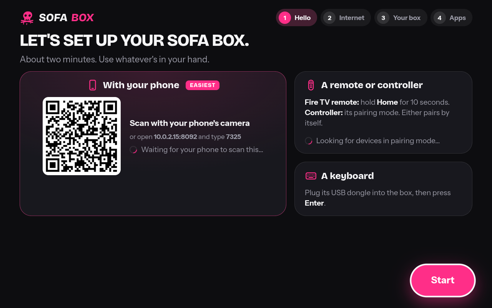

# Sofa Box OS on other hardware

Sofa Box OS was made for a Raspberry Pi 3 B+, 4 or 5. This guide is about everything else people have lying around:
an old PC or laptop, a mini PC, a virtual machine, and other single-board computers. It has five parts:

1. [What the box assumes about a Raspberry Pi](#1-what-the-box-assumes-about-a-raspberry-pi), and what a non-Pi needs instead.
2. [Plain Debian 13 on an x86-64 PC, a laptop or an arm64 board](#2-plain-debian-13-x86-64-and-arm64): how `install.sh` tells a Pi
   from the rest and what it does differently.
3. [The virtual-machine image](#3-the-virtual-machine-image-x86-64), built and booted on GitHub, and how to try it in UTM,
   VirtualBox, VMware, Proxmox, or from a USB stick on a real PC.
4. [Other boards](#4-other-boards): what the vendors' and distributions' documentation says, and what to support.
5. [Capabilities by platform](#5-capabilities-by-platform): one matrix, with only what is proven or read in the code marked as working.

Written 2026-11-10 against Sofa Box OS 1.1.60. The user's-side guide is `deploy/sofa-box/README.md` and `docs/capabilities.md`;
this is the engineering side.

## 1. What the box assumes about a Raspberry Pi

Read in `deploy/sofa-box/install.sh`, `sofa-box`, `sofa-box-agent.py`, `boxos.py`, `sofa-box-cec.py`, `home/home.js`,
`tools/build-sofa-box-image.sh` and the box README. "Where" names the file and the function or step.

| Assumption | Where | What a non-Pi needs instead |
|---|---|---|
| The boot files `config.txt` and `cmdline.txt` on a FAT partition at `/boot/firmware` (or `/boot`): `dtoverlay=vc4-kms-v3d`, `disable_splash=1`, `dtparam=audio=off`, the quiet-boot words, `console=tty3`, and LCD-show undone | `install.sh` (`BOOT`, "Setting up the Raspberry Pi"), `sofa-box setup-boot`, `sofa-box doctor` (`boot_dir`) | A PC boots with GRUB: the same kernel words go in `GRUB_CMDLINE_LINUX_DEFAULT` (the VM image does that; on an existing Debian they are the owner's to add). No `config.txt`: `install.sh` already skips the step when none is found, and `doctor` only looks for one on a Pi. |
| `vcgencmd get_throttled` and `measure_temp`: the power and heat record behind Home's note, Settings → Help and the report | `sofa-box-agent.py` `watch_power`/`power_note`, `sofa-box doctor`/`report`, `home.js` `powerLine` | Nothing has that record. The agent's watch returns on the first failed call, `box_info()["power"]` stays `None`, Home draws no note and Help no card; `doctor` skips the block. Checked by `tests/test_box_other_hardware.py`. Temperature comes from `/sys/class/thermal/thermal_zone0` where there is one, else "?" in About. |
| Raspberry Pi's apt archive and its packages: `libwidevinecdm0` (DRM), the Pi-built Chromium with V4L2 decoding, `raspi-firmware`/`rpi-eeprom`, `raspberrypi-sys-mods`, `userconf-pi`, `cloud-init` seeded by Raspberry Pi Imager | `install.sh` (`apt-get install libwidevinecdm0 \|\| true`, the `cloud-final` drop-in), `sofa-box own-screen`, `build-sofa-box-image.sh` | Debian's own `chromium`, `mpv`, `ffmpeg`, `cage`, `pipewire-pulse`, `network-manager`, `luanti`, `systemd-zram-generator` are all in Debian 13 and the same `apt-get` lines install them. No `libwidevinecdm0` (the line already tolerates its absence): Widevine on x86-64 comes from Google Chrome's package through `sudo sofa-box widevine`; on arm64 Debian offers `widevine-installer` only in trixie-backports (contrib). No `cloud-init`/`userconf-pi`: the drop-in and `own-screen` are harmless with nothing to act on; the VM image makes its own users at build time. No firmware packages from Raspberry Pi: Debian's `firmware-*` from `non-free-firmware`, added by `other-hardware.sh` where apt has them. |
| Hardware video decoding is V4L2 memory-to-memory (`/dev/video10`, `hwdec=v4l2m2m-copy`) on a Pi 3, and `auto-safe` elsewhere; `slow_board()` means "a Pi 3 or older" | `sofa-box-agent.py` `board`, `slow_board`, `caps`, `Player.args`, `learn_mpv`; `sofa-box doctor` | Any other computer is `gen 0`: `hwdec=auto-safe`, which on Linux means VA-API (Intel, AMD) through `/dev/dri/renderD128`, or software. `other-hardware.sh` installs the VA-API drivers and Debian's Chromium gets `--enable-features=VaapiVideoDecodeLinuxGL` through `/etc/chromium.d/sofa-box`; `doctor` reads `vainfo`. HEVC, VP9 and 4K are offered to Sofa (`caps`) as for a Pi 4: on a PC without a decoder they play in software (see §2). |
| Raspberry Pi Imager's first-boot tools: `userconf-pi`'s `cancel-rename` turns a console login back on and the box takes the screen back; `rpi-resize` grows the card | `install.sh` (`sofa-box-first-start`, the `cloud-final` drop-in, the getty preset), `sofa-box own-screen`/`tune` | Nothing renames users on Debian; `own-screen` finds nothing to fix. Growing the disk: the VM image uses `systemd-repart` and `x-systemd.growfs` (untested beyond the build). |
| `raspi-config` is never called, but the Pi's `dphys-swapfile` is switched off and zram put in its place | `install.sh` "Tuning the system" | Debian has no `dphys-swapfile` (the `disable` is tolerated) and has `systemd-zram-generator`: the same lines work. |
| The Wi-Fi hotspot at setup (`nmcli device wifi hotspot`), with PMF disabled because the Pi's chip can't do it as an access point, and Wi-Fi switched on at every start because Raspberry Pi OS keeps it rfkilled until a country is set | `sofa-box-agent.py` `Network.start_hotspot`, `sofa-box wifi-on`/`tune` | Any Wi-Fi card NetworkManager can put in AP mode works the same way; a PC with no Wi-Fi (or a VM) gets `"This box's Wi-Fi isn't working"` in the setup and the hotspot watch gives up quietly (`Network.watch`). The rfkill and `WirelessEnabled` fixes are no-ops where nothing is blocked. |
| HDMI-CEC comes from the Pi's own HDMI (`/dev/cec0`, the `vc4` driver, `cec-ctl` from `v4l-utils`, `ir-keytable` to quiet the kernel's own keymap); the service restarts every 5 s until it finds an adapter | `sofa-box-cec.py` `adapter()`, `install.sh` (`sofa-box-cec.service`), `sofa-box tv-on`/`doctor` | PC graphics cards expose no CEC to Linux. A Pulse-Eight USB-CEC adapter does, through the kernel's `pulse8-cec` driver once `inputattach --pulse8-cec` binds its serial port: `other-hardware.sh` adds a udev rule and a template unit for that, and a drop-in `ConditionPathExistsGlob=/dev/cec*` so the service waits instead of looping. Some Intel NUCs have CEC headers served by third-party adapters, not by the kernel. |
| Bluetooth through the Pi's combined Wi-Fi/Bluetooth chip, one aerial: discovery paused around a Wi-Fi join (`Bluetooth.pause`) | `sofa-box-agent.py` `Bluetooth`, `PairingHelper`; `sofa-box pair-controller` | Any BlueZ adapter works the same (`bluetoothctl`); a PC without one gets "no Bluetooth tools here" paths that already exist. The pause is harmless on separate chips. |
| The `pi` user (uid 1000) for SSH, and `sofabox` running the TV; `SOFA_BOX_USER` picks the latter | `build-sofa-box-image.sh`, `install.sh` (`WHO`) | The PC image makes `sofa` (uid 1000, sudo, no password, as on the card; `--password` gives a test build one) and `sofabox`; on an existing Debian the person who runs `sudo sh install.sh` is the box's user, as on a Pi set up by hand. |
| zram sized to half the memory, swappiness 100, the dirty ratios of a slow SD card | `install.sh` "Tuning the system" | The same settings do no harm on an SSD; nothing is changed. |
| The home page reads Pi-only state through the agent, never directly: `data.power` (Home's note, Help's card), `board.gen` ("Needs a Raspberry Pi N" on a game that needs one), "Built on Raspberry Pi OS" in About | `home.js` `powerLine`, `gameLine`, the About card | `power` is `null` on a non-Pi (no note); a game's `fits` is true for `gen 0`; About now says what `/etc/os-release` says (`box_info()["os"]`, e.g. "Debian GNU/Linux 13 (trixie)"). No other Pi-only endpoint exists in `home.js` or `inject.js`. |
| The user agent claims `Linux aarch64` | `boxos.py` `UA` | Left as it is: it is the TV-site user agent sites see, not a hardware fact, and changing it would change what the DRM and TV sites serve on the Pi. |
| The card is built by loop-mounting Raspberry Pi OS Lite and running `install.sh --image` in a chroot on an Arm runner | `tools/build-sofa-box-image.sh`, `.github/workflows/sofa-box-image.yml` | The x86-64 image is built by `tools/build-sofa-box-vm-image.sh` from `mmdebstrap` and GRUB, with the very same `install.sh --image` call (§3). |

## 2. Plain Debian 13, x86-64 and arm64

### How `install.sh` tells a Pi from the rest

`install.sh` sets `OTHER=1` unless it finds a Raspberry Pi: `config.txt` in `/boot/firmware` or `/boot`, "Raspberry Pi"
in `/proc/device-tree/model`, Raspberry Pi OS's apt list `/etc/apt/sources.list.d/raspi.list`, or its tools
(`userconf-pi`, `raspberrypi-sys-mods`, `vcgencmd`). A card being built in a chroot has no `/proc/device-tree` of its own,
but has the apt list, so it counts as a Pi before its boot files are in place (the `rpi-image-gen` prototype's chroot too).
`SOFA_BOX_HARDWARE=pi` or `=other` overrides it.

On a Pi nothing changes: every new line is inside one `if [ -n "$OTHER" ]` block, which runs
`deploy/sofa-box/other-hardware.sh`. The test `tests/test_box_other_hardware.py` checks that the block is the only place
the script is called from, that no PC package name appears outside it, and that the decision goes the right way for each
of the signs above. The card's `tools/build-sofa-box-image.sh` is untouched. (The card's bytes still change with this
version, as with any: the box's own files on it are newer. The system a Pi gets, package for package and unit for unit,
is the same.)

### What `other-hardware.sh` does

Run as root after the box's files are in place, `--image` while an image is built (nothing is started):

- **VA-API decoding:** `vainfo`, `libva-drm2`, `libva-wayland2`, `mesa-va-drivers` (AMD), and on amd64
  `intel-media-va-driver` (Intel Broadwell, 2014, and newer) and `i965-va-driver` (Sandy Bridge, 2011, to Broadwell).
  Each package on its own, so a name Debian lacks on arm64 stops nothing. mpv picks VA-API by itself (`hwdec=auto-safe`
  on any non-Pi). Debian's `/usr/bin/chromium` reads `/etc/chromium.d/*`, so `/etc/chromium.d/sofa-box` adds
  `--enable-features=VaapiVideoDecodeLinuxGL,VaapiIgnoreDriverChecks --ignore-gpu-blocklist`. Without a decoder these flags
  change nothing.
- **Firmware:** when apt's sources have Debian's `non-free-firmware` component (Debian 13's own installer adds it),
  the `firmware-*` packages for Intel and Realtek and Atheros and Broadcom Wi-Fi, AMD and Intel graphics, and Intel laptop
  sound (`firmware-sof-signed`). Nothing is added to the sources; a system without the component gets a note.
- **HDMI-CEC only through an adapter:** `inputattach`, a udev rule that starts `sofa-box-pulse8@ttyACMn` for a Pulse-Eight
  USB-CEC adapter (USB id 2548:1001/1002), which loads `pulse8-cec` and binds the port so `/dev/cec0` appears, and a
  rule that starts `sofa-box-cec.service` when any `/dev/cec` appears. The service itself gets a drop-in
  `ConditionPathExistsGlob=/dev/cec*`, so a PC without one has it skipped instead of restarting every five seconds
  for ever. The Pi's unit file is unchanged.
- **Chromium's crash-reports folder:** Debian 13's Chromium (156.0.8078.79) dies the moment it starts when the user has
  no `~/.config/chromium/Crash Reports` yet. It starts its crash handler without a database folder, the handler quits
  (`chrome_crashpad_handler: --database is required` is the only message), and Chromium stops on a check that prints
  nothing (`trap int3` in the kernel log). Found with `strace` inside the VM image: `access("…/Crash Reports") =
  ENOENT`, the handler's exit, then `SIGTRAP`; headless, with and without the sandbox, with and without the GPU, all the
  same; with the empty folder in place everything runs. The script makes the folder for the box's user. It looks like
  a Debian packaging bug worth reporting (the owner's call); crash reports are never sent (the browser's rules).
- **A virtual machine draws with SwiftShader:** when `systemd-detect-virt --vm` says so, `/etc/chromium.d/sofa-box` adds
  `--use-gl=angle --use-angle=swiftshader --enable-unsafe-swiftshader`, Chromium's own software renderer, since a VM
  mostly has no OpenGL to give (no virgl, VirtualBox without 3D). A real PC keeps its graphics chip.
- **Widevine is not installed.** It is a separate, chosen step (below).

### Installing on an existing Debian 13 or Ubuntu

```bash
curl -fsSL https://raw.githubusercontent.com/krintoxi/sofa/main/deploy/sofa-box/install.sh | sudo sh
```

As on a Pi, from your own account. On a PC also: add `quiet splash loglevel=3 vt.global_cursor_default=0 console=tty3`
to `GRUB_CMDLINE_LINUX_DEFAULT` in `/etc/default/grub` and run `sudo update-grub` for the Pi-like quiet start (the VM
image comes with it). `sudo sofa-box doctor` then says what the graphics chip decodes and whether Widevine is in place.

### What an old laptop decodes in hardware, and what falls back to software

What VA-API offers depends on the graphics chip; `sofa-box doctor` prints the profiles `vainfo` reports. From Intel's
driver documentation ([intel/media-driver README](https://github.com/intel/media-driver), platform table, read 2026-11-10)
and Mesa's: 

| Graphics | H.264 1080p | HEVC | VP9 | AV1 | Note |
|---|---|---|---|---|---|
| Intel HD, Sandy Bridge to Haswell (2011-2013, `i965-va-driver`) | hardware | software | software | software | A 1080p H.264 film plays; HEVC from Sofa comes converted, or taxes the processor. |
| Intel Broadwell, Skylake (2014-2015, `intel-media-va-driver`) | hardware | 8-bit from Skylake | software | software | |
| Intel Kaby Lake to Comet Lake (2016-2020) | hardware | 8- and 10-bit | hardware | software | A typical office laptop of that age: everything but AV1. |
| Intel Tiger Lake and newer (2020-) | hardware | hardware | hardware | hardware | |
| AMD GCN with UVD 6 (Carrizo, 2015, and Polaris) to Vega (`mesa-va-drivers`) | hardware | 8-bit (10-bit from Polaris) | from Raven Ridge (2018) | software | |
| AMD RDNA 2 and newer, Ryzen 6000 and newer (2022-) | hardware | hardware | hardware | hardware | |
| Nvidia | software | software | software | software | No VA-API driver in Debian: everything on the processor. |
| A virtual machine (QEMU, UTM, VirtualBox, VMware) | software | software | software | software | No decoder is passed through; proven in the GitHub boot (`vainfo: 0 profiles`). |

Intel's free `intel-media-va-driver` build decodes H.264, HEVC and VP9; the `-non-free` build adds encoders and VC-1 and
isn't needed for the box. "Software" means mpv decodes on the processor: a dual-core from 2012 manages 1080p H.264 and
struggles with 1080p HEVC; anything with four cores from 2016 on plays 1080p HEVC in software. Chromium's own video
(the streaming sites, YouTube) follows the same table, in software without VA-API. The agent still tells Sofa the box
takes HEVC and 4K (`caps()` treats any non-Pi as a Pi 4 or better); if that proves too much for a given laptop, Settings →
Video quality → 1080 or 720 and `hwdec` are the owner's knobs, as on a Pi.

### Widevine, for the DRM apps

Debian's Chromium is built to load Widevine but doesn't ship it; Raspberry Pi OS ships `libwidevinecdm0`, which doesn't
exist outside Raspberry Pi's archive.

- **x86-64:** `sudo sofa-box widevine` downloads Google Chrome's own `.deb` (about 100 MB, from `dl.google.com`), takes
  its `WidevineCdm` folder and puts it where Chromium looks: `/usr/lib/chromium/WidevineCdm` and the box's browser
  profile at `WidevineCdm/<version>/` with the `latest-component-updated-widevine-cdm` hint, as Chromium's own component
  updater lays it out. The TV's screen restarts. Widevine is Google's, under
  [Google's terms](https://www.google.com/chrome/terms/), which is why it is a chosen step and never part of an image.
  **Untested on real hardware by this change**: it is the same layout the Arch and Debian communities use with vanilla
  Chromium; `chrome://components` in the box's browser says whether it loaded. Expect L3 (software) Widevine: 720p/1080p
  on most services, never 4K.
- **arm64 (a non-Pi board, a Mac VM):** Debian offers `widevine-installer` (contrib, arm64 only) in `trixie-backports`
  ([tracker.debian.org](https://tracker.debian.org/pkg/widevine-installer), 0.0~git20240811-3~bpo13+1, read 2026-11-10): it
  fetches the ChromeOS arm64 CDM and patches it for glibc, the Asahi Linux route. Untested with the box; Radxa's forum
  reports both successes and crashes with the same approach on ROCK 5
  ([forum.radxa.com](https://forum.radxa.com/t/lets-get-widevine-working/15391)). `sofa-box widevine` refuses on arm64
  and points here.
- **A Pi running plain Debian arm64** (not Raspberry Pi OS): the same as arm64 above; Raspberry Pi's archive can be added
  for `libwidevinecdm0`, untested with Debian's Chromium.

### The credits page

The box's credits (`home/credits.json`) list every package `install.sh` installs and a test enforces it. The packages
`other-hardware.sh` and the VM image add (`vainfo`, `libva-*`, `mesa-va-drivers`, `intel-media-va-driver`,
`i965-va-driver`, `inputattach`, the `firmware-*` set, `grub-*`, `systemd-repart`, `openssh-server`,
`qemu-guest-agent`, the microcode packages) are not yet credited there, because `credits.json` is being changed by the
licence pull request and this change doesn't touch it. **Follow-up:** add their lines once that lands (they are all free
software except the firmware and microcode, which are "not free software" like the Pi's).

## 3. The virtual-machine image (x86-64)

### What it is and how it is made

`tools/build-sofa-box-vm-image.sh` makes `sofa-box-os-<VERSION>-x86_64.img` (raw, 8 GB, sparse), `.qcow2.xz` and
`.img.xz`, with a report like the card's:

1. One GPT disk: a 1 MiB BIOS boot partition, a 256 MiB EFI system partition, and the root (type `root-x86-64`, so
   `systemd-repart` grows it to the disk at the first start; `x-systemd.growfs` grows the filesystem).
2. Debian 13 (Trixie) from `deb.debian.org` with `mmdebstrap` (`important` variant, `main contrib non-free-firmware`),
   the archive key checked: the host's keyring if it knows Trixie, else the `debian-archive-keyring` package pinned by
   URL and SHA-256 in `tools/debian-archive-keyring.txt` (GitHub's Ubuntu 24.04 runners don't know Trixie's key).
   Included: the kernel, GRUB for EFI and BIOS, `systemd-repart`, `openssh-server`, `qemu-guest-agent`, the firmware set.
3. In a chroot, **the very same line as the card's build**: `SOFA_BOX_USER=sofabox sh /tmp/sofa/deploy/sofa-box/install.sh --image`,
   with Sofa itself copied in for "This box". `install.sh` finds no Pi and runs `other-hardware.sh`.
4. GRUB: `grub-install --target=x86_64-efi --removable --no-nvram` (so any UEFI finds `EFI/BOOT/BOOTX64.EFI` with no
   NVRAM entry: VMs, USB sticks) and `grub-install --target=i386-pc` into the same disk; the Pi's quiet-boot words in
   `GRUB_CMDLINE_LINUX_DEFAULT`; Plymouth with the box's theme; `update-initramfs`.
5. Users: `sofa` (uid 1000, sudo) and `sofabox`, locked, which runs the TV. As on the Pi card, `sofa` has no password
   and SSH is off: the image goes on people's USB sticks, so it has no login anyone could know. A test build of your
   own can have one: `--password WORD` gives `sofa` that password (to be changed at the first login) and switches SSH
   on. SSH's host keys are made on each machine at its first start (never shared by copies of the image).
   `/etc/machine-id` is empty, so the first start is a first start (the boot screen says so).
6. The games whose data isn't free software are checked to be absent, as on a card; the package list goes in the report.

Nothing from a Pi: no `config.txt`, no `vcgencmd`, no Raspberry Pi archive.

### Built and booted on GitHub

`.github/workflows/sofa-box-vm.yml` (`ubuntu-24.04`, `permissions: contents: read`, on pushes to `other-hardware`
and by hand) installs `mmdebstrap`, QEMU and OVMF, opens `/dev/kvm` with the udev rule GitHub documents for its hosted
runners ([GitHub changelog, 2024-04-02](https://github.blog/changelog/2024-04-02-github-actions-hardware-accelerated-android-virtualization-now-available/);
GitHub calls nested virtualization unsupported but it works there), builds the image, then runs
`tools/boot-sofa-box-vm.sh` twice: **UEFI** (OVMF) and **BIOS**. Each boot:

- copies the image and makes two changes in the copy only: the kernel console on the serial port (`console=ttyS0`, the
  log is a file) and a oneshot service `sofa-box-vm-proof.service` running `tools/sofa-box-vm-proof.sh`;
- starts QEMU with 2 GB, 2 cores, `virtio-vga` with a VNC display nobody looks at (so the virtual screen has a
  connected output, 1280x800, for `cage` and Chromium), QEMU's monitor for a screenshot, and user-mode networking with
  the phone remote's port 8092 forwarded;
- the in-VM script waits for the box's helper on `127.0.0.1:8091` and prints `/box/api/info` (Sofa Box OS version, model
  "this computer", OS, `gen 0`) and `/box/home` (200); asks `box.localhost:8091/api/info`, which makes the helper start
  Sofa on the box, and prints Sofa's own `127.0.0.1:8095/api/info`; waits for `sofa-box.service` active, `cage` running and
  Chromium's DevTools port answering; prints the services, the CEC condition (skipped: no `/dev/cec`), `vainfo` (0 profiles),
  `sofa-box doctor`'s ticks, then `SOFA-BOX-PROOF done` and powers the VM off;
- the host meanwhile asks the phone remote through the forwarded port, like a phone on the home network would, and
  takes a screenshot of the VM's screen (`screendump`) once the in-VM script has reported on the screen;
- the step fails unless every `SOFA-BOX-PROOF` line is ok, `done` was printed, and the remote answered from outside.

What the first boots found, fixed on the way (the runs are on the pull request): the proof unit was ordered after the
target that wanted it (an ordering cycle); `/box/api/info` takes longer than 5 s on a box with no Bluetooth adapter
(`bluetoothctl`'s 5 s wait, so the proof waits 40 s); and Debian's Chromium 156 dying at its start without its
`Crash Reports` folder (§2), which took the image booted on this Mac under QEMU's emulation, the box's `sofa` user
over SSH and `strace` to see. The setup screen of that locally booted copy of the GitHub-built image:



The run's artifact `sofa-box-vm` (kept a week) holds `sofa-box-os-<VERSION>-x86_64.qcow2.xz`, `.img.xz`, the `.sha256`,
the report, `console-uefi.log` and `console-bios.log`, and `screen-uefi.png` and `screen-bios.png`. The job summary shows the report and the proof lines. **No
release is made**: the image is a run artifact only, the owner says if and when it is published.

### Trying it

Unpack the `.qcow2.xz` (`xz -d`, or 7-Zip on Windows). The VM wants 2 GB of memory and 2 cores at least, and a network
adapter; the first start takes a minute or two and restarts once. The TV's screen is the VM's display; the phone remote
is reached at the VM's address on port 8092 (the setup shows the QR code), so give the VM a **bridged** network adapter
if phones are to reach it, or forward port 8092.

- **UTM on a Mac (Apple Silicon or Intel):** File → New → Emulate (the image is x86-64; on Apple Silicon it runs under
  QEMU's emulation, slowly: the home screen is usable, video is not; it is a way to look, not to watch) → Other →
  skip ISO, then in the VM's settings remove the new drive and **Import** the unpacked `.qcow2` as a VirtIO drive;
  Display: `virtio-vga`; Network: Bridged. UTM boots UEFI by default and the image boots that way. On an Intel Mac, UTM's
  "Virtualize" runs it at full speed.
- **VirtualBox on Windows (or Linux, Mac):** VirtualBox doesn't take qcow2 well. Convert the raw image instead:
  unpack `.img.xz`, then `VBoxManage convertfromraw sofa-box-os-<VERSION>-x86_64.img sofabox.vdi --format VDI`
  ([VBoxManage manual](https://www.virtualbox.org/manual/ch08.html), read 2026-11-10). New VM: Linux, Debian (64-bit),
  2048 MB, use the existing `sofabox.vdi`; System → Enable EFI (either works: the image boots BIOS and UEFI; EFI gives
  the box's full-size boot screen); Display → VMSVGA, 128 MB; Audio on; Network → Bridged. VMDK: the same command with
  `--format VMDK`.
- **VMware (Workstation, Fusion, ESXi):** convert to VMDK with `qemu-img convert -O vmdk -o subformat=streamOptimized`
  from the qcow2, or `VBoxManage convertfromraw … --format VMDK` from the raw image, and add it to a new "other Linux
  6.x 64-bit" VM.
- **Proxmox:** `qm importdisk <vmid> sofa-box-os-<VERSION>-x86_64.qcow2 <storage>`, attach it as `virtio0` (or `scsi0`),
  set it as the boot disk; SeaBIOS (default) or OVMF both boot it; add a `virtio-gpu` display, an audio device
  (`ich9-intel-hda`), and `virtio` networking on the home bridge. `qemu-guest-agent` is on the image.
- **QEMU by hand:** what the workflow does, with a display:
  `qemu-system-x86_64 -accel kvm -m 2048 -smp 2 -device virtio-vga-gl -display gtk,gl=on -drive file=sofabox.qcow2,if=virtio -nic bridge,br=br0 -device intel-hda -device hda-output`.

What a VM can and can't do is in the matrix (§5): no hardware decoding, no HDMI-CEC, no Bluetooth or Wi-Fi unless the
host passes an adapter through, no DRM apps unless `sofa-box widevine` is run inside it (then L3, untested).

### A USB stick, a real PC

**The same image boots a real PC, and it's published for that.** The card workflow builds it beside every card (job
`pc` in `.github/workflows/sofa-box-image.yml`, 4 GB, `--size 4G`) and puts it on the same releases:
`sofa-box-pc.img.xz` on `sofa-box` (the newest) and `sofa-box-os-X.Y.Z-pc.img.xz` on each version's own. Before that,
GitHub starts it in QEMU on a 16 GB stick with UEFI (and checks the root grew to fill it), with BIOS, and with Secure
Boot on and Microsoft's keys enrolled (OVMF's `secboot` code and `ms` variables), and nothing is published unless all
three pass. It's a whole disk with GRUB for BIOS and for UEFI (removable path), with Debian's signed boot chain (the
Microsoft-signed `shim`, Debian's signed GRUB and kernel), so it starts most PCs as they come, Secure Boot on or off,
and the root grows to the stick at the first start. Write it with Sofa Box Imager (**For a PC**), Raspberry Pi Imager
(our list's device **A PC, from a USB stick**, or "Use custom"), balenaEtcher or `dd`; on Windows Rufus in **DD
mode**. Kernel lockdown is on under Secure Boot (Debian's); nothing the box does needs what it closes. The stick is
slow: a USB 3 SSD in a case is a better "stick", and a PC that will live under the TV is better off with it on its own
drive. Nothing different is needed for a USB stick; what is **untested** is the firmware and the decoding on any given
laptop, which only that laptop can tell (`sofa-box doctor`).

**Installed from the stick onto the PC's own drive** (since 1.1.84): Settings → This box → **Install on this
computer**, shown only on a PC running from a USB stick (`boxos.install_disks()`: the root's disk is on USB or
removable; x86-64; no device tree). The TV lists the PC's other whole drives (never the stick; not a disc drive,
zram or a loop file), biggest first, each with what's on it by label or filesystem, and why not where it can't go
(read-only, in use, under 7.5 GB or what's on the stick and 2 GB). A drive is said twice by name before anything
happens; the agent starts `sofa-box install-to-disk DEV --yes` (sudo, as its own service) only for a drive exactly as
it was listed (path, serial, size). The installer checks it all again, then, in a mount namespace of its own: the
stick's layout (GPT: a 1 MiB BIOS part, a 256 MiB EFI system partition, the root to the end), new filesystems (new
UUIDs: the stick still starts on its own), a copy of the running root from a read-only private bind of `/` (the root's
own files only, nothing mounted on it), the stick's EFI files, `fstab` with the new UUIDs, then in a chroot GRUB for
UEFI by the removable path with Secure Boot's shim, an entry in the PC's own start list where the firmware takes one
(`efibootmgr`), GRUB for BIOS, and `update-grub`. It writes `/etc/sofa-box-installed` on the drive (About shows it)
and `/etc/sofa-box-installed-onto` on the stick (Settings then says it's done). Progress: `/run/sofa-box-install.json`;
Files leaves the drive alone while it's written. GitHub proves it on every PC image: the image as a USB stick (xHCI)
beside a blank 16 GB drive, installed through `/box/api/install` as the TV does it, then the PC started from that drive
alone with Secure Boot on and with BIOS, each with the usual checks and that the root is the drive's and fills it.

**A live DVD** (since 1.1.85): `tools/build-sofa-box-dvd.sh` makes it from the PC image in the same job, the
image's root as it is in a squashfs (`/live/filesystem.squashfs`, zstd), the image's signed kernel, and a start of its
own with Debian's live-boot (`/live/initrd.img`, made in a throwaway overlay, so the system on the disc has no
live-boot and a drive installed from it is the same as one installed from the stick). live-boot finds the disc,
puts the system together in memory (overlayfs over the squashfs) and leaves `/etc/fstab` alone (`nofstab`); the
image's parts for a disk are switched off for that start (`systemd.mask=boot-efi.mount`, `systemd-repart`,
`systemd-growfs-root`, `systemd-remount-fs`; the EFI partition is `nofail` anyway). It starts by UEFI (the El Torito EFI image holds shim
and Debian's signed GRUB for a disc, `gcdx64.efi.signed`, which finds the disc by `/.disk/info`: Secure Boot on or off)
and by BIOS (GRUB's El Torito image), and it's a hybrid (GRUB's MBR, the EFI image as a partition), so the same file
written to a USB stick starts too. GitHub starts it as a disc (QEMU's IDE CD drive) with Secure Boot on and with
BIOS, then installs from it onto a blank drive and starts that drive; the test's own files go on a copy of the disc
as a layer of their own (`/live/zz-proof.squashfs`, which live-boot puts over the system). Install on this computer
from the DVD copies the system put together in memory (the disc's `filesystem.size` is what it copies); the DVD
drive, and a stick holding the disc's file, are never offered. Sofa Box Imager burns it with `hdiutil burn`.

A mini PC (NUC-class, the Beelink/Minisforum kind) is a PC: start it from the stick, then Install on this computer.
Debian's own installer and `install.sh` (§2) still work too. Intel's or AMD's VA-API covers them (table above).

## 4. Other boards

Assessed from the vendors' and distributions' documentation, without buying anything; read 2026-11-10 unless dated
otherwise. "Debian" means Debian's own installer and kernel; "Armbian" means Armbian's images on Debian 13 with its
own kernel. Hardware decode "mainline" means the upstream kernel's V4L2 driver that Debian's or Armbian's `mpv`
and `ffmpeg` can use without vendor patches. Prices are what the sources gave on that day and move with tariffs
and memory prices (cnx-software compared 2024 and 2026 prices on 2026-04-28 and found most boards dearer).

| Board | SoC | Debian / Armbian | Hardware video decode in mainline | Widevine | HDMI-CEC | Price | Verdict |
|---|---|---|---|---|---|---|---|
| Orange Pi 5 (and 5B/5 Plus) | Rockchip RK3588S/RK3588 | Armbian **Standard**, maintainer named, kernels 6.18 (current) and 6.1 vendor, Debian 13 images ([armbian.com/orangepi5](https://www.armbian.com/orangepi5/)). Debian's own 6.12 kernel boots it (debian-kernel list, 2025-10) but not the GPU/VPU. | H.264 and HEVC decoders (VDPU381) **merged upstream February 2026**, in Linux 7.0 by reports ([cnx-software, 2026-02-27](https://www.cnx-software.com/2026/02/27/rockchip-rk3588-rk3576-h-264-and-h-265-video-decoders-mainline-linux/)); VP9 and AV1 not upstream. Debian 13's 6.12 and Armbian's 6.18 don't have it; the vendor 6.1 kernel decodes everything with Rockchip's `mpp`, not through standard mpv. | No Pi-style package; the arm64 ChromeOS CDM route (`widevine-installer`), reports mixed. | RK3588 has a CEC controller; works on the vendor kernel, status in mainline unverified. | 8 GB about $80-90 in 2025 lists; 5B 16 GB rose from $160 to $312 by April 2026 ([cnx-software, 2026-04-28](https://www.cnx-software.com/2026/04/28/what-a-difference-two-years-make-comparing-sbc-prices-in-2024-and-2026/)). | **The best second board after the PC**, once a kernel with the upstream decoder reaches Armbian's `current` (Linux 7.0+). Until then: community, untested. |
| Orange Pi 3B | Rockchip RK3566 | Armbian **Community maintained** (untested images, no fixes promised) ([armbian.com/orangepi3b](https://www.armbian.com/orangepi3b/)). Not in Debian's installer. | RK3566's Hantro H.264 and rkvdec HEVC/VP9 are in mainline (the Pine64/Quartz64 work, 5.x-6.x); untested with the box. | As above. | RK3566 has CEC; unverified in mainline. | About $35-60 bracket (2026 round-ups). | Community, untested: Pi 3-class speed without the Pi's support. |
| Radxa ROCK 5B (5B+, 5A, 5C) | Rockchip RK3588 | Armbian **Standard**, two maintainers, Debian 13 images ([armbian.com/rock-5b](https://www.armbian.com/rock-5b/)); Radxa's own Debian images use the vendor kernel. | As Orange Pi 5. | As Orange Pi 5; Radxa's forum thread is the reference for the ChromeOS-CDM route. | As Orange Pi 5. | 5B+ 8 GB $189-250 and often out of stock in 2026 ([cnx-software, 2026-04-28](https://www.cnx-software.com/2026/04/28/what-a-difference-two-years-make-comparing-sbc-prices-in-2024-and-2026/)). | Same verdict as the Orange Pi 5, dearer; the 5C ($60-ish class) is the one to watch. |
| Radxa ZERO 3W / 3E | Rockchip RK3566 | Armbian **Standard**, Debian 13 images ([armbian.com/radxa-zero-3](https://www.armbian.com/radxa-zero-3/)). | As Orange Pi 3B. | As above. | Micro-HDMI; CEC unverified. | From $25.95 (Ameridroid, 2026 listing). | A Pi Zero 2-class box: community, untested, and only 1080p. |
| Libre Computer Le Potato (AML-S905X-CC), Sweet Potato, La Frite | Amlogic S905X / S805X | Armbian **Standard** (Le Potato: maintainer named, Debian 13 images, mainline 6.18 only) ([armbian.com/lepotato](https://www.armbian.com/lepotato/)); Libre Computer's own Debian/Ubuntu images are upstream-based (their stated policy since 2017: they sponsored S905X mainline work, [cnx-software 2018](https://www.cnx-software.com/2018/10/12/la-frite-amlogic-s805x-board-mainline-linux/)). | Amlogic's `meson-vdec` is in mainline: H.264 and MPEG-2 (stateful V4L2); HEVC and VP9 never finished upstream. 2 GB memory. | None. | Yes in hardware (`meson-ao-cec` in mainline; Le Potato has a CEC jumper). | $35 class (2 GB) at Libre Computer's partners (2025 lists; not re-checked today, their shop blocked the fetch). | Honest, cheap, well-supported in mainline, but H.264 only in hardware and 2 GB: community, untested; a candidate for a "light" tier if anyone asks. |
| Libre Computer Alta (AML-A311D-CC), Solitude (AML-S905D3-CC) | Amlogic A311D / S905D3 | Shipped with Debian 12 and a 6.1 kernel; Armbian pages not found for them. | Same `meson-vdec` state (H.264). | None. | Yes (Amlogic CEC). | $55-60 class (launch coverage, [notebookcheck](https://www.notebookcheck.net/Libre-Computer-Alta-launches-as-a-powerful-low-cost-SBC.764288.0.html)). | Community, untested. |
| Banana Pi M5 (and M2 Pro) | Amlogic S905X3 | Armbian **Standard** ([armbian.com/bananapi-m5](https://www.armbian.com/bananapi-m5/)), mainline 6.18, Debian 13 images. Not in Debian's installer. | `meson-vdec`: H.264 in hardware; HEVC/VP9 software. 4 GB memory. | None. | Yes (Amlogic). | About $50-70 (2026 round-ups). | Community, untested; the most capable of the Amlogic set. |
| Old Android TV boxes (Amlogic S905/S905X/S905X3/S922X "X96", "H96", Tanix…) | Amlogic | **Not supported by Armbian**: community builds only (ophub's `amlogic-s9xxx-armbian`, Armbian's "TV boxes" forum: no quality control, boards vary within one model name) ([forum.armbian.com](https://forum.armbian.com/forum/59-tv-boxes-running-armbian/)). | `meson-vdec` H.264 where the device tree matches; often HDMI or Wi-Fi don't work. | None. | Sometimes. | $0 (already owned) to $30. | **Leave out**: "community, untested" and say so plainly; the Pi 3 B+ is the better free box. |
| Intel NUC-class mini PCs (NUC 7-13, Beelink, Minisforum; used from 2015) | Intel Core / Celeron / N-series, AMD Ryzen | **Plain Debian 13, x86-64: this change's path.** | VA-API through `intel-media-va-driver` or Mesa, per the §2 table: HEVC and VP9 from about 2016, AV1 from 2020 (Intel) / 2022 (AMD). | `sofa-box widevine` (Chrome's CDM, L3). | No (a Pulse-Eight USB adapter, $40-50, adds it). | Used NUC 7/8 i3 about $80-150; new N100 mini PCs about $120-180 (2026 listings; prices move). | **Support officially after the Pi**: the x86-64 path and the VM image are the same system, and the QEMU boot proves the software; a real NUC is the one hardware test still to do (an owner with one: `sofa-box doctor` and a report). |
| Apple Silicon Mac under UTM | Apple M1-M4 | An arm64 Debian 13 VM with Apple Virtualization or QEMU: `install.sh` on it takes the arm64 non-Pi path (same as any arm64 Debian). The x86-64 image runs only under emulation (slow). | None (no GPU video decode is passed to a VM; `virtio-gpu-gl` gives OpenGL only). | arm64 route (`widevine-installer`), untested. | No. | The Mac you have. | A way to try the box on a Mac, not a TV box: community, untested. UTM's own Debian guide covers the arm64 VM and Rosetta ([docs.getutm.app](https://docs.getutm.app/guides/debian/)). |

**Recommendation.** After the Pi: the **x86-64 PC** (an old laptop, a NUC-class mini PC, a VM) as the second official
platform, because it needs no vendor kernel, decodes in hardware on anything from the last ten years, and this change
proves its software on GitHub. Then the **RK3588 boards (Orange Pi 5, ROCK 5)** as the third, *when* Armbian's `current`
kernel carries the upstream decoder (Linux 7.0 or later); until then, and for every Amlogic board, the Zero 3, the
Orange Pi 3B and TV boxes: "community, untested", documented honestly, with `install.sh`'s non-Pi path open to them.
Armbian's "Standard" tier means a named maintainer and tested images; "Community maintained" means images nobody tests
([Armbian's support rules](https://docs.armbian.com/contribute/board-support-rules/)): the former is a precondition for
anything we call supported.

## 5. Capabilities by platform

Only what is proven (the tests, the GitHub QEMU boot) or read in the code is marked **Works**; what the code has but no
test or boot of this change exercised is **Untested**. The Pi columns say what the code does on that board as the tests
cover it; the owner's Pi 3 B+ is the only real Pi the project has tested on so far, and the stable channel is the
record of that. "PC" is an x86-64 laptop, desktop or mini PC on plain Debian 13 through `install.sh`; "VM" is the image
of §3 in QEMU as GitHub boots it (no decoder, no Wi-Fi, no Bluetooth, no HDMI).

| Capability | Pi 3 B+ | Pi 4 | Pi 5 | x86-64 PC | VM | Note |
|---|---|---|---|---|---|---|
| Home screen (the box's own, in cage + Chromium) | Works | Works | Works | Untested | Works | VM: proven (`/box/home` 200, cage up, DevTools answers, the setup screen in the screenshot). PC: the same packages, no real PC booted by this change. |
| Sofa (a Sofa at home, a share link, Jellyfin/Emby/Plex) | Works | Works | Works | Untested | Works | VM: Sofa on the box answers `/api/info` and through the helper; a remote Sofa needs a network the test VM hasn't got. |
| Sofa on this box ("This box") | Works | Works | Works | Untested | Works | VM: started by the helper on first visit, proven. |
| Live TV | Works | Works | Works | Untested | Partly | Plays through mpv; in a VM in software only, and the test VM has no internet. |
| Streaming apps without DRM (YouTube, web apps) | Works | Works | Works | Untested | Untested | Needs internet; the proof VM is offline. Software video in a VM. |
| Streaming apps with DRM (Netflix, Disney+…) | Partly | Works | Works | Untested | Untested | Pi 3: the README says a service may refuse or stutter. PC/VM: only after `sudo sofa-box widevine` (L3), not exercised. |
| Games, the box's own pages | Works | Works | Works | Untested | Untested | Chromium with software GL in a VM: they load; speed unmeasured. |
| Games, native (Luanti, and the ones installed on request) | Works | Works | Works | Untested | Untested | `luanti` installs from Debian on any arch; the GPU check (`/box/games/probe/`) decides the rest. |
| Phone remote (QR code, port 8092, the secure relay) | Works | Works | Works | Untested | Works | VM: answered from outside the VM through the forwarded port (`SOFA-BOX-PROOF outside`). |
| Controllers (USB, Bluetooth; `sofa-box-input`) | Works | Works | Works | Untested | Partly | The service runs in the VM (proven active); a controller needs USB passthrough. |
| HDMI-CEC (the TV's remote) | Works | Works | Works | Partly | No | PC: only with a Pulse-Eight USB adapter (udev + `pulse8-cec`, untested with a real adapter). VM: the service is skipped by its condition, proven. |
| Bluetooth (controllers, remotes) | Works | Works | Works | Untested | No | Any BlueZ adapter; the VM has none. |
| USB drives (Files, Sofa on this box) | Works | Works | Works | Untested | Untested | `udisks2` and the polkit rule are arch-neutral. |
| DVD, Blu-ray, music CD | Works | Works | Works | Untested | Untested | A USB drive on a PC is the same path (`libdvdnav`/`libbluray` come with mpv). |
| Wi-Fi hotspot setup (the box's own Wi-Fi) | Works | Works | Works | Untested | No | Needs a Wi-Fi card that does AP mode; a VM has none and the setup says so (`Network.start_hotspot`). |
| Wi-Fi, from the TV | Works | Works | Works | Untested | No | NetworkManager; a laptop's card needs its firmware (`other-hardware.sh`). |
| Boot screen (Plymouth, the box's theme) | Works | Works | Works | Untested | Untested | The image sets the theme and `splash`; the proof boot disables Plymouth to keep the serial log. |
| Power and heat note | Works | Works | Works | No | No | `vcgencmd` only; nothing shown elsewhere, by design (proven: `power` is null). |
| Hardware video decoding | Works (H.264, V4L2) | Works | Works | Partly | No | PC: VA-API per the §2 table, read from vendor docs, not run. VM: `vainfo` 0 profiles, proven. |
| Updates (`sofa-box update`, the stable/testing channel, the weekly update) | Works | Works | Works | Untested | Untested | The same code: it downloads that version's `install.sh`, which takes the non-Pi path again. Not run on a PC. |
| Sofa Shield (ad blocking) | Works | Works | Works | Untested | Untested | `/etc/hosts`, arch-neutral; the image build fetches the list when it has network. |
| Send a report | Works | Works | Works | Untested | Untested | `report` skips the `vcgencmd` lines when there is none. |
| First start (grows the disk, makes keys) | Works | Works | Works | Untested | Partly | VM: SSH keys and `machine-id` at first boot proven by the boot; the partition growth needs a bigger disk than the test gives it. |

How to move a cell from Untested to Works: boot the thing, run `sudo sofa-box doctor`, use the capability, and send a
report (Settings → Help); or, for the PC, a GitHub runner with a real GPU, which there isn't.
