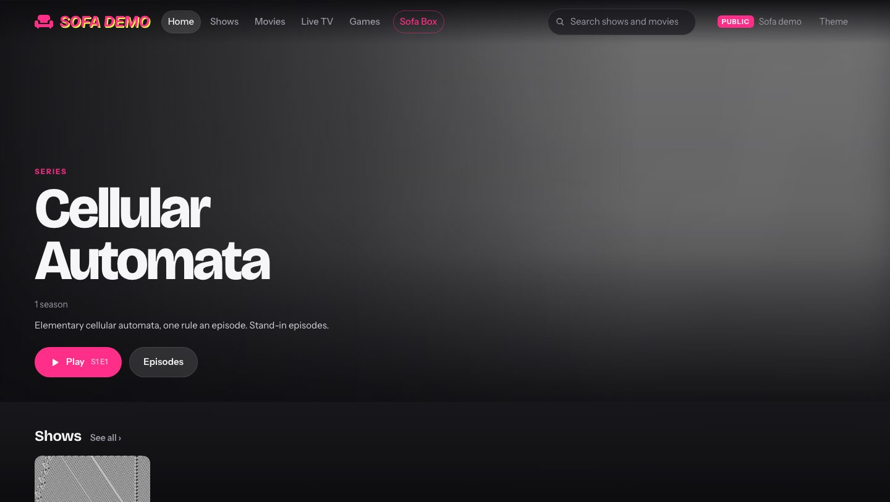
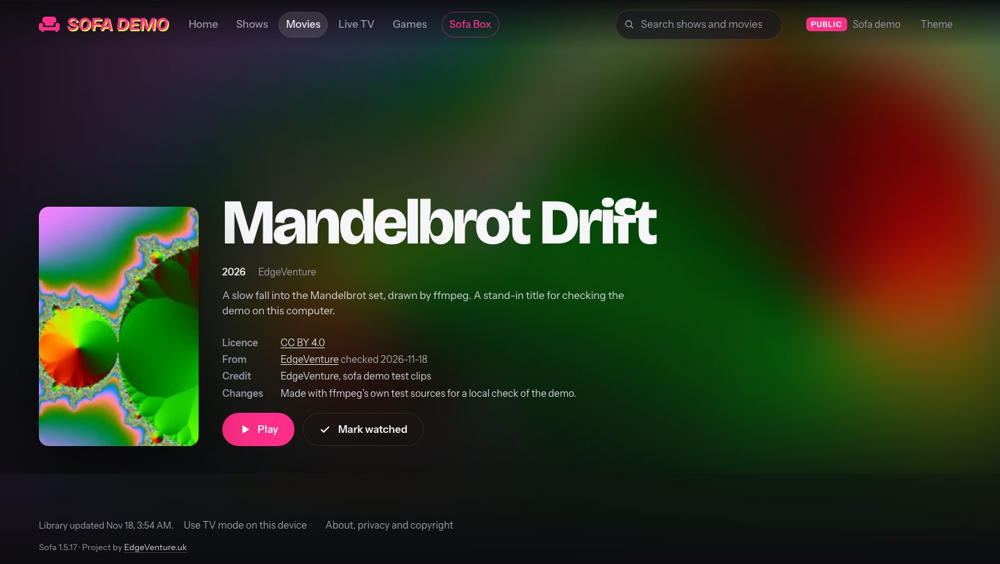
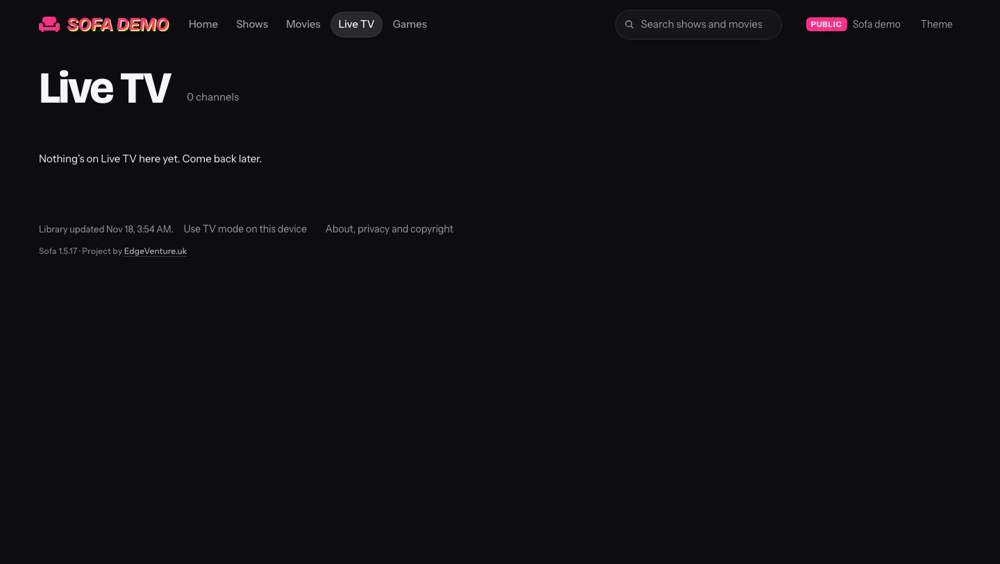
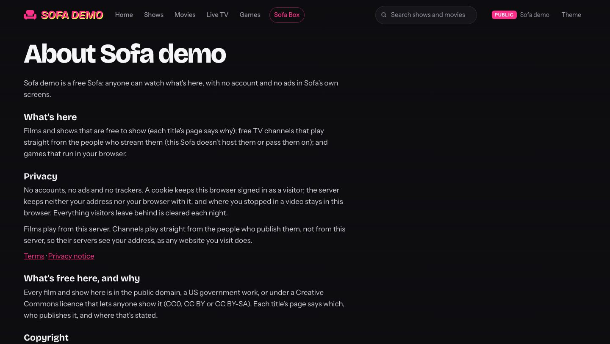
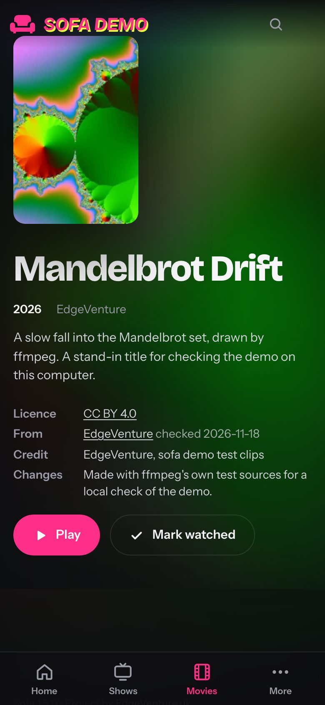

# The public demo

A Sofa anyone can open without installing anything: a free library, Live TV from a short checked list, and the
games, with no account, no ads and no trackers. It runs as **its own instance**, never a household's Sofa, and the
planned address is `sofa.edgeventure.uk`.

Status: built and tested in Sofa 1.5.17 (`sofa/demo.py`, `sofa/rights.py`, `tools/demo-seed.py`,
`deploy/demo/`). It has run as a scratch instance on a Mac, on 127.0.0.1 only. **It isn't hosted anywhere yet**:
the steps under [Before it goes public](#before-it-goes-public) come first.

| | |
|---|---|
|  |  |
|  |  |

(The titles in these pictures are stand-ins we made with ffmpeg's test sources for the local check, each with a CC0
or CC BY record of its own. The demo's real library is the one in `deploy/demo/library.json`.)

## Where it runs

Decide this first; the rest follows from it.

- **Its own machine or VM, its own data.** Never the household's Sofa, its computer, or the Sofa Box service.
- **Its own Cloudflare account,** not the one that carries `boxcert.edgeventure.uk` (every box's secure phone remote
  goes through that one). If something on the demo drew a complaint, that account could be closed, and the boxes'
  remote with it.
- **No video through Cloudflare.** Cloudflare's terms (updated 2026-09-28) bar serving video below the Enterprise
  plan except through its paid video products, and a tunnel's public hostname is covered. So by default the demo's
  server sends no video at all:
  - each title plays **from its publisher's own address** (`play_url` in its record: Wikimedia Commons for the ones
    we picked), straight into the visitor's browser;
  - each channel plays **straight from its broadcaster**, never through the relay;
  - the tunnel carries only the pages, the pictures and the app's JSON.

  `demo_serve_files` lets the demo play its own copies instead. Turn it on only on a host where that's allowed
  (a server of your own with no Cloudflare proxy in front, for instance).
- **The address.** A hostname lives in the Cloudflare account that holds its zone. If `edgeventure.uk` is in the
  same account as `boxcert`, then `sofa.edgeventure.uk` can't be in a different one by itself. Check which account
  holds the zone, and what your plan allows for a subdomain elsewhere. If it can't move, use another domain on the
  demo's own account. We haven't checked this.
- **Wikimedia's servers.** Playing their copies from another site is allowed and common, and they answer with the
  CORS and range headers a player needs (checked 2026-11-18). If the demo gets busy, host copies somewhere video is
  allowed rather than lean on theirs.

## What the switch locks

`SOFA_DEMO=1` in the environment (the compose file sets it) or `"demo": true` in config.json. With it on:

| Area | What the code does | Where |
|---|---|---|
| **Nobody is at home** | Every request counts as the internet, whatever address it comes from. On Docker's own network a tunnel's container looks like the home network; here it doesn't. So there's no admin, setup, sign-in, sign-up, guest, pairing or profile switching over the web, from anywhere, and the routes answer 404. Everyone is the public library's Visitor. | `web.Handler.network`, `demo_refuses` |
| **Settings** | Everything in `config.DEMO_LOCKED` reads as it's set there. config.json and the web can't change it. | `sofa/config.py` |
| **Library** | Only titles whose rights record passes. Each plays as it is: from its publisher, or from this server when `demo_serve_files` is on. No conversion, repackaging, HLS, travel copies, downloads, previews or scrubbing pictures. | `sharing.py`, `demo.title_ok`, `demo.play_plan` |
| **Live TV** | Only `channels.json`'s channels that pass `demo.channel_problems`: https, CORS checked, no made-up browser name or referrer, no FAST service, nothing geo-blocked, a publisher, its page and a rights note. Each plays from its publisher; the relay at `/live/` never answers. No lists added by hand, tuners, guides or channel checks from the server. | `live.py`, `demo.py` |
| **The decades and Classic Cinema** | Off: `retro_eras`, `archive_channels` and `share_cinema` are locked off, with `defaults_rev` 1. | `DEMO_LOCKED` |
| **Uploads, Inbox, downloads** | None. The Inbox isn't read, the admin routes are closed, and the library may be mounted read-only. | `organizer.process_inbox`, `demo_refuses` |
| **No accounts, ads or trackers** | A content policy on every page names no other site for scripts, styles, fonts or pictures. Only a channel's stream and a title's video come from other https addresses. A visitor's sign-in keeps neither the address nor the browser. | `DEMO_CSP`, `auth.start_session` |
| **Games** | Open to visitors with no account. Their own content policy lets them reach nothing but this server: no chat, and nowhere to send anything. | `DEMO_GAMES_CSP` |
| **Rate limits** | 900 requests a minute per visitor; 20 new visitor sign-ins an hour per address, 3,000 an hour for everyone. The container's own health check isn't counted. | `demo.LIMITS` |
| **Nightly reset** | At `demo_reset` (04:30): sign-ins idle an hour or more, and everything kept per person (places, likes, favourites, plays), the log, the tries and the rate limits are cleared. The channel list and the library are read again. | `demo.reset` |
| **Pages** | The Sofa Box link is off the Live TV page, and the box's page doesn't offer free Live TV on the demo. The footer doesn't mention an Inbox. The About page shows the terms, the privacy notice, why each thing is free, each channel's publisher and rights note, and where copyright notices go. | `client/app.js` |
| **Lookups** | Off (TVmaze, the iTunes Store and Wikipedia, TMDB), so a free film never gets a copyrighted poster. Pictures come from the video itself. | `DEMO_LOCKED`, `tools/demo-seed.py` |

`tests/test_public_demo.py` fails if any of these breaks.

## The free library

A title gets in only with a **rights record** that passes `sofa/rights.py`. The record is
`<video name>.rights.json` next to the video, or `rights.json` in a show's folder for every episode without its own:

```json
{
  "licence": "CC BY 3.0",
  "licence_url": "https://creativecommons.org/licenses/by/3.0/",
  "publisher": "Blender Foundation",
  "source": "https://commons.wikimedia.org/wiki/File:Big_Buck_Bunny_4K.webm",
  "checked": "2026-11-18",
  "credit": "(c) copyright Blender Foundation | www.bigbuckbunny.org",
  "changes": "Played from Wikimedia Commons' 720p VP9 copy of the original 4K file, re-encoded by Wikimedia; nothing else changed.",
  "play_url": "https://upload.wikimedia.org/wikipedia/commons/transcoded/c/c0/Big_Buck_Bunny_4K.webm/Big_Buck_Bunny_4K.webm.720p.vp9.webm"
}
```

- **Licences allowed**, safest first:
  - `Public domain`, with a `basis` saying why;
  - `US government work`, with a `basis`;
  - `CC0 1.0`;
  - `CC BY x.x` and `CC BY-SA x.x`, each with the licence's address and the `credit` it asks for.

  Nothing NC (the demo promotes a product), nothing ND, no "fair use", nothing "free to watch".
- **Every record names** its publisher, an https page that states the licence, and the day someone read that page.
- **A title's page shows the record** (licence, publisher, credit, changes), on the demo and on any Sofa that has one.

**The seed tool** builds the library from a manifest and refuses any title without a passing record:

```bash
python3 tools/demo-seed.py library deploy/demo/library.json --library ./library --fetch
```

`--fetch` downloads each title's `download_url` when it has no `file`. `--convert` makes an H.264/AAC copy of a file
browsers can't play as it is, and says so in the record's `changes`. It writes the video, its record, an `.nfo` with
the summary, and a picture taken from the video itself.

**Ours** (`deploy/demo/library.json`). Each source page was read on 2026-11-18, and each play address answered with
byte ranges and `Access-Control-Allow-Origin: *`:

| Title | Licence | From | Plays from |
|---|---|---|---|
| Big Buck Bunny (2008) | CC BY 3.0 | Blender Foundation | Wikimedia Commons, 720p VP9 |
| Sintel (2010) | CC BY 3.0 | Blender Foundation | Wikimedia Commons, 720p VP9 |
| Elephants Dream (2006) | CC BY 2.5 | Blender Foundation and the Netherlands Media Art Institute | Wikimedia Commons, 720p VP9 |
| Apollo 11: First Steps on the Moon (1969) | US government work | NASA | Wikimedia Commons, 240p VP9 |
| Night of the Living Dead (1968) | Public domain in the US | | **Held** (see the lawyer's view below) |

The copies are WebM with VP9 video: Chrome, Edge, Firefox and current Safari play them. Older iPhones and iPads may
not. To add titles, add entries with their records and run the tool again. `tools/demo-seed.py check --library
./library --online` says what the demo will show and leave out, and why.

## Live TV: the channel list

`channels.json` in the demo folder (`deploy/demo/channels.json` is the empty start). **You pick the channels.**
Each entry:

```json
{
  "name": "…", "group": "News",
  "url": "https://…/master.m3u8",
  "publisher": "who streams it",
  "page": "https://… the publisher's own page that offers the stream",
  "kind": "us-government | broadcaster | public-domain | cc",
  "rights": "why the publisher allows playing it here",
  "logo": "a-file-in-logos.png"
}
```

Then `python3 tools/demo-seed.py channels ./demo/channels.json --check` plays each one the way a browser on another
site would: the playlist, one quality and a segment, each asked for with an `Origin` header. Each channel that
answers with CORS headers gets `"cors": true` and the date; one that doesn't is left out. The demo also leaves out:

- plain http;
- any channel that asks for a made-up browser name or referrer;
- anything marked geo-blocked, or played from around a geo-block;
- the FAST services and their distributors: Pluto TV, Samsung TV Plus (and Wurl), Plex, The Roku Channel, Tubi,
  Xumo, Amagi, Stirr, Distro TV, LG Channels and the like;
- the list sites that collect them (i.mjh.nz, iptv-org).

Logos are files next to the list, never addresses elsewhere.

What a public site can carry, safest first:

1. US government streams: NASA's own, and the House and Senate floor feeds (not C-SPAN's own live streams).
2. Broadcasters' own officially free streams, offered on their own pages, chosen one by one.

Never a list of thousands, and never a channel just because a list has it: "publicly available" in those lists
means reachable, not licensed.

## Running it

From `deploy/demo/`, on the machine that will run it. The image needs Sofa 1.5.17 or later (`--build` makes it
from this checkout until a published image has it).

1. Make the folders, owned by the user the container runs as (`PUID`/`PGID`, 1000:1000 unless set):
   `mkdir -p data library demo/logos`.
2. Seed the library:

   ```bash
   python3 ../../tools/demo-seed.py library library.json --library ./library --fetch
   ```

3. Write the config. `--library` and `--demo` are the paths inside the container; `--contact` is the DMCA agent's
   address:

   ```bash
   python3 ../../tools/demo-seed.py config --data ./data --library /media --demo /demo --contact <dmca address>
   ```

4. Copy `channels.json` into `demo/`, fill it, and check it:

   ```bash
   python3 ../../tools/demo-seed.py channels demo/channels.json --check
   ```

5. Put `terms.html` and `privacy.html` in `demo/`, and set `"demo_terms": "terms.html"` and
   `"demo_privacy": "privacy.html"` in `data/config.json` (https addresses work too).
6. Start it on this computer only, and look at it on `http://127.0.0.1:8090`:

   ```bash
   docker compose up -d --build
   ```

7. Only after [Before it goes public](#before-it-goes-public): put the tunnel token from the demo's own Cloudflare
   account in `.env` as `DEMO_TUNNEL_TOKEN=…`, point the tunnel's public hostname at `http://sofa-demo:8090`, and:

   ```bash
   docker compose --profile public up -d
   ```

The container runs as that user, with no capabilities, a read-only root, `no-new-privileges`, 1 GB of memory, 2
processors and 256 processes. It sits on its own Docker network, published to 127.0.0.1 only. The library and the
demo folder are mounted read-only. Its health check passes only when the server says demo mode is on, and the
tunnel waits for it, so an older image that ignores `SOFA_DEMO` never gets a tunnel in front of it.

## Before it goes public

These are the owner's, in this order:

1. **Where it runs:** the machine, and a **Cloudflare account separate from boxcert's**, with the address question
   above settled.
2. **A DMCA agent:** register one with the US Copyright Office (about $6, renewed every three years). Put the
   agent's address in `share_contact`: the About page shows it as where copyright notices go, and a notice is
   acted on at once (the title comes out of the manifest and the library).
3. **Terms and a privacy notice.** The privacy notice should say:
   - one functional cookie, for the visitor sign-in;
   - no address or browser kept with it;
   - the rate limits, which count requests by address in memory, for an hour at most, and write nothing down;
   - the nightly reset;
   - that the publishers of films and channels see visitors' addresses when they play;
   - what the host and Cloudflare log on their side.
4. **A lawyer's view**, US law first, then:
   - the UK exposure (playing channels on a public site can count as a communication to the public there);
   - *GS Media*'s presumption that a for-profit linker knows what it links to (the demo promotes the Sofa Box);
   - whether the UK's Online Safety Act reaches a site where visitors post nothing;
   - **US-only public-domain titles** for visitors in the UK and the EU (Night of the Living Dead is held for this);
   - NASA's works outside the US.
5. **The channel list:** chosen, each with its rights note, and checked with `--check`.
6. **The day before:** run `tools/demo-seed.py check --library ./library --demo ./demo --online`, look at every page
   on 127.0.0.1, then start the tunnel.

## What was tested

- `tests/test_public_demo.py`: every lock, against the running server:
  - nobody at home from a Docker-bridge, home-network, Tailscale, loopback or tunnel address;
  - every closed route, from the tunnel and from the computer itself;
  - only titles with a passing record, played as they are, from their publisher or from here;
  - the channel rules one by one, and the relay closed;
  - no decades or Classic Cinema;
  - the content policies, and no visitor address kept;
  - games with nowhere to connect;
  - the rate limits and the health check;
  - the nightly reset;
  - the seed tool;
  - in Chrome: no Sofa Box link on the Live TV page, the rights on a title's and a show's page, and the About page.
- A scratch instance on a Mac, bound to 127.0.0.1, its library and demo folder read-only:
  - `sofa.py` started with the library read-only;
  - the seed tool refused a title with no record and one licensed CC BY-NC;
  - the routes above answered 404, written plainly or `%`-encoded;
  - 905 requests in a minute from one visitor got 900 answers and 5 turned away;
  - Chrome played a title as it is under the content policy;
  - a game, WYRD and the game maker ran under the games' policy with no violations and no errors.
- **Not yet run:**
  - the compose file in Docker (`docker-compose config` passes; the image wasn't built here);
  - a Cloudflare tunnel;
  - any real channel;
  - `--fetch` of the starter titles (their addresses answered a header check; nothing was downloaded);
  - Safari on an iPhone.


