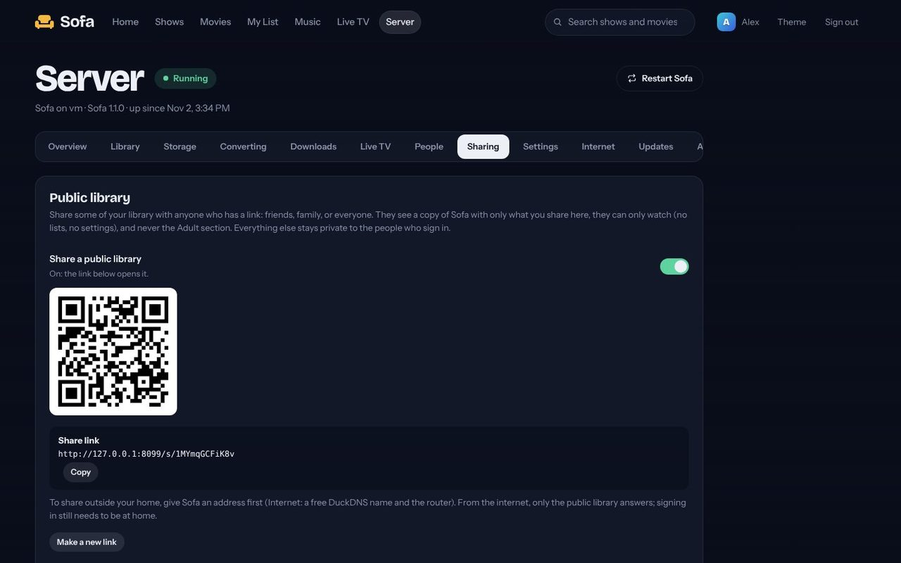
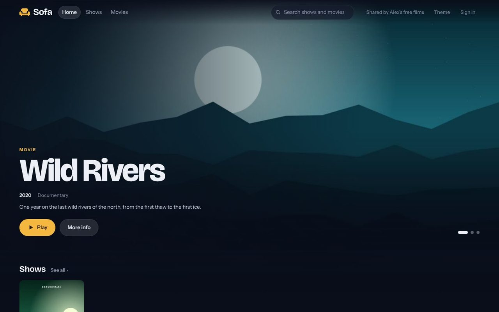
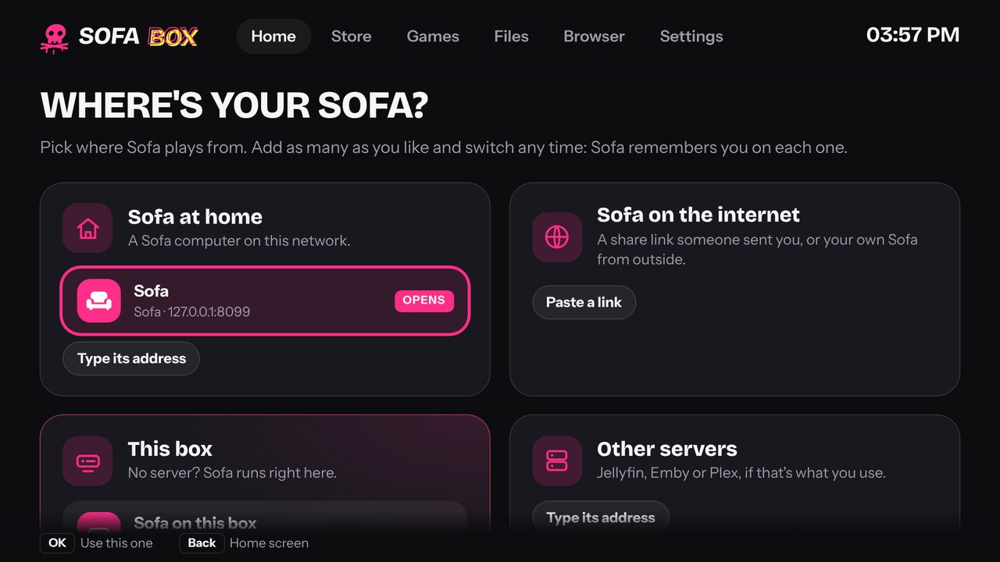

# Sofa anywhere: public libraries, other servers, and a box that works on its own

The plan for the round that started 2026-11-02. Each part has a status: ☐ not started, ◐ under way, ☑ done.
[HANDOFF.md](HANDOFF.md) says where things stand overall.

## What the owner asked for

- A Sofa server can have a **public library**: the admin picks titles to share, and a **share link**
  opens a copy of the app that shows only those titles. Everything else stays private to the people
  who sign in (at home).
- Sofa and the Sofa Box can **add other servers** (paste a link) and **switch** between them: Sofa at
  home, Sofa on the internet (a share link), and other kinds of servers (Jellyfin, Emby, Plex).
- On the box, opening **Sofa** asks where from the first time. You can have it **remember the choice
  or ask every time**, and change it later in Settings.
- **A box with no server** still works. It has Live TV (free channels), videos on **USB drives**, and
  **DVDs/CDs** from a USB drive. Live TV gets its own tile on the box's Home screen. A free public Sofa
  (to be run by the owner) can be listed for people with no server.
- The box's **store** gets the popular streaming apps, **icons** and **Home** look better, and the
  **first setup** is beautiful: the basics, pick your streaming apps, then Home.
- The **Server page** stops hanging, and has a **Restart** button.
- Hover previews, the header banner and the top slider play **with sound** by default.
- The **card image** can be downloaded from GitHub (Releases), and the **install command** for a Pi
  that already has Raspberry Pi OS comes from GitHub, so it doesn't depend on a server address.
- **Bug:** playing from a phone to the box gave an "mpv" error.

## Decisions

- **Visitors, not accounts.** The share link signs the browser in as the built-in *Visitor*
  (`users.guest = 2`). A Visitor can only see what's shared, can only read (no progress saved on the
  server, no lists, no casting), and never sees Adult. Making a new link signs every Visitor out.
- **Home stays home.** With `remote = home` (the default), the internet still can't sign in. When
  sharing is on, the internet can reach only the share link and the Visitor's library, art, video and
  (if shared) Live TV. Visitors are allowed over plain HTTP, because no passwords are involved. When
  HTTPS is set up, they are redirected to it as before.
- **"Open to everyone"** (`public_open`): the server's plain address opens the public library
  without a link. This is for a server that exists only to share, like the owner's free one.
- **The box gives each server its own address**, `http://<name>.localhost:8091`. Chromium sends
  `*.localhost` to the box itself, and the agent picks the server from the name. This keeps each
  server's sign-in, settings and history separate, and switching never signs you out. The agent now
  speaks HTTPS to servers on the internet. It removes `Secure` from their cookies (the box's page is
  plain http on the box itself) and turns their own-address redirects back into box addresses.
- **"This box" is Sofa itself, running on the box** (`127.0.0.1:8095`, its own data folder). It
  starts only when someone picks it. It has Live TV (the free channel lists) and a library on the
  box's own Videos folder and on USB drives laid out as a Sofa Library. It doesn't convert video,
  make previews or make scrub pictures: mpv plays the files as they are.
- **USB drives and discs** are opened by the box itself, not by Sofa: Files lists every drive.
  A **Disc** tile appears on Home when a DVD, CD or Blu-ray drive has a disc in it, and mpv plays
  `dvd://`, `bd://` or `cdda://`. Store-bought DVDs and Blu-rays are usually encrypted; reading those
  needs extra software that isn't on the card (the guide says so plainly).
- **Other servers** (Jellyfin, Emby, Plex) open as web apps with the Sofa bar. The box finds Jellyfin
  and Emby on the network (UDP 7359) and Plex (GDM, UDP 32414), or takes a typed address.
- **Releases from the workflow.** The card workflow, on a push to `main` that changes the box,
  publishes a release `box-YYYY.MM.DD` with the card attached (using the run's own token).
  The install command is
  `curl -fsSL https://raw.githubusercontent.com/krintoxi/sofa/main/deploy/sofa-box/install.sh | sudo sh`.
  It downloads the box (and Sofa, for "This box") from GitHub.

## Parts

1. ☑ **Phone → box "mpv" error.** `--profile=fast` exists only in mpv 0.37+; Raspberry Pi OS Bookworm
   has 0.35, so mpv quit at once. Ask mpv which profiles it has. If mpv still can't start, or can't
   open a window, the page plays the video itself (the agent says `failed`, and the page falls back
   to its own player). Look harder for the screen (cage's Wayland socket, X `:0`).
2. ☑ **Server page.**
   - The page asks for one status at a time, gives up after 20 s, and stops asking while hidden.
     The extra data for a tab is fetched together, and only once per tab change (no more reload loops).
   - On the server, the slow parts are worked out in the background and kept for a while: the
     Deleted folder's size, the cache's size, previews, duplicates, the git version. A status reply is
     shared by everyone asking at the same time.
   - **Restart** button (Overview): `POST /api/admin/restart` starts the server again.
3. ☑ **Public library** (`sofa/sharing.py`):
   - the `public_items` table;
   - the settings `share_on`, `share_token`, `public_open`, `share_live`, `share_all`;
   - the Visitor user, `/s/<token>`, the gate rules, a whitelist of what a Visitor may ask;
   - `visible_item` checks shared titles, and pictures only for shared titles.
   - On the Server page, a **Sharing** tab: switch on, the link (copy, QR, new link), "Open to
     everyone", Live TV, "Share everything", and the list of shared titles. Each title's page has a
     **Share** switch for admins.
   - The app for Visitors: only the library and Live TV, a "Shared by <name>" badge, a Sign-in button,
     and your place kept on that device only.
4. ☑ **Servers in the app.**
   - Menu → **Servers**: this one, plus the ones you've added (pasting an address or a share link).
     Picking one opens it. On the box, this list is the box's own, and switching keeps you signed in.
5. ☑ **Box: opening Sofa.**
   - The chooser offers: Sofa at home (found + type an address), Sofa on the internet (paste a link,
     plus the free servers from `deploy/sofa-box/servers.json`), This box, and Other servers.
   - Then "Remember this, or ask every time?", with "You can change this in Settings → Sofa".
   - Settings → Sofa: the list, the default, remove, add.
   - Agent API: `/box/api/sofa`, `/box/api/sofa/add|remove|default|open|scan`.
6. ☑ **Box: no server needed.**
   - "This box" (local Sofa, started on demand) and a **Live TV** tile.
   - USB drives are mounted by udisks2 (a udev rule), with a toast and an **USB** tile.
   - The **Disc** tile; `libdvdnav`/`libbluray`/`libcdio` support is in mpv already.
7. ☑ **Box: store, icons, Home, first setup.**
   - About 40 popular apps in the store.
   - Icons:
     - each app tile has its own color and a large, sharp icon (the site's biggest manifest or
       touch icon, else a drawn monogram);
     - built-in apps get drawn icons.
   - Home:
     - a featured banner (what you last opened, or a suggestion);
     - rows for Your apps, Watch, Listen and Play, plus Inputs (USB, Disc) when there's something there.
   - First setup: Welcome → Wi-Fi → look (theme) → pick your streaming apps → Sofa (optional) →
     Home, with a progress line and big friendly steps.
8. ☑ **Sound on by default** for hover previews, the banner and the top slider. They start with sound;
   if the browser won't allow it, they play muted with a sound button. The box's Chromium is started
   with `--autoplay-policy=no-user-gesture-required`.
9. ☑ **GitHub:** install from raw.githubusercontent.com; the workflow publishes the card release.
   - Docs:
     - this plan;
     - the box guide (servers, no server, USB/DVD, install command);
     - the README (Sharing, Restart).
   - Tests for sharing, the box's servers and the mpv options.
10. ◐ **The public Sofa** (the owner's free one, at a name like `sofa.edgeventure.uk`), from 2026-11-08.
    - ☑ In Sofa 1.4.6:
      - a tunnel or proxy on the same computer that Sofa wasn't told about (`trust_proxy`) gets what the
        internet gets;
      - with `trust_proxy`, Cloudflare's `CF-Connecting-IP` names the visitor, and the proxy's address isn't
        held to the per-address connection limit;
      - **Games** (the box's page games) for anyone not on a box, and for Visitors with **Games too**
        (`share_games`);
      - a highlighted **Sofa Box** page for anyone not on a box (what it is, what you need, the download);
      - away from home, Live TV plays straight from the channel when the channel allows it (https, no
        headers of its own, not a tuner at home), and through Sofa when it doesn't.
    - ☑ In Sofa 1.5.0, from the industry study's guardrails (`~/IRONGATE/research`, owner's go 2026-11-08):
      - away from home, and for every Visitor, a channel plays only straight from where it's streamed; Sofa's relay
        answers only at home, and a channel that can't play directly isn't listed away from home;
      - the public library gets only the channel lists an admin marks for visitors (Server → Live TV), and
        Classic Cinema only with **Classic Cinema too** (`share_cinema`);
      - Retro TV's decades (recordings of broadcasts, rights not cleared) are off unless an admin turns them on,
        for the household only, and never reach Visitors;
      - channels that need a made-up browser name or referrer are hidden unless allowed (`live_headers`);
      - visitors get an **About** page: privacy, copyright and where notices go (`share_contact`);
      - a new Sofa Box adds no channel lists of its own.
    - ☐ The owner's, before launch:
      - where it runs: a separate free-only Sofa, not the iMac's, on a Cloudflare account apart from boxcert's;
      - a DMCA agent (copyright.gov, $6, renewed every 3 years) and the contact in Sharing;
      - which channels are on its public list (owner-published free streams only), with a lawyer's view;
      - an outside look at its security.

## How it looks

## Where it stands (2026-11-02)

- **Everything in the plan is built**, and the tests pass (68).
  - `tests/test_server.py` `Sharing`: visitors at home and from the internet.
  - `tests/test_sofa_box.py` `Agent`:
    - each server at its own address;
    - the box's controls refused to other pages and other names;
    - a share link through the box;
    - mpv that can't start handing the video back to the page.
- **Checked in a browser:**
  - Server → Sharing, the Share button, and a visitor's Home on a computer and a phone;
  - the box's Home, the chooser, the store, Settings → Sofa and the first start's apps step;
  - This box: it starts, makes its own account and signs in.
- **Not yet tried on real hardware:**
  - the Pi 3 B+;
  - USB drives mounting through udisks;
  - a USB DVD drive;
  - Jellyfin/Emby/Plex discovery on a real network;
  - store icons (the cloud session couldn't reach those sites; on the box it can).
- **For the owner:**
  - Put a free public Sofa in `deploy/sofa-box/servers.json` (name, url, about) when there is one;
    every box picks it up from GitHub within a day.
  - The first build on `main` publishes the release `sofa-box`.

## Added after the plan (2026-11-02)

- **Setting up a box with nothing but a phone or a Fire TV remote.**
  - The first start is a setup of its own: Hello (how you'll work it), Internet, Bluetooth, Your box
    (name, time zone, look), and Apps.
  - **The phone remote** (`deploy/sofa-box/remote.html`, served by the box on port 8092, home network
    only, a code from the TV in its QR code): a pad, a keyboard, a touchpad and Wi-Fi. Nothing to
    install; Add to Home Screen keeps it like an app.
  - Bluetooth remotes and controllers in pairing mode pair by themselves during the first start.
  - The box makes its own Wi-Fi when it has no network.
  - The box's Settings: Remotes and Bluetooth, Time zone, Update the box, Reset to how it came.
- **Selling boxes:** [sofa-box-product.md](sofa-box-product.md) covers what's ready, how to prepare
  a box, everything it connects to, and what's left before selling.
- Tests: the phone remote's pairing and access rules, the remote key translation, and the
  Bluetooth device sorting.
- **Sofa Box OS versions:** `deploy/sofa-box/VERSION` and `CHANGES.md`; each new number becomes the
  release "Sofa Box OS X.Y.Z" on GitHub, beside the always-newest `sofa-box` card. The README links
  both at the top.
- **Fixes found in a review:** Update and Reset no longer cut themselves off; after a router restart
  the box waits for its Wi-Fi instead of switching to its own; "Starting Sofa…" while Sofa on the box
  starts.

## Ideas for later

- A way to send a link to the box from a phone (for people with only a TV remote).
- A list of the open tabs inside the browser.
- A public Sofa's visitors could keep their place across devices (today it stays on each device).
