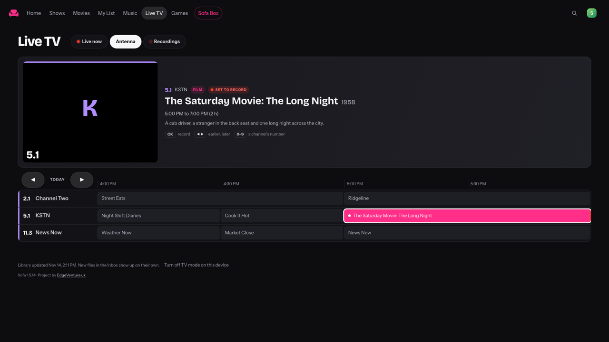
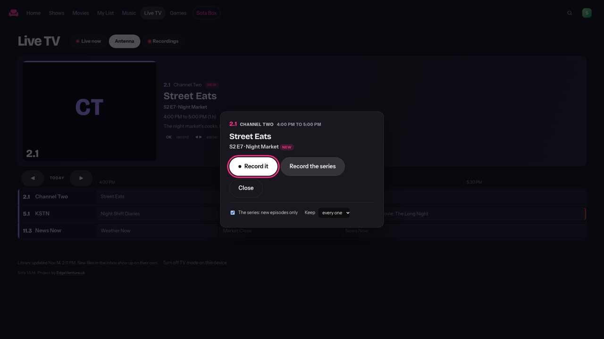
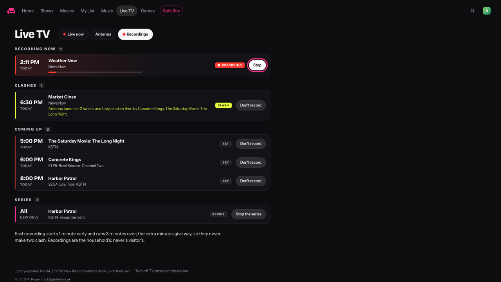

# Tuners, the guide, and recording

**New in Sofa 1.5.13, with its screens since 1.5.14.** Built and tested against a stand-in tuner, in a browser too;
**no real tuner has run it**, and no real TV has shown its screens.

## Tuners at home

A network tuner (an HDHomeRun, or anything that answers as one) is a small box on the home network with an antenna or
a cable in it. Sofa finds it by itself (SiliconDust's discovery packet, a UDP broadcast on port 65001), or takes its
address. A tuner found is listed **off**: its channels join Live TV when an admin turns it on.

- Its channels keep their own numbers ("5.1") and names, after the channel lists' on Live TV's dial, in a group of
  their own. Copy-protected channels are left out (they don't play anywhere but the maker's own apps).
- Most over-the-air TV is MPEG-2, interlaced, which no browser plays: Sofa converts it as it plays and weaves the
  lines back into whole pictures. H.264 channels are repackaged as they are.
- A tuner's channel is at home: never listed for the public library's Visitors, never played away from home through
  this Sofa, and never "looked at" by the channel checker (a look would take a tuner from someone watching).
- Offline mode is about the internet: a tuner keeps working with it on.

## The guide

An XMLTV source the household gives (an address, or a file on this computer): Server → Live TV → Guide. Sofa reads
it every six hours and keeps two weeks. Channels are matched by the id a channel list gave, a tuner's number among
the guide's names for a channel, or the name. A guide file that declares entities of its own is refused (that's how
a small file is made to fill a computer's memory). Nothing of the guide is shown to Visitors.

## Recording

Only channels at home can be recorded: a tuner's, or a channel list kept on the home network. **Never a channel list
from the internet, never Classic Cinema or the Retro TV decades.** A recording is the household's: it is never
shown to the public library's Visitors, even when the show it belongs to is shared.

- **Now:** to the end of the programme the guide shows (an hour without a guide).
- **A programme** from the guide, or **a slot** (a channel and two times, twelve hours at most).
- **A series:** every showing of a title, on one channel or any; **new episodes only** if asked; **keep the last N**
  (older ones go to Deleted, which someone empties when sure). A repeat of an episode already recorded (the same
  season and episode) isn't recorded again.
- **Padding:** a minute before and three after (Settings: `dvr_pad_before`, `dvr_pad_after`, in minutes). Padding
  gives way: it never makes two recordings clash; a recording only in its extra minutes stops when another needs
  its tuner.
- **Conflicts:** a box has a number of tuners. What's recording keeps its tuner, then one-offs, then a series', in
  the order they were asked for; the rest wait as conflicts, saying what they clash with, and are recorded if a
  tuner comes free. Someone watching a tuner's channel is a tuner taken too.
- **The file** is the channel's own stream, copied as it comes (MPEG-TS, no conversion). If the stream breaks off,
  Sofa opens it again (three times at most) and joins the parts. Then it goes into the **Inbox** under a name the Inbox
  reads (`Night Court S03E07 Tonight.ts`, `The News Hour 2026-11-13.ts`, `Casablanca (1942).ts`) and is filed like
  anything else, with its artwork and details. Background conversion to MP4, if it's on, converts it like any other
  file.

## The screens

- **Live TV → Antenna:** the tuners' channels on the clock, by their own numbers, from the guide. Up top: what's on,
  its episode, how long is left. OK (or a click) on what's on now watches it; on a later programme it asks what to
  record: that one, or the series (new episodes only, the last few kept). Past a row's ends ◀ ▶ go two hours back
  and on, a week ahead at most; digits go to a channel by its own number (5 is 5.1). A programme set to record has a
  red dot, one a series will record a red ring. A channel without a guide is on air, all the way along.
- **The Record dialog:** "Record it" (or "Record the rest of it" while it's on), "Record the series", "Watch it", and
  what's already set: "Don't record it", "Stop recording the series". A film has no series.
- **Live TV → Recordings:** recording now (with Stop), clashes (and what they clash with), coming up, the series,
  and what's recorded: being filed, in the library, or why it didn't record. Each with a way out.
- **REC in the player:** on a channel at home, records what's on from now to the end of its programme (an hour
  without a guide). Pressed again it stops (on a TV, twice within four seconds), and what's recorded is filed. The R
  key does it too. The Sofa Box's own player has no REC yet: record from Antenna's guide there.
- **Server → Live TV → Tuners at home:** look on the network or give an address, switch a tuner on or off, remove
  it; the guide's sources (an address or a file on the Sofa computer) and how many channels each matched; the minutes
  before and after each recording.
- **Offline**, Live TV keeps the channels at home (a tuner's, a list on the home network) and leaves out the rest.

Recording is the household's: Antenna's Record, Recordings and REC aren't there for Visitors, Kids profiles or
guests, and away from home the tuners' channels aren't in Live TV at all.

## The API

| Call | Who | What |
|---|---|---|
| `GET /api/admin/tuners` | admin, at home | the tuners (on, channels, free tuners) and the guide's sources |
| `POST /api/admin/tuners` `{"find": true}` · `{"add": "192.168.1.50"}` · `{"switch": {"id", "on"}}` · `{"remove": id}` · `{"guide_add": url or path}` · `{"guide_remove": …}` | admin, at home | |
| `GET /api/live/tuner-guide?channel=a,b&from=<time>` | the household | six hours of the guide for those channels |
| `GET /api/dvr` | the household (not Kids, not Visitors) | recordings, series, padding |
| `POST /api/dvr` `{"now": channel}` · `{"programme": {"channel", "start"}}` · `{"slot": {"channel", "start", "stop", "title"}}` · `{"series": {"title", "channel", "new_only", "keep"}}` · `{"cancel": id}` · `{"stop_series": id}` | the household, at home | |
| `POST /api/admin/settings` `{"dvr_pad_before": 0–15, "dvr_pad_after": 0–30}` | admin | the minutes before and after |

## What has run where

| | On real hardware | In the tests |
|---|---|---|
| Discovery, the channel list, the streams | **No.** No tuner in the household's fleet. | A stand-in that answers as an HDHomeRun does (`tests/stand_in_tuner.py`): discovery over UDP with SiliconDust's own packet, `discover.json`, `lineup.json`, MPEG-TS streams, two tuners at once and a refusal for a third, a stream that breaks off |
| Recording | **No.** | Real: ffmpeg copies the stand-in's stream, the Inbox files the file, Visitors don't see it; conflicts, padding, series, repeats, keep-last-N |
| The guide | **No real source yet.** | XMLTV written by the tests: time zones, both kinds of episode numbers, films, matching |
| The screens | **No real TV, tuner or Sofa Box.** | Headless Chrome against the stand-in (`tests/test_tuner_screens.py`): Antenna in number order, one recorded and cancelled, a series, a film, later hours with the remote, REC in the player, the Server page |

A real tuner costs about $110 new (two tuners) or $90 refurbished.
