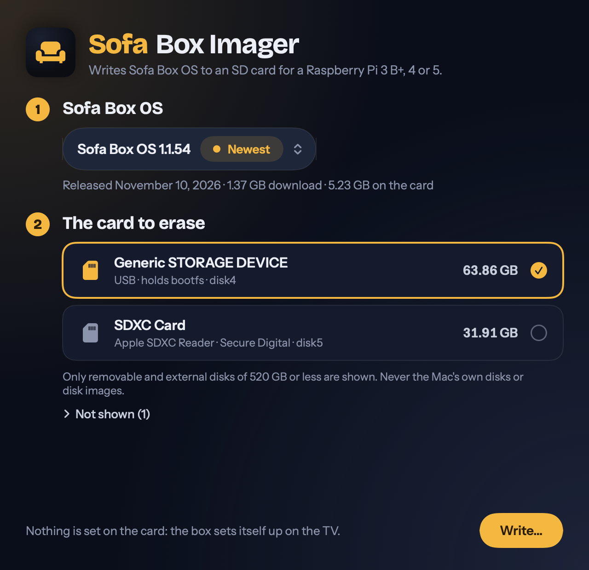
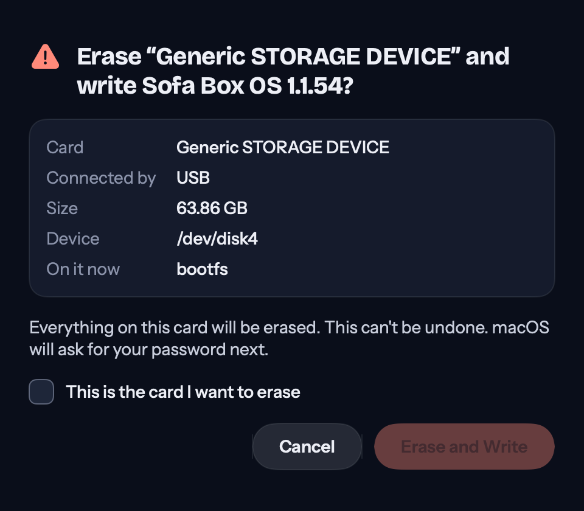

# Sofa Box Imager

EdgeVenture's own app for writing a Sofa Box OS card, for a Raspberry Pi 3 B+, 4 or 5. It does one thing:
pick the version, pick the SD card, confirm, and it downloads the card, writes it, reads every byte back and
ejects it. It sets nothing on the card (no user, no SSH, no Wi-Fi): the box sets itself up on the TV.

**Where it stands (version 0.1.0, 2026-11-10):**

- macOS only, 13 or newer, Apple silicon and Intel. Windows comes later (see [Windows](#windows)).
- **It has never written a real SD card.** Everything up to the hardware is tested, including a real
  Sofa Box OS 1.1.54 card downloaded from GitHub and written to a disk image. The password prompt and a real
  card reader need a person at a Mac: [the list is below](#what-only-a-real-mac-with-a-real-sd-card-can-confirm).
- It isn't signed with an Apple Developer ID, so macOS blocks a downloaded copy until its owner allows it
  (see [Signing](#signing)).
- It reads the Sofa Box list on the `sofa-box` release, published since 2026-11-10 (see [The list](#the-list)).

It's written from scratch in Swift and SwiftUI, not forked from Raspberry Pi's imager, and has no other
dependencies: unpacking is macOS's own Compression framework, the password prompt is macOS's own `authopen`.

| Pick the version and the card | Confirm |
|---|---|
|  |  |

(Drawn by the tests with made-up disks, not photographed from a real write.)

## How it looks

It wears Sofa's own look, not the Mac's stock controls: the ink room with the sofa's amber glowing in a corner,
Bricolage Grotesque for headings and Instrument Sans for everything else, pill buttons, amber for the one
thing to do and coral for erasing. It looks the same whether the Mac is set to light or dark.

- The colours are `SofaTheme` in `Sources/ImagerKit/SofaTheme.swift`: the web app's own values (the Midnight
  theme in `client/sofa.css`, which Sofa's icon is drawn in). A test reads that style sheet and fails if the
  two drift apart. A Windows build reads the same table, so every version looks alike.
- The fonts are Sofa's own files (`client/vendor/fonts`, SIL Open Font License 1.1). The build copies them
  and their licences into the app.
- The controls (`Sources/SofaBoxImager/Theme.swift`) are the app's own. Two things stay macOS's: the menu
  that opens from the version pill, and the password dialog, which is macOS's on purpose.

## Build and run

Needs Xcode, for Swift and the macOS SDK (built here with Xcode 27.2). From this folder:

```
swift test                 # the tests (about a minute; they attach and write RAM disks of their own)
scripts/build-app.sh       # build/Sofa Box Imager.app and a zip of it, for Apple silicon and Intel
open "build/Sofa Box Imager.app"
```

`swift run SofaBoxImager` also opens it, without building the app bundle.

Two read-only checks from Terminal, which open no window and never open a disk:

```
"build/Sofa Box Imager.app/Contents/MacOS/SofaBoxImager" --versions   # the versions it would offer
"build/Sofa Box Imager.app/Contents/MacOS/SofaBoxImager" --disks      # every disk, offered or not, and why not
```

`--disks` is the first thing to run when a card doesn't show up in the window.

GitHub builds and tests it on every change to this folder (`.github/workflows/imager.yml`) on three of its
Macs: Apple silicon on macOS 26 and macOS 15, and an Intel Mac. The unsigned app is kept with each run as
the `sofa-box-imager-mac-unsigned` artifact. That workflow is new with this folder: its first runs are on
the pull request that adds it.

## Which disks it may write

A bug here erases someone's computer, and it can't be undone. So the decision is made in one place,
`DiskPolicy.refusals(for:needs:)` in `Sources/ImagerKit/DiskPolicy.swift`. It's a pure function: it reads a
description of a disk and nothing else, and returns every reason not to write it. **A disk is offered only when
there's no reason at all**, and anything macOS doesn't say counts against the disk.

`Sources/ImagerMac/DiskList.swift` fills in the description from DiskArbitration and IOKit. A disk is refused when:

| Reason | How it's told |
|---|---|
| It isn't a whole disk | DiskArbitration's "whole" flag, and a name that isn't exactly `diskN` |
| It's a disk image | Its model is "Disk Image", its protocol is "Virtual Interface", or a disk-image driver sits beside its media in IOKit. Any one is enough. |
| It isn't physical | An APFS container (what Disk Utility calls "synthesized"), a RAID set, CoreStorage or a virtual machine's disk: its media doesn't sit directly on a storage device's driver |
| It's inside the Mac | DiskArbitration's "internal" flag. The one exception is a removable SD card in the Mac's own card slot, which macOS also calls internal. |
| macOS doesn't say where it is | No "internal" flag at all. Disk images have none, so a filter that only asked "removable, and not internal?" would offer them. |
| It's neither removable nor ejectable | DiskArbitration's flags |
| The Mac starts up from it | It holds `/` or anything under `/System/Volumes`, directly or through an APFS container. This holds for a Mac started from an external disk too. |
| It holds your home folder, this app or the temporary folder | The same lookup, for those folders |
| It's on the network, or read-only | DiskArbitration's flags (a locked SD card is read-only) |
| It's smaller than the card | The list's `extract_size` (5.23 GB for 1.1.54) |
| It's bigger than 520 GB | See below |
| Its sectors aren't 512 bytes to 1 MiB, a power of two | So that every write is whole sectors |

**Why 520 GB.** SD cards for a Pi run from 8 GB to 512 GB, and the guide says 32 GB is plenty. Cards are
sold in decimal gigabytes and never hold more than they say, so a 512 GB card is under 512,000,000,000 bytes;
520 leaves room for an odd one. Disks of 1 TB and up are almost always someone's backup drive or SSD, so they
aren't offered at all. This limit doesn't protect a 500 GB external SSD: the confirmation does, by naming it.
It's one guard of several.

Then, before anything is written:

1. **The confirmation** names the card, the reader it's in, how it's connected, its size, its device and
   the volumes on it. Its "Erase and Write" button stays off until "This is the card I want to erase" is ticked.
2. **The disk is looked up again** when the write starts. It must be the very disk that was confirmed (the
   same device, the same place in IOKit, the same moment it appeared, the same size), and the policy must
   still allow it. A card swapped in the reader after the confirmation stops the write.
3. **Every volume on it is unmounted**, not by force: a volume in use stops the write with its name. While
   the card is written, macOS is refused any mount from it.
4. **macOS asks for an administrator's password** in its own dialog (`/usr/libexec/authopen`), and hands
   back the open disk. The app never sees the password and installs no helper.
5. **The opened disk is measured** (its sector size and count, asked of the disk itself). If that isn't
   the confirmed size to the byte, nothing is written.

The app has one way to open a disk, `AuthOpener`, and one place that calls it, `WriteJob`.

## What a write does

`CardPipeline.run` in `Sources/ImagerKit/CardWriter.swift`, the same code in the app and in the tests:

1. Blanks the disk's first megabyte (the old partition table) and its last (where an old GPT keeps a backup
   copy that would otherwise outlive the new card and confuse the box's first-start resize). A counterfeit
   card that claims more room than it has may never answer a write to its end, so that write has 30 seconds
   and then says so.
2. Downloads the `.img.xz` and unpacks it as it arrives, holding at most about 32 MB: when the card is
   slower than the network, the download waits. If the connection drops, it carries on from the byte it
   stopped at, up to four times, and only if the server answers with exactly that range.
3. Writes in aligned 1 MiB blocks to the raw device (`/dev/rdiskN`), never past the card's own size.
   **The first megabyte is held back** and written last, only once everything else is on the card and the
   SHA-256 of what was unpacked matches the list's `extract_sha256`.
4. Asks macOS and the card reader to flush, then **reads every byte back** from the card and checks it
   against the same SHA-256.
5. Ejects the card.

If anything goes wrong (the download is damaged or isn't the listed card, the card reads back differently,
it's pulled out, Stop is pressed), the first megabyte is blanked again. A card that failed can't start a Pi
half-written: it has no partition table.

The card that ends up on the SD card is, byte for byte, the one GitHub built: the app can't change it, and
the check against the list's SHA-256 would fail if anything did.

## The list

The app reads the same list Raspberry Pi's imager can open, built from the releases by
`tools/sofa-box-imager-list.py` ([how it's made](../docs/raspberry-pi-imager.md#our-list)):

    https://github.com/krintoxi/sofa/releases/download/sofa-box/sofa-box.rpi-imager-manifest

It offers the first entry that isn't marked "(testing)": the stable version once one is marked (tried on a real
box), the newest until then. Beside it come the "(testing)" entries when the list has them (a newer version, the
newest build), then the "earlier versions" group, each with its release date, download size and size on the
card. It reads only what
it needs (`name`, `url`, `extract_size`, `extract_sha256`, `image_download_size`, `release_date`, `devices`)
and is strict about it: an entry without a usable size or SHA-256, with an address that isn't `https`, or
for other boards is left out, never written unchecked. It ignores `init_format` because it never customises a
card.

If that address can't be reached, the app says so. To try it with another list, one built from a checkout of
this repository say:

```
python3 tools/sofa-box-imager-list.py build --keep 0 --cache /tmp/imager-cache.json --out /tmp/sofa-box.rpi-imager-manifest
open "imager/build/Sofa Box Imager.app" --args --list /tmp/sofa-box.rpi-imager-manifest
```

(The build unpacks each listed card once to measure it, about two minutes a card. `--keep 0` lists only the
newest; leave it out for the five earlier versions too.) `--list` takes a file or an `https` address; the `SOFA_BOX_IMAGER_LIST` environment variable does the
same. A list opened from a file may point at cards in files too, which is how the tests work.

What the app trusts: the list, fetched over HTTPS from the release, and nothing else. The card itself can come
from anywhere the list says, because it's checked against the list's SHA-256.

## What's tested, and where

`swift test` runs 83 tests; three more run only when asked. None writes a disk it didn't attach itself: the
tests that write attach a RAM disk, check with DiskArbitration that the device they got is a disk image of
exactly the size they asked for, and only then touch it.

| What | Tests | How |
|---|---|---|
| Which disks may be written | `ImagerKitTests/DiskPolicyTests` (22) | Made-up disks. This Mac's internal SSD, APFS container and a RAM disk are copied from what macOS really said; the card readers are written from Apple's documented values. Every combination of inside / removable / ejectable / card / image / APFS is checked against the rule. |
| The list | `ImagerKitTests/CardListTests` (10) | A list made by `tools/sofa-box-imager-list.py`'s own `build()` and `check()` (1.1.54's sizes and SHA-256 are the real card's, the other versions invented); the list as it was first published on 2026-11-10; and one opening with a stable version, followed by two "(testing)" ones. |
| Unpacking | `ImagerKitTests/XZDecoderTests` (8) | Files made by `xz -T0 -6` as the box's card is: one stream of 9 blocks, and two streams with zero padding between. Damage, a short file, bad padding and trailing junk are all caught. |
| Writing and checking | `ImagerKitTests/CardWriterTests` (13) | A plain file as the disk. Only whole-sector writes at megabyte offsets; the first megabyte last; nothing past the card but the disk's last megabyte; a wrong download, a card that reads back wrong, Stop and a card that never answers each leave the first megabyte blank. |
| Downloading | `ImagerKitTests/DownloadTests` (9) | A web server inside the test: a whole download, carrying on after a drop, a server that ignores or mangles the range, the wrong size, giving up, and download-to-checked-card in one go. |
| Finding disks | `ImagerMacTests/DiskListTests` (7) | The Mac running the tests: its startup disk is found and refused; a RAM disk is seen as a disk image and refused; the volumes on a disk are found, unmounted, and refused a mount while a write is on; `authopen` with no one to type a password opens nothing. |
| The whole write | `ImagerMacTests/WriteJobTests` (5) | The app's own `WriteJob` on a RAM disk with a volume on it: unmount, open the raw device, write, read back, eject. Two things differ from the app: the RAM disk is opened directly (it belongs to the user, so no password), and the policy is told to accept that one RAM disk. Also: a disk that changed since it was confirmed, a disk that turns out to be another once open, and the real policy refusing the RAM disk before anything is unmounted. |
| The password hand-over | `ImagerMacTests/AuthOpenTests` (6) | A stand-in for `authopen` (`Tests/FakeAuthOpen`) that takes its arguments and sends back an open file as `authopen` does: the 32-byte authorization arrives whole, the file opens for reading and writing, a helper that fails after opening isn't trusted, and the helper inherits nothing of the app's but its three standard streams. |
| The app | `SofaBoxImagerTests/WindowTests` (5 + 1) | What's chosen is what's written; progress in words; the colours match Sofa's style sheet and its fonts load; the app's own words never include Raspberry Pi's imager's name, and nothing in it writes a user, SSH or Wi-Fi setting. `SOFA_IMAGER_SNAPSHOTS=<folder>` draws every screen to a PNG, with the Mac set to light and to dark. |
| A real card | `ImagerMacTests/RealCardTests` (2, when asked) | `SOFA_IMAGER_REAL_LIST=<list> swift test --filter RealCardTests`. Downloads the newest card from GitHub and writes it to a disk image through the raw device with `WriteJob` (about 1.4 GB down, 6 GB of disk for a few minutes), and checks that a download dropped on purpose carries on through GitHub's redirect. |

**Run here on 2026-11-10** (a Mac on macOS 27.2, Apple silicon, Xcode 27.2):

- `swift test`: 83 passed.
- `RealCardTests`: Sofa Box OS 1.1.54, 1,367,936,428 bytes from GitHub, unpacked to 5,226,102,784 bytes on a
  disk image, read back and matched `8b1b6299541a101af1e03f761b150f1cc606a6f067cdca301a17ff927a913e5a`, in
  105 seconds. A download dropped at 4 MB carried on and gave the same first 64 MB.
- macOS's Compression framework unpacks the real card, which is one xz stream of 208 blocks (207 of 24 MiB
  and a last one of 16 MiB, read from the file's own index). It stops at the end of the first stream of a
  file with several, so `XZDecoder` starts it again for each. liblzma isn't needed, and isn't bundled.
- The built app (`--disks`) refused every disk on that Mac: the internal SSD, the APFS containers on it, and
  the disk images attached at the time, each with its reasons.

## What only a real Mac with a real SD card can confirm

Not done yet. The owner's Macs with card readers can do each of these; only a card built by GitHub goes on
the owner's hardware, which is the only kind this app writes.

1. **The password prompt.** macOS shows its dialog with "Sofa Box Imager needs your password to write the
   card.", and `authopen` hands back `/dev/rdiskN`. Cancelling it writes nothing. Also from an account that
   isn't an administrator.
2. **A real card is offered.** `--disks` on a Mac with a card in a USB reader, and in a Mac's own SD slot,
   shows it as OFFERED. What macOS says about real readers (protocol, removable, internal) is from Apple's
   documentation here, not from a reader. If a reader is refused, `--disks` says why.
3. **Unmounting a real card** whose volume is open in Finder, and one that's in use.
4. **The write itself** on real media: megabyte writes to the raw device, the flush, and how long the write
   and the read-back take.
5. **Nothing mounts before the eject.** macOS doesn't mount the new card's boot partition or say "the disk
   you attached was not readable" while the app holds it.
6. **The eject** lets the card be taken out, in a USB reader and in a built-in slot.
7. **The card starts a Pi**: a 3 B+ first, then a 4 and a 5, to the box's setup screen.
8. **Things going wrong on real hardware:** a locked card, a card pulled out mid-write, the Mac going to
   sleep, and a counterfeit card if one's to hand (the 30-second limit on its last megabyte is tested only
   against a pretend one).
9. **The window under a hand.** The screens are drawn and looked at, but nobody has clicked through them:
   the version menu opening from its pill, the window with its title bar hidden, the keyboard (Return,
   Escape, Tab), and VoiceOver.
10. **Another Mac and an older macOS.** The app is built for macOS 13 and later and has run on 27.2, plus
   whatever GitHub's Macs run. How Gatekeeper treats the unsigned zip after a download is untested.

## Signing

The app is signed ad hoc only (`codesign --sign -`: no identity, no key), which Apple silicon needs to run
it at all. That isn't a signature macOS trusts. A copy downloaded with a browser is blocked the first time:
its owner has to open **System Settings → Privacy & Security** and press **Open Anyway**. A copy built from
source on the same Mac opens normally.

A build people can simply open needs two things, both the owner's accounts to open. Nothing here uses or
asks for a key.

1. **An Apple Developer Program membership** (US$99 a year), in the name the app should carry.
2. **A "Developer ID Application" certificate** from that account, and an **App Store Connect API key** (or an
   app-specific password) for notarisation.

With those, the build gains three steps after `scripts/build-app.sh`:

```
codesign --force --options runtime --timestamp --sign "Developer ID Application: NAME (TEAMID)" "build/Sofa Box Imager.app"
ditto -c -k --keepParent "build/Sofa Box Imager.app" build/Sofa-Box-Imager.zip
xcrun notarytool submit build/Sofa-Box-Imager.zip --key KEY.p8 --key-id KEYID --issuer ISSUER --wait
xcrun stapler staple "build/Sofa Box Imager.app"        # then zip it again, or put it in a .dmg
```

- The hardened runtime (`--options runtime`) is required for notarisation. The app needs no entitlements:
  it isn't sandboxed (a sandboxed app can't write a raw disk), and it runs `authopen`, which is Apple's.
- For GitHub to do it, the certificate (a `.p12` and its password) and the API key go in the repository's
  **secrets**, and the workflow imports them into a temporary keychain. They never go in the repository.
- Until then, the unsigned zip is fine for the owner's own Macs and for testers who know to press Open Anyway.

## Windows

Later. Writing a disk on Windows is different work (an elevated helper that locks and dismounts the volumes,
then writes `\\.\PhysicalDriveN` in whole sectors) and needs a Windows code-signing certificate, or SmartScreen
warns on every download. The fleet has no Windows PC, and a writer that has never written a real card
shouldn't reach owners. Until one exists, Windows owners use the list in Raspberry Pi's own imager
([the guide](../deploy/sofa-box/README.md#setting-it-up-the-ready-made-card-easiest)).
`ImagerKit` (the list, the policy's rules, the writer) has nothing Mac-only in it but the unpacker and the
SHA-256, so a Windows app can share its design and its tests' cases.

## Not in this version

- No settings for the card. On purpose: the box sets itself up on the TV, and this app never makes a user.
  (A user made by Raspberry Pi's imager stopped the TV screen before Sofa Box OS 1.1.56;
  [docs/raspberry-pi-imager.md](../docs/raspberry-pi-imager.md) has the story, and what settings of our own
  could look like: Wi-Fi and a name, in a file the box reads itself.)
- The download isn't kept: writing a second card downloads it again.
- No update check for the app itself, and no translations.
- A card file chosen from disk (only through a list file, for testing).
- An extra warning for an external disk that holds a Time Machine backup or an APFS volume. Today it's
  shown with its name, size and volumes like any other.

## Where things are

```
Package.swift                 Swift Package Manager: three libraries, the app, the tests
VERSION                       the app's version
Resources/Info.plist          the app bundle's Info.plist (version filled in by the build)
scripts/build-app.sh          builds "Sofa Box Imager.app" (Apple silicon and Intel) and zips it
Sources/ImagerKit/            no disks, no AppKit: CardList (the list), DiskPolicy (which disks), XZDecoder,
                              Download (HTTPS with carry-on), CardWriter (write, check, CardPipeline),
                              SofaTheme (the look, as numbers)
Sources/ImagerMac/            macOS: DiskList (DiskArbitration, IOKit), DiskOps (unmount, eject, refuse mounts,
                              authopen, stay awake), WriteJob (one card, start to finish)
Sources/CAuthOpen/            C: runs authopen and receives the open disk from it; the disk's flush and size
Sources/SofaBoxImager/        the app: SwiftUI window, Sofa's look (Theme), its model, the --versions and --disks reports
Tests/                        see "What's tested, and where"; Tests/FakeAuthOpen is the stand-in for authopen
```

## Licence

MIT, like the rest of Sofa; the two typefaces are under the SIL Open Font License 1.1. No code is copied from Raspberry Pi Imager. Its macOS disk code (Apache-2.0,
version 2.0.12) was read to see how it uses `authopen` and DiskArbitration, and three of its habits are
followed: blanking a disk's last megabyte, giving that write a time limit, and holding the first block back
until the end. The app uses no Raspberry Pi logos; "Raspberry Pi" appears only to say which boards the card
is for.
