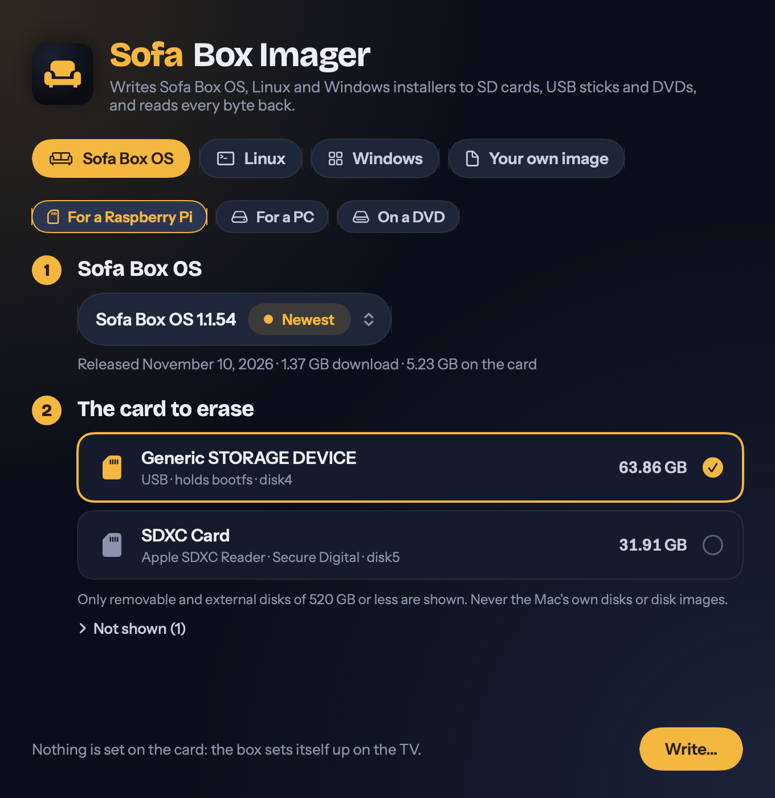
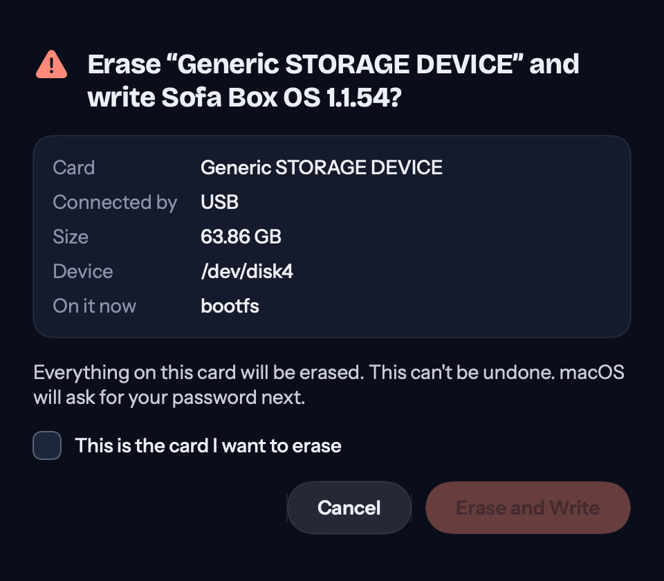
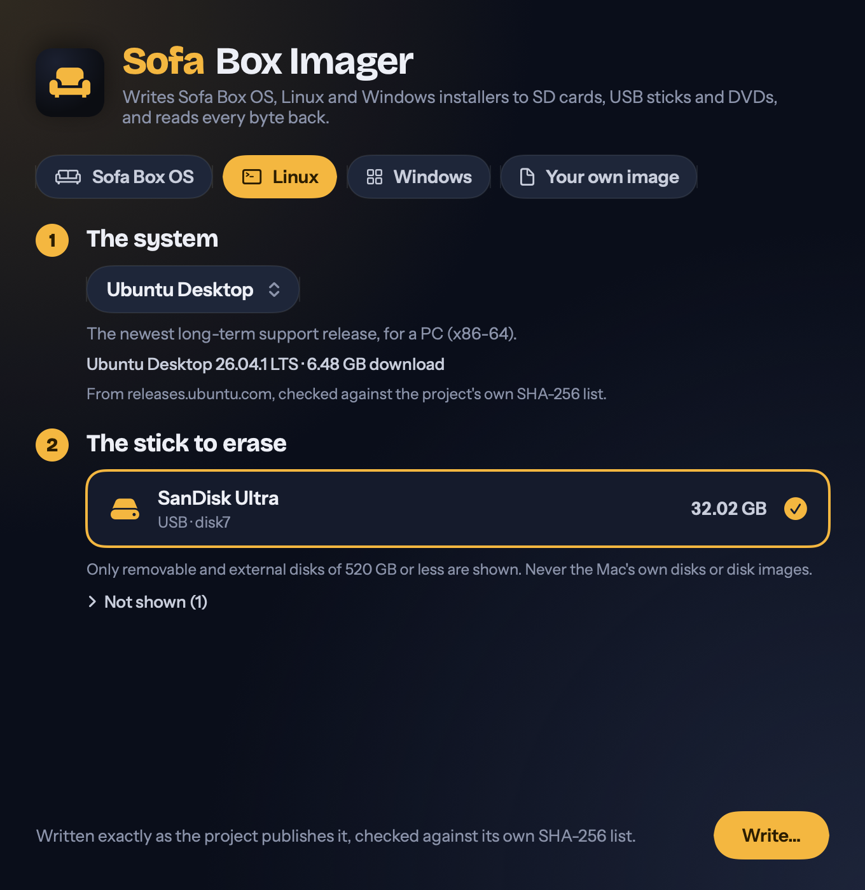
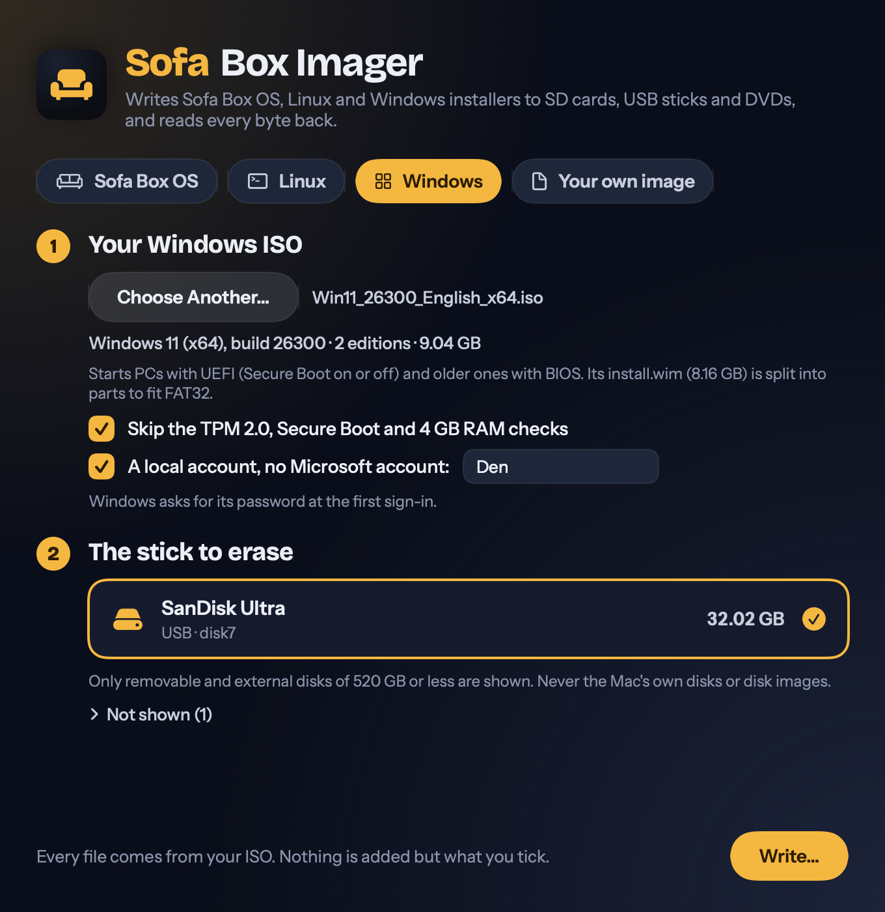

# Sofa Box Imager

EdgeVenture's own app for writing disks, from the Mac. It began with Sofa Box OS: to an SD card for a Raspberry Pi
3 B+, 4 or 5, to a USB stick for a PC (since 0.2.0, [below](#for-a-pc-a-usb-stick)), or burned to a DVD for a PC
(since 0.3.0, [below](#on-a-dvd)). Since 0.4.0 it's a universal imager: **other Linux systems** from their projects'
own sites ([below](#linux)), **Windows 7, 8.1, 10 and 11 installers** from an ISO you bring ([below](#windows)), and
**your own image** ([below](#your-own-image)). It does one thing each time: pick what to write, pick the card or stick,
confirm, and it writes it, reads every byte back to check it, and ejects it.

**Where it stands (version 0.4.0, 2026-11-14):**

- macOS only, 13 or newer, Apple silicon and Intel. Windows and Linux builds of the app are wanted, and come next
  (see [On Windows and Linux](#on-windows-and-linux)).
- **It has never written a real SD card or USB stick.** Everything up to the hardware is tested, and every kind of
  media has been written to a disk image through the raw device and started in a virtual PC, with UEFI (Secure Boot
  on) and with BIOS: [what was proven, and how](#proven-in-virtual-pcs). The password prompt and a real card reader or
  stick need a person at a Mac: [the list is below](#what-only-a-real-mac-with-a-real-sd-card-can-confirm).
- It isn't signed with an Apple Developer ID, so macOS blocks a downloaded copy until its owner allows it
  (see [Signing](#signing)).
- It reads the Sofa Box list on the `sofa-box` release, published since 2026-11-10 (see [The list](#the-list)).
- **For a PC**, it writes a USB stick of 8 GB or more, once the list has a PC's Sofa Box OS (the card workflow
  builds one beside every card from the change that brought 0.2.0). Like the SD card, it has never written a
  real stick, and no real PC has started from one yet.
- **On a DVD**, it burns a blank DVD-R or DVD+R in a DVD burner on the Mac, once the list has a PC's DVD. It has
  never burned a real disc: there's no DVD burner here (see [On a DVD](#on-a-dvd)).

It's written from scratch in Swift and SwiftUI, not forked from Raspberry Pi's imager or any other, and has no other
dependencies: unpacking is macOS's own Compression framework, the password prompt is macOS's own `authopen`. What a
Windows stick needs (reading UDF and WIM files, splitting a WIM, laying out FAT32, the BIOS boot code) is our own code
too, with nothing from another tool.

| Pick the version and the card | Confirm |
|---|---|
|  |  |

| Linux, from the project's own site | Windows, from your ISO |
|---|---|
|  |  |

(Drawn by the tests with made-up disks, not photographed from a real write.)

## How it looks

It wears Sofa's own look, not the Mac's stock controls: the ink room with the sofa's amber glowing in a corner,
Bricolage Grotesque for headings and Instrument Sans for everything else, pill buttons, amber for the one
thing to do and coral for erasing. It looks the same whether the Mac is set to light or dark.

- The colours are `SofaTheme` in `Sources/ImagerKit/SofaTheme.swift`: the web app's own values (the Midnight
  theme in `client/sofa.css`, which Sofa's icon is drawn in). A test reads that style sheet and fails if the
  two drift apart. A Windows build reads the same table, so every version looks alike.
- The fonts are Sofa's own files (`client/vendor/fonts`, SIL Open Font License 1.1). The build copies them
  and their licences into the app.
- The controls (`Sources/SofaBoxImager/Theme.swift`) are the app's own. Two things stay macOS's: the menu
  that opens from the version pill, and the password dialog, which is macOS's on purpose.

## Build and run

Needs Xcode, for Swift and the macOS SDK (built here with Xcode 27.2). From this folder:

```
swift test                 # the tests (about a minute; they attach and write RAM disks of their own)
scripts/build-app.sh       # build/Sofa Box Imager.app and a zip of it, for Apple silicon and Intel
open "build/Sofa Box Imager.app"
```

`swift run SofaBoxImager` also opens it, without building the app bundle.

Two read-only checks from Terminal, which open no window and never open a disk:

```
"build/Sofa Box Imager.app/Contents/MacOS/SofaBoxImager" --versions   # the versions it would offer
"build/Sofa Box Imager.app/Contents/MacOS/SofaBoxImager" --disks      # every disk, offered or not, and why not
"build/Sofa Box Imager.app/Contents/MacOS/SofaBoxImager" --systems    # the Linux list, as found on each site now
"build/Sofa Box Imager.app/Contents/MacOS/SofaBoxImager" --inspect FILE   # what it makes of an image or ISO
```

`--disks` is the first thing to run when a card doesn't show up in the window.

GitHub builds and tests it on every change to this folder (`.github/workflows/imager.yml`) on three of its
Macs: Apple silicon on macOS 26 and macOS 15, and an Intel Mac. The unsigned app is kept with each run as
the `sofa-box-imager-mac-unsigned` artifact, and each build on main replaces the zip on the
[`sofa-box-imager` release](https://github.com/krintoxi/sofa/releases/tag/sofa-box-imager) (a pre-release, so it
never becomes the repository's latest), the one fixed place to download the newest app.

## Which disks it may write

A bug here erases someone's computer, and it can't be undone. So the decision is made in one place,
`DiskPolicy.refusals(for:needs:)` in `Sources/ImagerKit/DiskPolicy.swift`. It's a pure function: it reads a
description of a disk and nothing else, and returns every reason not to write it. **A disk is offered only when
there's no reason at all**, and anything macOS doesn't say counts against the disk.

`Sources/ImagerMac/DiskList.swift` fills in the description from DiskArbitration and IOKit. A disk is refused when:

| Reason | How it's told |
|---|---|
| It isn't a whole disk | DiskArbitration's "whole" flag, and a name that isn't exactly `diskN` |
| It's a disk image | Its model is "Disk Image", its protocol is "Virtual Interface", or a disk-image driver sits beside its media in IOKit. Any one is enough. |
| It isn't physical | An APFS container (what Disk Utility calls "synthesized"), a RAID set, CoreStorage or a virtual machine's disk: its media doesn't sit directly on a storage device's driver |
| It's inside the Mac | DiskArbitration's "internal" flag. The one exception is a removable SD card in the Mac's own card slot, which macOS also calls internal. |
| macOS doesn't say where it is | No "internal" flag at all. Disk images have none, so a filter that only asked "removable, and not internal?" would offer them. |
| It's neither removable nor ejectable | DiskArbitration's flags |
| The Mac starts up from it | It holds `/` or anything under `/System/Volumes`, directly or through an APFS container. This holds for a Mac started from an external disk too. |
| It holds your home folder, this app or the temporary folder | The same lookup, for those folders |
| It's on the network, or read-only | DiskArbitration's flags (a locked SD card is read-only) |
| It's smaller than what's written | The list's `extract_size` (5.23 GB for 1.1.54), a Linux ISO's size, a Windows stick's files and their FAT32 |
| It's bigger than 520 GB | See below |
| Its sectors aren't 512 bytes to 1 MiB, a power of two | So that every write is whole sectors |

**Why 520 GB.** SD cards for a Pi run from 8 GB to 512 GB, and the guide says 32 GB is plenty. Cards are
sold in decimal gigabytes and never hold more than they say, so a 512 GB card is under 512,000,000,000 bytes;
520 leaves room for an odd one. Disks of 1 TB and up are almost always someone's backup drive or SSD, so they
aren't offered at all. This limit doesn't protect a 500 GB external SSD: the confirmation does, by naming it.
It's one guard of several.

Then, before anything is written:

1. **The confirmation** names the card, the reader it's in, how it's connected, its size, its device and
   the volumes on it. Its "Erase and Write" button stays off until "This is the card I want to erase" is ticked.
2. **The disk is looked up again** when the write starts. It must be the very disk that was confirmed (the
   same device, the same place in IOKit, the same moment it appeared, the same size), and the policy must
   still allow it. A card swapped in the reader after the confirmation stops the write.
3. **Every volume on it is unmounted**, not by force: a volume in use stops the write with its name. While
   the card is written, macOS is refused any mount from it.
4. **macOS asks for an administrator's password** in its own dialog (`/usr/libexec/authopen`), and hands
   back the open disk. The app never sees the password and installs no helper.
5. **The opened disk is measured** (its sector size and count, asked of the disk itself). If that isn't
   the confirmed size to the byte, nothing is written.

The app has one way to open a disk, `AuthOpener`, and one place that calls it, `WriteJob`.

## What a write does

`CardPipeline.run` in `Sources/ImagerKit/CardWriter.swift`, the same code in the app and in the tests:

1. Blanks the disk's first megabyte (the old partition table) and its last (where an old GPT keeps a backup
   copy that would otherwise outlive the new card and confuse the box's first-start resize). A counterfeit
   card that claims more room than it has may never answer a write to its end, so that write has 30 seconds
   and then says so.
2. Downloads the `.img.xz` and unpacks it as it arrives, holding at most about 32 MB: when the card is
   slower than the network, the download waits. If the connection drops, it carries on from the byte it
   stopped at, up to four times, and only if the server answers with exactly that range.
3. Writes in aligned 1 MiB blocks to the raw device (`/dev/rdiskN`), never past the card's own size.
   **The first megabyte is held back** and written last, only once everything else is on the card and the
   SHA-256 of what was unpacked matches the list's `extract_sha256`.
4. Asks macOS and the card reader to flush, then **reads every byte back** from the card and checks it
   against the same SHA-256.
5. Ejects the card.

If anything goes wrong (the download is damaged or isn't the listed card, the card reads back differently,
it's pulled out, Stop is pressed), the first megabyte is blanked again. A card that failed can't start a Pi
half-written: it has no partition table.

The card that ends up on the SD card is, byte for byte, the one GitHub built: the app can't change it, and
the check against the list's SHA-256 would fail if anything did.

## For a PC: a USB stick

The switch at the top of the window, **For a Raspberry Pi** or **For a PC**, picks which of the list's entries are
offered (by their `devices` tags: Raspberry Pi OS Lite's own for the Pi, `sofa-box-pc-x86_64` for a PC) and the
words the window uses ("card" or "stick"). `--for pc` opens the window on a PC, and makes `--versions` and
`--disks` answer for a PC.

The PC's Sofa Box OS is the same box on Debian 13 for x86-64 (`tools/build-sofa-box-vm-image.sh`), built by
GitHub beside every card (`.github/workflows/sofa-box-image.yml`, job `pc`) as a 4 GB disk image with GRUB for
newer PCs (UEFI) and older ones (BIOS). GitHub starts it in QEMU both ways before it's published, on a 16 GB "stick":
its root grows to fill the stick at the first start. Written to a stick, it starts the PC from the stick (its start
menu key as it starts: often F12, F11, F10, F8 or Esc) and runs from it, keeping its settings there. Like the card,
it has no login: no password, SSH off.

The write is the same as a card's, in every step: the same disk policy (a USB stick is removable and external,
like a card reader), the same download, unpacking, first megabyte held back, read-back against the list's
SHA-256, and eject.

## On a DVD

**On a DVD**, the third choice at the top, offers the list's live DVDs for a PC (entries tagged `sofa-box-pc-dvd`,
whose file is the disc's `.iso`; no device in the list has that tag, so Raspberry Pi Imager never offers them) and,
instead of disks, the Mac's DVD burners, each with the disc in it (macOS's own DiscRecording, which Finder burns
with). Only a burner with a **blank** DVD big enough can be chosen; Sofa Box Imager never erases a disc (a DVD-RW with
something on it is erased in Finder or Disk Utility first).

A burn: the burner looked at again; the `.iso` downloaded to `~/Library/Caches/SofaBoxImager` and checked against
the list's size and SHA-256 (one already there and right isn't downloaded again; older ones are removed); then
macOS's own `hdiutil burn` on that drive only, with the file as it is (`-noaddpmap -nooptimizeimage`: the disc's
own partition map stays, so the same file works on a USB stick), reading the disc back to check it
(`-verifyburn`) and ejecting it. No password: nothing is erased. Its progress comes from `-puppetstrings`.

The disc is the PC's Sofa Box OS as a live DVD (`tools/build-sofa-box-dvd.sh`, from the same image as the stick,
the same system on it). A PC started from it runs Sofa Box OS from the disc, keeping what's set up until it
restarts; Settings → This box → Install on this computer puts it on the PC's own drive. GitHub starts it as a disc
in QEMU with Secure Boot on and on an older PC, and installs from it onto a blank drive, before it's published.
`--for dvd` opens the window on a DVD and makes `--versions` and `--disks` answer for one (`--disks`: the burners).

## Linux

**Linux**, the second choice at the top, offers a short list we keep:

| Entry | Found on | Checked against |
|---|---|---|
| Ubuntu Desktop (the newest LTS) | `changelogs.ubuntu.com/meta-release-lts`, then `releases.ubuntu.com/<version>/` | that folder's `SHA256SUMS` |
| Debian (the stable installer, netinst) | `cdimage.debian.org/debian-cd/current/amd64/iso-cd/` | that folder's `SHA256SUMS` |
| Fedora Workstation (the newest release, never a beta) | `fedoraproject.org/releases.json` | the SHA-256 in that file |
| Linux Mint Cinnamon (the newest release) | `mirrors.kernel.org/linuxmint/stable/` | that release's `sha256sum.txt` (the address Mint's own download pages give) |
| Raspberry Pi OS (64-bit), and Lite | Raspberry Pi's own list, `downloads.raspberrypi.com/os_list_imagingutility_v4.json` | its `extract_sha256` |

Nothing in the list names a version, so it doesn't go stale between our releases: when an entry is chosen, the app
fetches the project's own files over HTTPS (they're never cached), finds the newest release there, and takes the file's
address and SHA-256 from them (`CatalogResolver` in `Sources/ImagerKit/Catalog.swift`). Only `https` addresses are
used. The download itself may come from a mirror the project sends it to; it's checked against the project's SHA-256
all the same, so a mirror can't change it.

The write is a card's: an ISO is written to the stick whole, byte for byte as its project publishes it (every Linux ISO
is also a disk now, an "isohybrid"), and Raspberry Pi OS (`.img.xz`) is unpacked as it's written, to an SD card. The
first megabyte is held back until everything downloaded matches the project's SHA-256, then every byte is read back.
Like Sofa Box OS, nothing is set on it: no user, no Wi-Fi, no SSH.

What isn't checked: the projects' GPG signatures on their sums files. HTTPS to the project's own site is what's
trusted, as for our own list.

## Windows

**Windows**, the third choice, makes a Windows installer stick from an ISO you bring: Windows 7, 8.1, 10 or 11, 32-bit,
x64 or ARM64. Sofa Box Imager never downloads Windows or keeps a copy; for 10 and 11 the window links to Microsoft's
own download pages. The stick starts Windows Setup, which installs Windows onto the PC's own drive (it's not a Windows
that runs from the stick).

What it does with the ISO (`WindowsStick` in `Sources/ImagerKit/WindowsMedia.swift`):

1. **Reads it.** Microsoft's ISOs keep their files in UDF only (their ISO 9660 part holds just a note saying so), so
   the app has its own UDF reader (`UDF.swift`), and reads the install image's header and XML (`WIM.swift`) for the
   version, the build, the editions and the processor. `--inspect FILE` prints all of it.
2. **Lays out a FAT32 stick** (`FAT.swift`): an MBR with one active FAT32 partition from the first megabyte to the end
   of the stick, every file of the ISO in it under the same names (long names kept), each file in one unbroken run.
   FAT32 because every UEFI PC reads it, with Secure Boot on: no extra loader or driver is needed, and Windows' own
   signed boot files do the rest.
3. **Splits `install.wim`** when it's over FAT32's 4 GB limit (Microsoft's own ISOs for 10 and 11 are 5 to 8 GB), into
   `install.swm`, `install2.swm`… of at most 3,800 MiB, which is what Microsoft documents for FAT32
   (`DISM /Split-Image /FileSize:3800`), and Windows Setup reads by itself. Every piece of the image is copied byte
   for byte (nothing is unpacked), so every SHA-1 Windows checks still holds. An `install.esd` over 4 GB is packed
   "solid" and can't be split this way: the app says so (Microsoft's download page gives an install.wim).
4. **BIOS PCs** start from our own boot code (`imager/boot/mbr.S` and `fat32.S`, assembled with Xcode's clang into
   `BootCode.swift`; a test assembles them again and checks the bytes). The MBR starts the active partition; the boot
   sector reads BOOTMGR, laid out in one run, to 2000:0000 and jumps to it with the drive in DL and its BPB at
   0000:7C00, which is what Windows' own boot sector hands it. Then it's all Windows': BOOTMGR, its BCD, Setup.
5. **Windows 7** has no `efi/boot/bootx64.efi` on its ISO: its UEFI loader is only inside the ISO's UEFI boot image
   (`efi/microsoft/boot/efisys.bin`, a small FAT12 image), and is copied out of it. Windows 7 predates Secure Boot and
   still wants legacy video: start it with legacy boot (CSM) on and Secure Boot off.
6. **Writes it** like any card: the same disk rule, the first megabyte last, every byte read back against what was
   written, eject. The stick is read from the ISO as it's written; nothing is unpacked to the Mac's disk first.

**The Windows 11 switches**, each off unless ticked:

- **Skip the TPM 2.0, Secure Boot and 4 GB RAM checks:** Setup is told to skip them with Microsoft's own LabConfig keys
  (`BypassTPMCheck`, `BypassSecureBootCheck`, `BypassRAMCheck`). Microsoft doesn't support Windows 11 on PCs that fail
  them.
- **A local account, no Microsoft account:** a local administrator with the name you type, Setup's network step
  allowed to be skipped (`BypassNRO`), and the account's password set at its first sign-in.

Ticked, they're written as `autounattend.xml` at the stick's root, which Setup reads by itself. It holds only those
settings: nothing that chooses, wipes or partitions a disk, and no product key. An ISO with its own `autounattend.xml`
can't take them. Nothing at all is added to a stick when nothing is ticked.

## Your own image

**Your own image** writes a file from this Mac: an `.iso` that's also a disk, an `.img`, or a packed `.img.xz` (its size
unpacked is read from the xz file's own index). It's looked at first (`ImageInspector`): a Windows ISO is sent to
Windows, which makes it properly; an ISO with no partition table only starts from a DVD, and is refused with that
reason; anything that isn't a disk image is refused. It's written whole and read back against what was read from the
file.

## The list

The app reads the same list Raspberry Pi's imager can open, built from the releases by
`tools/sofa-box-imager-list.py` ([how it's made](../docs/raspberry-pi-imager.md#our-list)):

    https://github.com/krintoxi/sofa/releases/download/sofa-box/sofa-box.rpi-imager-manifest

It offers the first entry that isn't marked "(testing)": the stable version once one is marked (tried on a real
box), the newest until then. Beside it come the "(testing)" entries when the list has them (a newer version, the
newest build), then the "earlier versions" group, each with its release date, download size and size on the
card. It reads only what
it needs (`name`, `url`, `extract_size`, `extract_sha256`, `image_download_size`, `release_date`, `devices`)
and is strict about it: an entry without a usable size or SHA-256, with an address that isn't `https`, or
for other boards is left out, never written unchecked. It ignores `init_format` because it never customises a
card.

If that address can't be reached, the app says so. To try it with another list, one built from a checkout of
this repository say:

```
python3 tools/sofa-box-imager-list.py build --keep 0 --cache /tmp/imager-cache.json --out /tmp/sofa-box.rpi-imager-manifest
open "imager/build/Sofa Box Imager.app" --args --list /tmp/sofa-box.rpi-imager-manifest
```

(The build unpacks each listed card once to measure it, about two minutes a card. `--keep 0` lists only the
newest; leave it out for the five earlier versions too.) `--list` takes a file or an `https` address; the `SOFA_BOX_IMAGER_LIST` environment variable does the
same. A list opened from a file may point at cards in files too, which is how the tests work.

What the app trusts: the list, fetched over HTTPS from the release, and nothing else. The card itself can come
from anywhere the list says, because it's checked against the list's SHA-256.

## What's tested, and where

`swift test` runs 138 tests; four more run only when asked. None writes a disk it didn't attach itself: the
tests that write attach a RAM disk, check with DiskArbitration that the device they got is a disk image of
exactly the size they asked for, and only then touch it.

| What | Tests | How |
|---|---|---|
| Which disks may be written | `ImagerKitTests/DiskPolicyTests` (22) | Made-up disks. This Mac's internal SSD, APFS container and a RAM disk are copied from what macOS really said; the card readers are written from Apple's documented values. Every combination of inside / removable / ejectable / card / image / APFS is checked against the rule. |
| On a DVD | `ImagerKitTests/BurningTests` (2), `ImagerMacTests/BurnTests` (4) | Which burner and disc can take it (no disc, a CD, a disc that isn't blank, too small); hdiutil's progress lines; DiscRecording's own dictionaries for a drive, with and without a disc; the whole `BurnJob` with a stand-in for hdiutil: downloaded, checked, burned with exactly `burn FILE -device PATH -noaddpmap -nooptimizeimage -verifyburn -eject -puppetstrings`, a second burn not downloading again; a download that isn't the list's is never burned; no burner, no disc, and a failed burn each say so. |
| The list | `ImagerKitTests/CardListTests` (12) | A list made by `tools/sofa-box-imager-list.py`'s own `build()` and `check()` (1.1.54's sizes and SHA-256 are the real card's, the other versions invented); the list as it was first published on 2026-11-10; and one opening with a stable version, followed by two "(testing)" ones; one with a PC's images, read for a Pi and for a PC; one with a DVD's `.iso`, read for a DVD only. |
| Unpacking | `ImagerKitTests/XZDecoderTests` (8) | Files made by `xz -T0 -6` as the box's card is: one stream of 9 blocks, and two streams with zero padding between. Damage, a short file, bad padding and trailing junk are all caught. |
| Writing and checking | `ImagerKitTests/CardWriterTests` (13) | A plain file as the disk. Only whole-sector writes at megabyte offsets; the first megabyte last; nothing past the card but the disk's last megabyte; a wrong download, a card that reads back wrong, Stop and a card that never answers each leave the first megabyte blank. |
| Downloading | `ImagerKitTests/DownloadTests` (9) | A web server inside the test: a whole download, carrying on after a drop, a server that ignores or mangles the range, the wrong size, giving up, and download-to-checked-card in one go. |
| Finding disks | `ImagerMacTests/DiskListTests` (7) | The Mac running the tests: its startup disk is found and refused; a RAM disk is seen as a disk image and refused; the volumes on a disk are found, unmounted, and refused a mount while a write is on; `authopen` with no one to type a password opens nothing. |
| The whole write | `ImagerMacTests/WriteJobTests` (5) | The app's own `WriteJob` on a RAM disk with a volume on it: unmount, open the raw device, write, read back, eject. Two things differ from the app: the RAM disk is opened directly (it belongs to the user, so no password), and the policy is told to accept that one RAM disk. Also: a disk that changed since it was confirmed, a disk that turns out to be another once open, and the real policy refusing the RAM disk before anything is unmounted. |
| The password hand-over | `ImagerMacTests/AuthOpenTests` (6) | A stand-in for `authopen` (`Tests/FakeAuthOpen`) that takes its arguments and sends back an open file as `authopen` does: the 32-byte authorization arrives whole, the file opens for reading and writing, a helper that fails after opening isn't trusted, and the helper inherits nothing of the app's but its three standard streams. |
| The app | `SofaBoxImagerTests/WindowTests` (11 + 1) | What's chosen is what's written, in each of the four choices (a Linux entry not found yet writes nothing, the Windows 11 switches are off until ticked and only Windows 11's, an account switch with no name stops the write, a Windows ISO is never written whole); progress in words ("card", "stick", "Writing" for what isn't downloaded, and a DVD's stages); For a PC, the list read again for a PC's images; On a DVD, a burner with a blank DVD is what's chosen and nothing else is; the colours match Sofa's style sheet and its fonts load; the app's own words never include Raspberry Pi's imager's name, and nothing in it writes a user, SSH or Wi-Fi setting. `SOFA_IMAGER_SNAPSHOTS=<folder>` draws every screen to a PNG, with the Mac set to light and to dark. |
| Windows ISOs | `ImagerKitTests/WindowsStickTests` (21) | Made-up Windows ISOs with Microsoft's layout (bootmgr, boot/bcd, efi/, sources/ with an install.wim in Microsoft's format, long names, a folder bigger than a cluster), put in UDF 1.02 by macOS's own `hdiutil makehybrid`. The UDF reader reads back every file of the folder the ISO was made from; Windows 11, 10, 7 and ARM64 are told apart; the WIM's table and XML are read; split parts each fit their limit, hold every resource exactly once and byte for byte, carry the same GUID, the part numbers and the XML, with the metadata in the first part only; a solid group stays whole; the finished stick is checked by macOS's own `fsck_msdos` and mounted by macOS's own FAT driver, every file read back as on the ISO; the MBR, the boot sector and its backup, and the run of BOOTMGR they point at; the same ISO gives the same stick byte for byte; Windows 7's loader copied out of a FAT12 `efisys.bin` made by `newfs_msdos`; the switches' `autounattend.xml` (only what's ticked, never a disk setting, Windows 11 only) and account names Windows would refuse. |
| The boot code | `ImagerKitTests/BootCodeTests` (4) | `imager/boot/*.S` assembled again with Xcode's clang: the bytes are `BootCode`'s exactly; the MBR fits in 440 bytes; the BPB and the partition table are laid out as the FAT32 specification says. |
| What a file is | `ImagerKitTests/ImageInspectorTests` (6) | An ISO with an isohybrid MBR or a GPT, one without (a DVD's only), MBR and GPT disk images and a bare boot sector, noise, packed `.img.xz` (its unpacked size from the xz index), Windows. |
| The Linux list | `ImagerKitTests/CatalogTests` (4) | Each project's own files as they read on 2026-11-14, cut down: SHA256SUMS in its three shapes, Ubuntu's meta-release-lts, a folder listing, Fedora's releases.json (a beta is never chosen), Raspberry Pi's list. Every entry turns into the right address, size and SHA-256, every address asked for is https, and answers that don't add up are refused. |
| Images written whole | `ImagerKitTests/RawPlanTests` (4) | An ISO written whole and checked against its SHA-256; an image with none must read back as what was streamed; an ISO that isn't the one listed never gets its first megabyte; a layout streams as it reads. |
| A real stick | `ImagerMacTests/RealStickTests` (1, when asked) | `SOFA_IMAGER_STICK_OUT=<file>` and one of `SOFA_IMAGER_WINDOWS_ISO=<iso>` (with `SOFA_IMAGER_WIN11_SKIP_CHECKS=1`, `SOFA_IMAGER_WIN11_ACCOUNT=<name>`), `SOFA_IMAGER_SYSTEM=<debian, ubuntu…>` or `SOFA_IMAGER_OWN_IMAGE=<file>`. Writes a stick through the raw device with the app's own `WriteJob` and leaves the image behind, to start in a virtual PC. |
| A real card | `ImagerMacTests/RealCardTests` (2, when asked) | `SOFA_IMAGER_REAL_LIST=<list> swift test --filter RealCardTests`. Downloads the newest card from GitHub and writes it to a disk image through the raw device with `WriteJob` (about 1.4 GB down, 6 GB of disk for a few minutes), and checks that a download dropped on purpose carries on through GitHub's redirect. |

**Run here on 2026-11-10** (a Mac on macOS 27.2, Apple silicon, Xcode 27.2):

- `swift test`: 83 passed.
- `RealCardTests`: Sofa Box OS 1.1.54, 1,367,936,428 bytes from GitHub, unpacked to 5,226,102,784 bytes on a
  disk image, read back and matched `8b1b6299541a101af1e03f761b150f1cc606a6f067cdca301a17ff927a913e5a`, in
  105 seconds. A download dropped at 4 MB carried on and gave the same first 64 MB.
- macOS's Compression framework unpacks the real card, which is one xz stream of 208 blocks (207 of 24 MiB
  and a last one of 16 MiB, read from the file's own index). It stops at the end of the first stream of a
  file with several, so `XZDecoder` starts it again for each. liblzma isn't needed, and isn't bundled.
- The built app (`--disks`) refused every disk on that Mac: the internal SSD, the APFS containers on it, and
  the disk images attached at the time, each with its reasons.

## Proven in virtual PCs

On 2026-11-14, on a Mac with an Apple A18 Pro (macOS 27.2, Xcode 27.2), with QEMU 11.1 emulating an x86-64 PC (no
hardware help: slow, but the same firmware and boot path as a PC). Each stick was written by `RealStickTests`, that
is by the app's own `WriteJob` through the raw device of a 16 GB (Windows) or 8 GB (Linux) disk image, read back in full,
and then attached to the virtual PC as a USB stick (`usb-storage` on `qemu-xhci`, opened read-only). UEFI is OVMF from
Ubuntu's `ovmf-generic` package with Microsoft's Secure Boot keys enrolled and Secure Boot on; BIOS is SeaBIOS.

| Media | Written | UEFI, Secure Boot on | BIOS |
|---|---|---|---|
| Windows 11, build 26300 (Microsoft's ISO, 9.05 GB, its SHA-256 as Microsoft lists it) | 35 s, `install.wim` (8.16 GB) split into 3 parts | Windows Setup; inside it `UEFISecureBootEnabled = 1` | Our MBR and boot sector start BOOTMGR, then Windows Setup; the 11 editions listed from `install.swm`; Setup then refuses the virtual PC for having no TPM 2.0 and no Secure Boot, as Microsoft's own media does |
| Windows 11, both switches ticked | 30 s | Setup's LabConfig keys set by the stick's `autounattend.xml`; the editions listed; Setup's hardware check passed in a PC with no TPM, on to the license terms | — |
| Windows 10 22H2 (Microsoft's ISO, 6.14 GB, its SHA-256 as Microsoft lists it) | 17 s, `install.wim` (5.18 GB) split into 2 parts | Windows Setup; `UEFISecureBootEnabled = 1` | Windows Setup; the 11 editions listed from `install.swm` |
| Debian 13.7.0 netinst, downloaded by the app from cdimage.debian.org | 69 s, read back as Debian's SHA-256 | Debian's UEFI installer menu (its shim is Microsoft-signed) | "Debian GNU/Linux installer menu (BIOS mode)" |
| Fedora Workstation 45, as Your own image (Fedora's ISO, its SHA-256 as Fedora lists it) | 7 s, read back as Fedora's SHA-256 | GRUB's menu (through Fedora's Microsoft-signed shim), then Fedora's kernel starting | GRUB starting its default entry; Fedora's kernel and systemd up after about 5 minutes of emulation |
| Raspberry Pi OS Lite (64-bit) 2026-10-06, downloaded by the app from Raspberry Pi | 78 s, unpacked as written, read back as Raspberry Pi's `extract_sha256` | QEMU can't start a Pi here: checked byte for byte only | — |

The Windows 11 stick was also checked from the Mac: `fsck_msdos` found nothing wrong (1,073 files), and macOS's own
FAT and UDF drivers show every file on it the same as on the ISO, but for `install.wim`, which is the three parts.

**Not proven in a virtual PC:** a whole Windows install from the stick (Setup copying Windows from the split parts to a
drive, and the local account switch in Windows' first-start screens): that means accepting Microsoft's license terms
in Setup, which is the owner's to say yes to, and about 20 GB of disk. Windows 7 (Microsoft no longer offers its ISO;
its parts are tested with made-up ISOs only), 8.1, 32-bit and ARM64 Windows; Ubuntu and Linux Mint (their lists are
read from their sites and turned into the right files, and they're written the same way as Debian, but they weren't
downloaded); Fedora's live desktop: under emulation it hadn't finished starting after 15 minutes (on BIOS, with 2 GB, systemd stopped
with "Freezing execution" at 285 s, which points at the virtual PC rather than the stick, whose bytes are Fedora's own).

## What only a real Mac with a real SD card can confirm

Not done yet. The owner's Macs with card readers can do each of these; only a card built by GitHub goes on
the owner's hardware, which is the only kind this app writes.

1. **The password prompt.** macOS shows its dialog with "Sofa Box Imager needs your password to write the
   card.", and `authopen` hands back `/dev/rdiskN`. Cancelling it writes nothing. Also from an account that
   isn't an administrator.
2. **A real card is offered.** `--disks` on a Mac with a card in a USB reader, and in a Mac's own SD slot,
   shows it as OFFERED. What macOS says about real readers (protocol, removable, internal) is from Apple's
   documentation here, not from a reader. If a reader is refused, `--disks` says why.
3. **Unmounting a real card** whose volume is open in Finder, and one that's in use.
4. **The write itself** on real media: megabyte writes to the raw device, the flush, and how long the write
   and the read-back take.
5. **Nothing mounts before the eject.** macOS doesn't mount the new card's boot partition or say "the disk
   you attached was not readable" while the app holds it.
6. **The eject** lets the card be taken out, in a USB reader and in a built-in slot.
7. **The card starts a Pi**: a 3 B+ first, then a 4 and a 5, to the box's setup screen.
8. **Things going wrong on real hardware:** a locked card, a card pulled out mid-write, the Mac going to
   sleep, and a counterfeit card if one's to hand (the 30-second limit on its last megabyte is tested only
   against a pretend one).
9. **The window under a hand.** The screens are drawn and looked at, but nobody has clicked through them:
   the version menu opening from its pill, the window with its title bar hidden, the keyboard (Return,
   Escape, Tab), and VoiceOver.
10. **Another Mac and an older macOS.** The app is built for macOS 13 and later and has run on 27.2, plus
   whatever GitHub's Macs run. How Gatekeeper treats the unsigned zip after a download is untested.

### What only a real USB stick and a real PC can confirm

The same as a card's list above for the Mac's side (the password, the stick offered, unmounting, the write and the
read-back, nothing mounting, the eject), and on the PC's side:

1. **A Windows 11 stick starts a PC with UEFI and Secure Boot on**, and an older one with BIOS (or a newer one with CSM
   on), and Setup installs Windows from it, the split parts included, onto the PC's drive.
2. **A Windows 10 stick**, the same; and **Windows 7** on a PC with legacy boot, since no Windows 7 ISO was to hand.
3. **The Windows 11 switches** on a real PC: Setup goes on without TPM 2.0, and the local account is made, its password
   asked for at the first sign-in.
4. **A Linux stick** from the list starts a PC (Ubuntu, Debian, Fedora, Mint), and **Raspberry Pi OS** a Pi.
5. **Sticks of other sizes and makes**: our boot code reads BOOTMGR by LBA, which every PC that starts from USB has;
   a very old PC that only starts USB sticks as floppies won't start it.

### What only a real DVD burner can confirm

Not done: there's no DVD burner here. With Apple's USB SuperDrive or any USB DVD writer on a Mac, and a blank DVD-R:

1. **The burner and the disc are offered**: `--for dvd --disks` lists it as OFFERED with "Blank DVD-R in it".
   DiscRecording's dictionaries are read by the keys Apple documents; their values from a real drive aren't seen yet.
2. **`hdiutil burn -device` takes DiscRecording's path** for the drive (both are IOKit's; `hdiutil burn -list` shows
   the paths it accepts), and its `-puppetstrings` lines are as the tests say.
3. **The burn and the read-back** finish, and the disc ejects. How long it takes.
4. **The disc starts a real PC**, newer and older, with Secure Boot on: GitHub's QEMU has started it as a disc.
5. A DVD+R, and a disc pulled or the burn stopped half way.

## Signing

The app is signed ad hoc only (`codesign --sign -`: no identity, no key), which Apple silicon needs to run
it at all. That isn't a signature macOS trusts. A copy downloaded with a browser is blocked the first time:
its owner has to open **System Settings → Privacy & Security** and press **Open Anyway**. A copy built from
source on the same Mac opens normally.

A build people can simply open needs two things, both the owner's accounts to open. Nothing here uses or
asks for a key.

1. **An Apple Developer Program membership** (US$99 a year), in the name the app should carry.
2. **A "Developer ID Application" certificate** from that account, and an **App Store Connect API key** (or an
   app-specific password) for notarisation.

With those, the build gains three steps after `scripts/build-app.sh`:

```
codesign --force --options runtime --timestamp --sign "Developer ID Application: NAME (TEAMID)" "build/Sofa Box Imager.app"
ditto -c -k --keepParent "build/Sofa Box Imager.app" build/Sofa-Box-Imager.zip
xcrun notarytool submit build/Sofa-Box-Imager.zip --key KEY.p8 --key-id KEYID --issuer ISSUER --wait
xcrun stapler staple "build/Sofa Box Imager.app"        # then zip it again, or put it in a .dmg
```

- The hardened runtime (`--options runtime`) is required for notarisation. The app needs no entitlements:
  it isn't sandboxed (a sandboxed app can't write a raw disk), and it runs `authopen`, which is Apple's.
- For GitHub to do it, the certificate (a `.p12` and its password) and the API key go in the repository's
  **secrets**, and the workflow imports them into a temporary keychain. They never go in the repository.
- Until then, the unsigned zip is fine for the owner's own Macs and for testers who know to press Open Anyway.

## On Windows and Linux

Wanted: the owner's answer on 2026-11-14 was that a universal imager should run on Windows and Linux too, not only
the Mac. That's the next piece of work, not this version. What it needs:

- **The disk side, per system.** Windows: an elevated helper that locks and dismounts the volumes, then writes
  `\\.\PhysicalDriveN` in whole sectors, and a Windows code-signing certificate, or SmartScreen warns on every
  download. Linux: finding removable disks through sysfs/udev, and writing `/dev/sdX` through polkit. Each needs its own
  version of `DiskPolicy`'s facts (what's removable, what's the system disk), with the same pure rule and its tests.
- **The window, per system.** SwiftUI is Apple's only; the Windows and Linux apps need their own windows.
- **What's shared already.** Everything new in this version is in `ImagerKit` and uses nothing Mac-only: the UDF and WIM
  readers, the WIM splitter, the FAT32 layout, the boot code, the image inspector, the Linux list. What's still
  Mac-only there is older: the xz unpacker (macOS's Compression framework) and SHA-256 (CryptoKit). A Windows or Linux
  build needs its own of each (written here, like the rest).
- The fleet has no Windows PC, and a writer that has never written a real card shouldn't reach owners. Until then,
  Windows owners use the list in Raspberry Pi's own imager
  ([the guide](../deploy/sofa-box/README.md#setting-it-up-the-ready-made-card-easiest)).

## Not in this version

- No settings for the card. On purpose: the box sets itself up on the TV, and this app never makes a user.
  (A user made by Raspberry Pi's imager stopped the TV screen before Sofa Box OS 1.1.56;
  [docs/raspberry-pi-imager.md](../docs/raspberry-pi-imager.md) has the story, and what settings of our own
  could look like: Wi-Fi and a name, in a file the box reads itself.)
- Erasing a rewritable disc (DVD-RW, DVD+RW) before burning: Finder or Disk Utility does that.
- The download isn't kept: writing a second card downloads it again.
- No update check for the app itself, and no translations.
- A Windows that runs from the stick (Windows To Go): the stick installs Windows, it isn't Windows.
- An NTFS stick (with a UEFI NTFS driver from elsewhere): FAT32 and split parts start every UEFI PC with Secure Boot on,
  with nothing added.
- An `install.esd` over 4 GB (packed solid, it can't be split to fit FAT32), a UDF 2.50 ISO (metadata partition), and
  a Windows stick on a disk with 4,096-byte sectors: each is refused with its reason.
- GPG signatures on the Linux projects' sums files: the sums are fetched over HTTPS from each project's own site.
- Settings for a Linux system (a user, Wi-Fi): it's written as its project publishes it.
- An extra warning for an external disk that holds a Time Machine backup or an APFS volume. Today it's
  shown with its name, size and volumes like any other.

## Where things are

```
Package.swift                 Swift Package Manager: three libraries, the app, the tests
VERSION                       the app's version
Resources/Info.plist          the app bundle's Info.plist (version filled in by the build)
scripts/build-app.sh          builds "Sofa Box Imager.app" (Apple silicon and Intel) and zips it
Sources/ImagerKit/            no disks, no AppKit: CardList (the list), DiskPolicy (which disks), XZDecoder,
                              Download (HTTPS with carry-on), CardWriter (write, check, CardPipeline, WritePlan),
                              SofaTheme (the look, as numbers), Catalog (the Linux list), ImageInspector (what a
                              file is), UDF, WIM (reading and splitting), FAT (FAT12 reading, the FAT32 stick),
                              BootCode (our MBR and boot sector), WindowsMedia (the Windows stick, the switches),
                              RandomAccess (files and layouts read anywhere, streamed)
Sources/ImagerMac/            macOS: DiskList (DiskArbitration, IOKit), DiskOps (unmount, eject, refuse mounts,
                              authopen, stay awake), WriteJob (one disk, start to finish)
boot/                         the boot code's sources (assembly), assembled with Xcode's clang
Sources/CAuthOpen/            C: runs authopen and receives the open disk from it; the disk's flush and size
Sources/SofaBoxImager/        the app: SwiftUI window, Sofa's look (Theme), its model, the --versions, --disks,
                              --systems and --inspect reports
CHANGES.md                    what's new in each version
Tests/                        see "What's tested, and where"; Tests/FakeAuthOpen is the stand-in for authopen
```

## Licence

PolyForm Noncommercial License 1.0.0, like the rest of Sofa (see `LICENSE` and `TRADEMARKS.md` at the root); the two typefaces are under the SIL Open Font License 1.1. No code is copied from Raspberry Pi Imager, or from any other imager or Windows tool: the UDF, WIM and FAT code and the boot code are written here from the published formats (ECMA-167 and OSTA UDF, Microsoft's Windows Imaging File Format paper, Microsoft's FAT32 specification). Windows is Microsoft's: the app never downloads or carries it. Its macOS disk code (Apache-2.0,
version 2.0.12) was read to see how it uses `authopen` and DiskArbitration, and three of its habits are
followed: blanking a disk's last megabyte, giving that write a time limit, and holding the first block back
until the end. The app uses no Raspberry Pi logos; "Raspberry Pi" appears only to say which boards the card
is for.
